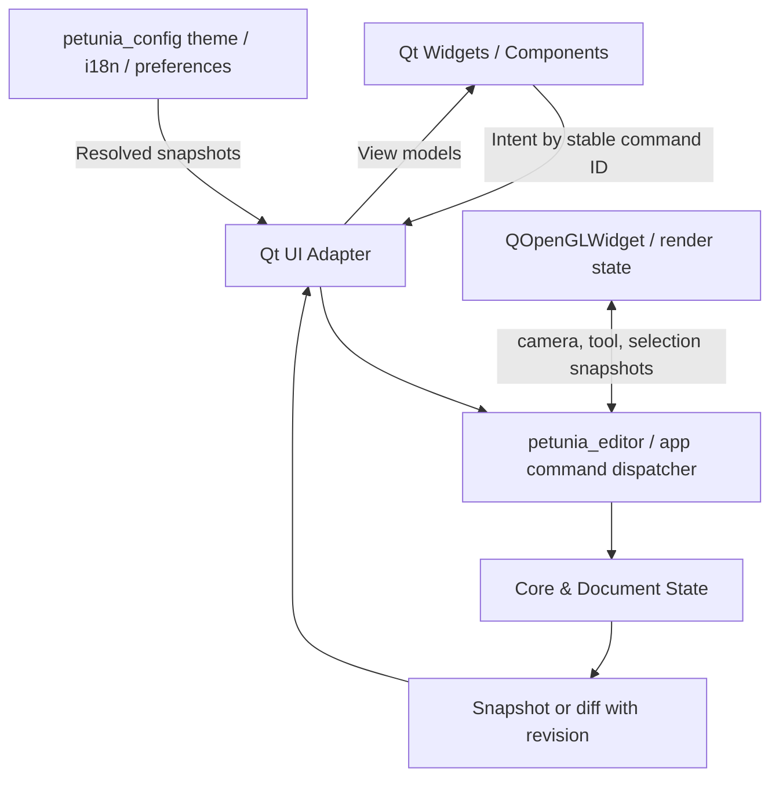
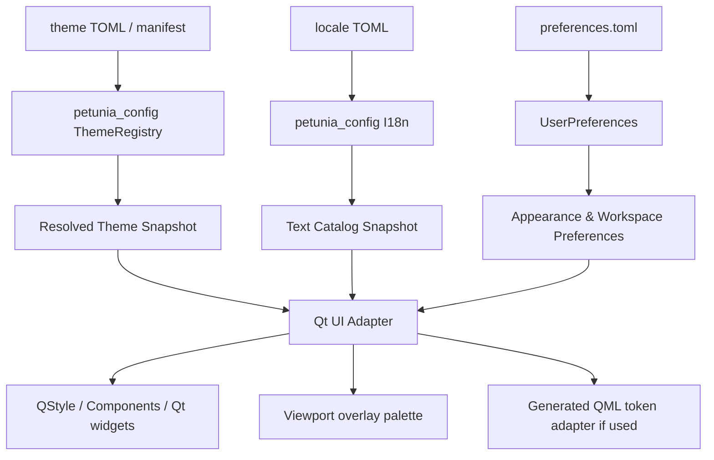

# Petunia3D — UI-001: Design System, Component Architecture & Workspace UX

> Status: architectural product specification / accepted baseline for code-agent implementation planning. 2026-10-15. The decisions recorded here apply to planned changes; do not assert they are already implemented. Do not change the repository until specifically instructed. The visual tokens and sizes here are starting targets requiring QA, not a license to override established persisted theme contracts.

## 0. Executive contract for the code agent

**Goal:** make the Petunia3D desktop UI clean, predictable, visually coherent, accessible, understandable for beginners, rich for professionals, and extensively customizable without losing function. **Approach:** refactor and reuse the established stack (Rust domain/editor + Qt 6 Widgets C++ + CXX/CXX-Qt + OpenGL viewport). **No migration** to Slint, Electron, or a wholesale QML frontend. Qt Quick remains an optional isolated consumer of tokens. Preserve existing commands, selection semantics, document format, tool behavior, Undo/Redo, rendering paths, and application startup.

**Repository inspected:** `WASDst/petunia3d` `main`, focusing on `crates/config/src/{theme,i18n,preferences}.rs`, `assets/themes/petunia-dark/theme.toml`, `crates/ui-cxxqt/{Cargo.toml,build.rs}`, `crates/ui-cxxqt/cpp/{petunia_main_window,petunia_editor_panel,petunia_dock_manager,petunia_reference_dialog,petunia_preferences_dialog}.cpp/.h`, `crates/ui-cxxqt/cpp/petunia_icons.h`, and `crates/ui-cxxqt/qml/tokens/DesignTokens.qml`. Before coding: re-check HEAD; code may change. References: https://github.com/WASDst/petunia3d.

**Product constraints:** All workspaces DRAW, POLY, PAINT, UV, ANIMATE should preserve stable navigation anchors but may use specialized editors. Selection & Transform (SEL-001–007), Viewport Spatial Perception (VSP-001–005), and optional Smart Rig requirements are upstream contracts. The UI must not enable snapping implicitly, start geometry dragging accidentally, lose manual overrides, or assume preview geometry is committed geometry.

### Mandatory agent workflow
1. Read the repository `AGENTS.md`, Cargo modules, docs, command catalogs, theme and i18n registries; reconcile outdated Slint references against actual Qt implementation before changes.
2. Inventory all existing widgets and their IDs, action routes, accessibility hooks, tokens, localization, layout persistence, and visual states. Establish baseline screenshots under at least DRAW, POLY, PAINT, UV, ANIMATE, Preferences, Reference Manager, HiDPI, dark/light/high-contrast.
3. Introduce foundations **behind current widgets** with feature flags or component-by-component migration; avoid sweeping panel replacement.
4. Introduce a self-contained **Component Gallery** and design-system tests; implement P0 primitives and patterns; migrate one narrow vertical slice (Inspector Transform) before the other workspaces.
5. Run existing Rust/C++/Qt builds and tests, visual/manual QA, theme and locale checks, verify Undo/Redo and document parity.
6. Report which components were migrated, screenshots, regressions, unimplemented behaviors, compatibility notes. No success claims for unevaluated manual UX.

## 1. Decision register

| ID | Decision | Default | Invariant |
|---|---|---|---|
| UI-001 | Qt 6 Widgets production desktop | Qt Widgets / QOpenGLWidget | No new toolkit migration |
| UI-002 | Single canonical token/locale authority | `petunia_config` | No separate hardcoded QML/C++ palettes |
| UI-003 | Semantic style tokens | alias existing theme fields, add versioned layers | Do not break persisted TOML themes |
| UI-004 | Reusable components/patterns | component library | No new one-off numeric fields/tabs without justification |
| UI-005 | Stable workspace anchors + customizable docking | stable shell with presets | User layout overrides presets; safe reset |
| UI-006 | Accessible, precise controls | keyboard-first and mouse/pen support | Do not require drag only |
| UI-007 | Stable locale IDs | canonical catalog + native adapter | No phrase-to-phrase translation lookup |
| UI-008 | Progressive disclosure | essential fields first | Advanced features always discoverable |
| UI-009 | One shell; multiple specialist workflows | DRAW/POLY/PAINT/UV/ANIMATE | Consistent semantics and focus |
| UI-010 | Incremental migration | foundation → components → shell → panels | Preserve command paths and Undo/Redo |
| UI-011 | Appearance separated from document data | user/workspace preferences | Theme/layout changes never dirty the 3D document |
| UI-012 | Explicit visual state & component contracts | enabled/disabled/loading/etc. | All state accessible to assistive tech |
| UI-013 | No surprise workspace reflow | predictable and opt-in | No panel jump during drag/focus |
| UI-014 | Layout restore validation | versioned state, stable IDs | Corrupt/obsolete layouts recover safely |
| UI-015 | Color-independent meaning | shape/text/texture + color | Differentiate viewport axes, selection, errors |

The original visual proposals are **candidates** until contrast tested; preserve existing public theme IDs and migration behavior. UI-001–UI-010 were set by the architectural review; UI-011–UI-015 are implementation guardrails consistent with it, not claims of prior explicit approval.

## 2. Evidence-driven screenshot diagnosis

Reference screenshot set supplied by user on 2026-10-15: DRAW, POLY, PAINT, UV (two configurations), ANIMATE, Preferences, Reference Manager.

1. **Overcrowded viewport head:** workspace tabs and dense viewport toolbar compete; many tiny controls and separators have no clear priority. Break into app navigation, viewport controls, tool options and selection actions.
2. **ToolRail truncation:** Brush, Airbrush etc. collapse to `P...h`, `A...h`. Never use ellipsized tool names as sole identifiers; compact rail = icon plus tooltip and accessible name; expanded rail = icon + full text.
3. **Inspector density:** many cramped tabs; X/Y/Z fields with tiny labels; repeated decimals like `0,0000` regardless of need. Build semantic PropertyGroups, responsive Vector3 field with editable units and precision, progressive advanced settings.
4. **PAINT:** canvas, Brush panel and Parts compete. Keep brush Size/Opacity/Hardness as essential; fold Jitter/Scatter/Spacing/Flow etc. into discoverable advanced groups with search and tooltips.
5. **UV:** 2D canvas too small and property pane controls over-prioritized. Allow editor-centric split; UV canvas initial share ≥ 55–65% of relevant editor region, respecting window constraints; persistence and resizing.
6. **ANIMATE:** timeline and Rig/Motion/Pose controls don't form an obvious workflow; make Rig/Weights/Pose/Timeline distinct sections with task-relevant defaults.
7. **Preferences:** over-large high-chroma selections, small legibility, more than one competing native settings implementation; unify PreferenceShell, search and clear categories.
8. **Reference Manager:** modal/window too large for little content; move to resizable dock or manageable dialog; show thumbnails, orientation slots, missing-file state, link/embedded state.
9. **Layout instability:** Parts moves between sides depending on workspace. Choose consistent default location and offer user customization; never overwrite user arrangement on workspace switch without opt-in.
10. **Viewport edges:** vivid axes/grid may compete with clay-shaded object. Define viewport-aware palette separate from Qt chrome tokens; obey VSP visual hierarchy.

These are **observations of screenshots**, not validation of runtime bugs. Test behavior in application before attributing root causes.

## 3. Inspiration matrix

| Product | Borrow | Avoid |
|---|---|---|
| Affinity | separate global/context toolbars, panel grouping, personas and docked studios | excessive density, many competing chrome layers |
| Shapr3D | contextual suggestions, direct manipulation, uncluttered canvas | hiding pro tools behind opaque heuristics |
| Blender | workspaces, layouts, shortcuts, editor replaceability, custom themes | cognitively dense defaults and deep menus |
| Rhino | numeric precision, gumball, discoverable commands, technical panels | requiring technical vocabulary for entry tasks |
| Plasticity | focused canvas, small tool-chrome, modeling-directness | sparse discoverability for beginner workflows |
| Nomad Sculpt / ZBrush | organic tool feedback, brush primacy, sculpt-ready shading | too many unexplained modes |
| 3D Slicer | linked multi-view orientation/cursor references | medical workflow complexity |

These are reference principles, not UI cloning instructions or license to embed other vendors' assets.

## 4. Information architecture & shell

**Application Bar**: menus, project identity and dirty state, workspace switcher DRAW/POLY/PAINT/UV/ANIMATE, Undo/Redo, command search, profile/help/settings. One clear visual hierarchy; app bar's groups may collapse responsively.

**Tool Rail**: one workspace-aware tool collection, stable position left by default, compact and expandable, full names and shortcuts in tooltip, searchable overflow, hotkey scope, no hover-driven surprises.

**Viewport Header**: scene view controls grouped as `Projection` / `Display Mode` / `Overlays` / `Navigation`, with one compact current-state affordance and overflow. Do **not** duplicate selection-domain controls in multiple unrelated locations.

**Context Actions**: independent lightweight toolbar near operation/selection, unobtrusive and user-repositionable; at most 3–4 prominent operations + `More` by default, capability-filtered, cannot occlude the gizmo or block picking.

**Document Area**: viewports 3D/2D, multi-view, Companion View, UV, Paint, scene switch; allocation favoring the actual drawing/modeling surface.

**Parts/Outliner**: tree with searchable/filterable stable identity, visibility/lock as properly labeled controls, active/selected/multi-selected distinctly marked. Hierarchical keyboard navigation.

**Properties**: contextual inspector with sticky essentials, adaptive groups and advanced sections. Tracked targets, state of selection and mixed values, pinning/lock support.

**Bottom Editor**: optional timeline, UV layers, curves, dope sheet, output, contextual commands; collapsible and resizeable without invalidating state.

**Status**: tool name, selection count/type, precision/snapping/context, background operation; distinguish toast/notification from non-urgent status.

**Workspace defaults**: DRAW and POLY: Parts + Properties at right, rail left, viewport dominant; PAINT: brush essentials near cursor/rail, Layers and Materials docked, UV/2D canvas available; UV: UV canvas dominant, 3D companion; ANIMATE: viewport + Timeline at bottom + Rig/Pose inspector. User layout has priority over defaults; no surprise shifting on switching workspaces.

### Layout storage
- `workspace_id`, `layout_schema_version`, `dock_ids`, tree of layout group/split/tab, dimensions relative + logical-pixel minimums, visible/collapsed/pinned flags, screen identity and DPI sanity metadata, `user_modified` bit.
- Keep existing stable Qt `objectName`/dock IDs; provide migrations for renamed docks. Do not overwrite a restored user's layout with `applyWorkspacePreset()` on every workspace switch.
- Validate missing dock IDs, removed panels and unreachable screen geometries. Restore safely with defaults; backup prior layouts. Distinguish global panel state and per-workspace views.
- Prefer existing `PetuniaDockManager` as abstraction over `QDockWidget`; evaluate Qt ADS in a separate spike and license assessment; do not prematurely commit to a docking library.

## 5. Foundational token architecture

### 5.1 Source of truth and compatibility
- `petunia_config::ThemeRegistry`, existing `ThemeToken`, `assets/themes/{petunia-dark,petunia-light,petunia-high-contrast}`, `UserPreferences` are canonical; preserve stable IDs and old TOML keys (`accent_blue` currently means floral purple, `accent_orange` selection orange). Introduce **semantic aliases** with explicit migration, not direct field renames breaking persisted themes.
- `crates/ui-cxxqt/qml/tokens/DesignTokens.qml` is currently a hardcoded parallel token set and must become generated/bridged from canonical theme snapshots, or removed from production pathways if unused. All QSS literals in dialogs and component source should be replaced by named tokens/Qt `QStyle` roles in staged migration.
- Four layers: `primitive` palette and dimension scale → `semantic` roles → `component` recipes → `state` variants. Tokens for viewport overlay differ from chrome tokens but resolve through same provider.
- Token snapshots immutable & versioned; export canonical resolved values for C++ consumers once on theme change, avoid high-frequency FFI lookups.

### 5.2 Token categories and defaults for experimentation
| Family | Tokens examples | Initial guidelines |
|---|---|---|
| Color | `color.canvas`, `surface.panel`, `surface.input`, `text.primary`, `border.subtle`, `focus.ring`, `selection`, `axis.x/y/z`, `status.warning` | Purple accent for interactive chrome; orange for 3D selection; never rely on color alone |
| Typography | family, body, secondary, caption, header, weight, line height | Body 14 logical px baseline; avoid tiny labels; respect UI scale and locale |
| Spacing | 0/4/8/12/16/24/32 | small finite scale; no arbitrary margins in each widget |
| Sizing | control compact/standard/comfortable, hit-target min, rail width, dock min | 32/36/40 logical px control-height candidates; 44–52 rail; adapt DPI |
| Shape | radius xs/s/m/l and border widths | consistent restraint; no pill treatment on every input |
| Motion | fast/normal timing, reduced motion | never animate geometry-critical labels in ways affecting accuracy |
| Elevation | scrim, shadow, overlay layer | shadows only for actual elevation; avoid widespread soft glows |
| Semantic | disabled/error/warning/focus/selection/pinned | must expose non-color indicators |

Tokens need fallback, validation of type/ranges, contrast checks, light/dark/high-contrast coverage, aliases for backwards compatibility, and packaging suitable for user theme packs. Theme packs must never execute arbitrary code.

### 5.3 Typography & locales
- Use stable IDs: `inspector.transform.position`, `paint.brush.opacity`, `viewport.overlay.depth`, not English/Portuguese source phrases as keys.
- `petunia_config::I18n` already parses TOML, has fallback English and typed TextId support; extend native Qt adapter to request by ID, not sentence-keyed translation map. Keep plural, interpolation and formatting hooks explicit.
- Audit every QMenu/QAction/QLabel/tooltip/dialog native text, including strings embedded in `.cpp`. Locale switching should preserve focus and ongoing numeric edit (avoid reinitializing tools).
- Numbers: preserve internal precision, display contextual decimals; correct locale decimal separators and unit suffixes; support pseudo-locale +40% expansion and long German-like examples; no hardcoded string slicing.
- `QAccessible::Name/Description` should resolve localization IDs just as visible text does.

### 5.4 Qt styling design
- Prefer Qt `QStyle` / `QProxyStyle`, palette, component subclasses/composition and Qt model/view idioms; QSS only for small exceptions. Avoid full per-dialog hardcoded QSS blobs and repeated `setStyleSheet` in event handling.
- If trialing **Qlementine**, do so behind style facade and in a standalone prototype; validate Qt version, custom widgets, theme updates, HiDPI, focus and license, do not force dependency in first wave.
- Preserve Qt platform events, standard widgets, accessibility APIs, native focus/tab-chain; use custom painting only for specialized controls that require it.
- SVG assets resolve via semantic icon ID; icons cached by theme, DPI, size, disabled state, orientation and stroke style; avoid per-paint file reads and arbitrary recoloring that changes semantic accent colors.

## 6. Reusable component catalog and contracts

### 6.1 Common contract of EVERY component
Stable `component_id`, `semantic_role`, `text_id`, `tooltip_id`, `enabled`, `visible`, `read_only`, `focus_policy`, `accessible_name`, `accessible_description`, `state`, `density`, `theme_binding`, `test_hook`, geometry constraints. User interactions fire semantic events and never mutate Rust document state directly.

**States**: idle, hover, focus-visible, pressed, active/selected, mixed/indeterminate, disabled, invalid, warning, busy, success, loading, read-only. Define contrast and screen-reader notification for relevant transitions. Focus styling must remain visible on all theme backgrounds, including viewport overlays.

**Consistency**: controlled view model; avoid Qt signal feedback loops during `sync` with scoped signal blocking. Do not read current selection from unrelated widgets; obtain it through shared editor state. Diff snapshots to minimize redraws, avoid rebuilding entire QWidget tree every timer tick.

### 6.2 P0 primitives
| Component | Qt basis | Essential requirements |
|---|---|---|
| `PetuniaLabel` | QLabel | style role, mnemonic, overflow/wrap policy, text ID |
| `PetuniaIcon` | QIcon/QSvgRenderer | stable semantic ID, theme/DPI cache, alt text on button |
| `PetuniaButton` | QPushButton/QToolButton | variants primary/secondary/quiet/danger; busy & icon-only accessible |
| `PetuniaToggle` | QCheckBox/QToolButton | selected/mixed/indeterminate, keyboard, feedback |
| `PetuniaSegmented` | QButtonGroup | single selection, disabled reasons, roving focus |
| `PetuniaTextField` | QLineEdit | clear, validation, IME, undo of text vs app commands |
| `PetuniaNumberField` | QDoubleSpinBox adapter or custom composite | units, formatting, expression (future), preview/commit/cancel, keyboard, range, step |
| `PetuniaSliderField` | QSlider + number | synchronized, no feedback loops; direct numeric alternative |
| `PetuniaSelect` | QComboBox | stable value ID separate from localized label; keyboard type-ahead |
| `PetuniaSearchField` | QLineEdit | debounce only search queries, Escape clear, search status |
| `PetuniaSection` | QFrame / collapsible composite | title+help, stable expanded/pin state, keyboard action |
| `PetuniaTooltip` | Qt help / popover | rich command, shortcut, alternate action, no obstruction |
| `PetuniaInlineMessage` | QWidget | status severity, action if applicable, live-region access |

### 6.3 P0/P1 patterns
| Pattern | Contract |
|---|---|
| `PropertyRow` | aligned label, help, value widget, unit, reset, modified indicator, visibility policy |
| `PropertyGroup` | collapsible+pin, selection-aware, remembers state, filtering, reset group action |
| `Vector3Field` | X/Y/Z colored AND letter-coded; linked/unlinked axes; per-axis input; mixed values; coordinate frame; responsive stack layout |
| `TransformInspector` | position/rotation/scale/pivot, clear selection state, numeric precision, Undo transaction boundaries |
| `OutlinerTree` | stable UUID-backed QModelIndex mapping; searchable & sortable, selection sync, drag/drop with preview, visibility/lock controls |
| `ToolRail` | compact/expanded; full text tooltips; no ellipsized sole labels; shortcut & active status |
| `ContextToolbar` | capability-filtered actions; bounded 3–4 prominent, overflow search, respects gizmo hit regions |
| `CommandPalette` | command registry, localization, enabled state and why, shortcut, command argument dialog |
| `DockPanel` | stable ID, title, close/pin/float, scroll, resize and layout state, accessible tab group |
| `EmptyState` | title, explanation, one meaningful action, not blank area |
| `SettingsShell` | search, sidebar categories, state preview, change/revert/reset, constrained dialog geometry |
| `ViewportOverlay` | anchored world/screen geometry, priority policy, cannot capture clicks unless explicitly interactive |

### 6.4 Specialized patterns after foundations
PAINT `BrushEssentials` (Size, Opacity, Hardness) plus separate detailed Dynamics; `LayerTree`, `BrushPresetGrid`, `ColorControls`; UV `UvCanvas`, `UvIslandTree`, `UvOperations`, `UvProperties`; ANIMATE `RigTree`, `PoseInspector`, `WeightLegend`, `Timeline`, `CurveEditor`; DRAW/POLY `ShapeParameters`, `ModifierStack`, `GeometrySelectionFilters`. They **compose** P0 patterns; no duplicate basic control implementations.

## 7. Detailed behavior: PetuniaNumberField

This is the first vertical-slice component because most panels use numbers and the screenshots expose precision/layout problems.

**Data/value model**: `f64` authoritative for editor numeric values where source supports it (respect existing f32 data model when appropriate); metadata: quantity kind (unitless, distance, degrees, percent, color channel...), unit symbol, value bounds, step, contextual format policy, mixed state, last applied value, disabled reason, precision source.

**Presentation**: 0 instead of 0.0000 by default; e.g. `1,5 m`, `30°`, `75%`. Preserve full value for edit and computations; never silently truncate internal state. Locale-aware decimal input, parse expression only after deterministic validated parser is provided. Use the same font size as other controls and correct text alignment.

**Interaction**: focus → edit text → preview (debounced/transaction if supported) → Enter commits once → Esc rolls back → arrows increment → Shift/Alt precision policy documented; optional label scrub with explicit hover affordance; no drag-only workflows. Double-click selects numeric digits for replacement. If expression invalid, maintain draft text and show non-blocking message; do not modify scene.

**Transacting**: Qt view emits `BeginEdit(command_id,target,field)`, `Preview(value)`, `Commit(value)`, `Cancel()`. Core controls atomic geometry transaction, captures initial state, validates constraints, integrates undo grouping. Grouped Vector3 fields must avoid three independent undo steps for a single linked edit.

**Qt API conceptual, not committed signature**:
```cpp
struct PetuniaNumberFieldSpec {
    QString propertyId;        // stable, non-localized
    QString labelTextId;       // translated by TextCatalog
    QString quantityId;        // distance, angle, ratio ...
    double minValue, maxValue, step;
    bool allowScrub;
    bool readOnly;
};
class PetuniaNumberField : public QWidget {
    Q_OBJECT
signals:
    void editStarted(QString propertyId);
    void previewRequested(QString propertyId, double value);
    void commitRequested(QString propertyId, double value);
    void editCanceled(QString propertyId);
};
```
**Qt implementation note**: ensure value metadata is supplied by editor/command descriptor; the widget is not allowed to assume meters or snap rules.

## 8. State, command & bridge architecture



- Commands have stable machine IDs, localized display names and explanations, category, current-enabled state, shortcut/contexts, optional undo/preview policy. One action registry should back menus, command palette, toolbar, context actions, keyboard shortcuts.
- Read-only UI state from Rust to Qt should be typed DTOs or validated JSON at boundary, revision-tagged, diffed. **Do not** dump arbitrary internal Rust structs as unstable public schema or recompute selection in each panel.
- Existing 33ms tick loop in `PetuniaMainWindow` should be assessed: apply state diff and signal-blocking rather than rebuilding panels; separate animation render tick from UI property update scheduling. Do not block GUI thread on slow geometry or I/O.
- Qt signal and event callbacks run on GUI thread. Long-running commands use async workers and deliver GUI-safe completion; no work crossing QOpenGLWidget/Qt ownership boundaries unsafely.
- External preferences/theme change should update UI without dirtying document. Qt state persistence (geometry/docking) and `UserPreferences` must have documented ownership; avoid QSettings vs Rust prefs disagreement.
- Do not leak CXX pointers, use lifetime guards (`QPointer`), check Qt thread ownership. Persist stable IDs for outliner/selection/docks rather than positional indices.

## 9. Density, layout and responsive constraints

- Modes: `compact`, `standard` (default), `focus/comfortable`. They adjust spacing/controls/section density; font scaling independently configurable. `compact` must still expose labels and keyboard focus.
- Font size floor is **UX target** not code invariant: body ≈14 logical px, captions 12–13, panel titles 14–16; test at 100/125/150/200% and default DPI scaling.
- Preferred dock width ~300–360 logical px, minimum width based on localized content. Responsive `Vector3Field`: triple column when room; stacked fields with full label when narrow; never clip X/Y/Z.
- No horizontal scroll in common Inspector rows; use stack/wrap responsive breakpoints. Reposition long tooltips/popovers so selection remains visible.
- Qt logical pixels and device pixels distinct. SVG icons rasterized at correct DPR, including disabled/focus states. Avoid manually multiplying UI scale and DPR twice.
- `QScrollArea` should scroll meaningful content and preserve heading/action context; keep at most 1–2 dominant scrollable regions per active editor.
- Viewport overlays have limited z-index and visual attention budget; gizmo/selection/active operation > contextual labels > decorative guidance. No fixed central popovers covering editing.

## 10. Accessibility design requirements

- Keyboard-only completion of essential UI journeys: select object, edit transform, change modes, open and move docks by available keyboard commands or dialog, reset layout, access command palette, cancel operation.
- Focus visible in all themes; tab order logical; Escape closes transient overlay before canceling active tool when appropriate, never commits inadvertently.
- `QAccessible` naming/roles/value/description for custom widgets; test screen-reader announcements and live-region/noisy event throttling.
- Differentiate active/selected/hover/pinned/error with shape, thickness, icon and text in addition to colors. Axis X/Y/Z always labeled, with optional colorblind pattern.
- Theme contrast: target ≥4.5:1 body text and ≥3:1 essential UI marks/focus against adjacent surfaces where feasible, evaluate per actual state; desktop targets inspired by WCAG, not automatic compliance claims.
- Comfortable hit targets ~40 logical px and standard 32–40; compact use sensible spacings/alternatives; allow accessible click-move-click option already in `UserPreferences`.
- Avoid tooltip overload, automatic focus theft, flashing or moving panes, high frequency toasts, unsought companion-camera appearance. Respect reduced motion and user-selected density/panel pinning.
- Screen-reader semantic inspectors for 3D values: semantic text mirror for numeric selection, bounds, rig and volume measurements so meaning isn't confined to GPU drawing.
- Accessibility gate for every component before panel migration: keyboard + screen reader + contrast + localization + motion + HiDPI + selection semantics.

## 11. Theme and localization runtime



Theme switching steps: parse file → validate token types/colors/required roles → fill stable fallbacks → validate high-impact contrast → emit immutable token snapshot → apply via style facade on GUI thread → invalidate icon cache → adjust dynamic paints → preserve editor selection, focus, scroll and geometry. On failed parse preserve last known working theme and report error.

Locale switching steps: load locale & fallback → get stable IDs → update UI texts and accessible labels → recalc min-content sizes → preserve active numeric edits and keyboard focus → revalidate truncation → no document dirty flag.

Theme preference and design-token versions must be serializable and forward compatible; only per-user store knows UI preferences. Existing persisted theme files remain readable after migration.

## 12. Component Gallery / Storybook-like native Qt showcase

Independent preview executable or app diagnostics page built with actual production components, not pictures. Required showcase groups: typography, surfaces, controls, inspector, trees, toolbars, empty/loading/error, overlays, dialogs, dock/layout demos, keyboard/accessibility. Control panel selects theme (dark/light/high contrast), locale (`en`, `pt-BR`, pseudo-long), density, DPI scale (test environment), enabled/focused/invalid/mixed states. Simulated selection and tool state; no real document mutation.

For every component supply usage examples, stable contract, screenshot snapshot, accessible semantics, theming tokens and ownership. This gallery is the acceptance gate for UI contribution. Automated screenshot baselines need platform/DPI tolerance to avoid false positives.

## 13. Workspaces and UI patterns (detailed)

### DRAW / POLY
- viewport dominant; left rail shape/selection/edit; right Parts + contextual Properties; viewport header only view controls; bottom context bar compact. Precision inputs and operation HUD linked to shared numeric field and command semantics.
- Context toolbar dynamic and semantic. Gizmo hit areas never overridden by overlay. Preserve SEL protected drag, mixed selection, shared/individual pivots.

### PAINT
- brushing mode: `BrushEssentials` visible (size/opacity/hardness), brush library nearby, advanced behavior in grouped optional sections (Dynamics, Texture, Stroke, Symmetry). Show status of pressure/pen. Layer and material panels remain dockable, optional 2D/3D split. Avoid listing ten+ parameters above the canvas.

### UV
- UV editor should receive majority of contextually relevant workspace area. Right-side controls group `Unwrap`, `Packing`, `Selection`, `Transform` with secondary details folded. 3D companion view secondary and resizeable; align zoom and selection semantics. Same number fields and unit policy for UV.

### ANIMATE
- rig/weights/pose/motion/timeline as discoverable subcontexts; timeline placed bottom by default, visible controls grouped. Rig hierarchy with color-independent selection and overrides. Smart Rig proposals, manual corrections, pinned joints and preview states use same feedback components. Never generate or overwrite rig when user is browsing inspector.

### Preferences and Reference Manager
- SettingsShell: left category navigation, top search, right content; persistent selection; reset category/current control; preview for theme/density; apply/cancel semantics and error handling. Avoid many unrelated big highlight selection lists.
- Reference Manager: smaller resizable dock with image thumbnail/slots, add/replace/remove, visibility, opacity/scale/orientation, invalid file feedback. Provide in-workspace contextual Properties instead of a full-screen property dialog; keep native file picker for importing.

## 14. Phased implementation with expected artifacts

| Phase | Deliverables | Exit gates |
|---|---|---|
| P0-Audit | widget and tokens matrix, screenshot baselines, command route map, accessibility audit | no unknown ownership of theme/locale/layout |
| P0-Foundation | canonical token snapshots + style facade + locale ID adapter + cached semantic icons | dark/light/high contrast + en/pt-BR + user theme fallback |
| P0-Gallery | Component Gallery, Button/Toggle/NumberField/Select/Section/PropertyRow/Vector3 | keyboard, focus, zero truncation, mixed state, visual tests |
| P1-Vertical slice | Transform inspector migrated; property bindings, undo boundaries, partial selections | zero lost actions, correct undo, responsive layout |
| P1-Shell | menu, rail, view header, contextual actions, docking manager, workspace persistence | switching does not shuffle pinned user layout |
| P1-Parts | OutlinerTree stable IDs, focus, selection, filter, visibility and lock | no selection desync or unexpected reordering |
| P2-DRAW/POLY | full groups, toolbars, context and viewport styles | actual end-to-end modeling acceptance |
| P2-PAINT/UV | brush essentials/advanced and UV canvas-first layout | brush/UV tasks easy to discover |
| P2-ANIMATE | Rig, Pose, Weights, Timeline design patterns | no accidental rig mutation |
| P3-Advanced | theme editor, layout editor, import/export packs, refinements | versioning, migrations, security and user testing |

**No big bang.** Feature flags, migration adapters and rollback until each panel passes. Keep original action IDs, menu shortcuts, project persistence and export unaffected.

## 15. Tests, performance, and gates

### Functional
- `Undo` after modifying Vector3 + label scrub = one coherent transaction; `Esc` restores initial value.
- Mixed selection shows indeterminate rather than arbitrary value; edits obey intended multi-selection policy.
- Rapid selection changes do not update previous object's inspector in async completion.
- Theme switching doesn't alter project dirty status; user theme with missing token falls back.
- Locale switch doesn't break shortcuts, active edits, panel sizing, or accessibility labels.
- Workspace layout recovers from missing dock ID, obsolete saved blob and unavailable monitor.
- Tooltips, outliner, Paint, UV and Animate actions issue correct command IDs and status.

### Usability and accessibility
- No truncated primary labels at 100/150/200% DPI in English, Portuguese, pseudo-long locale.
- Tab chain ordered, visible focus, native a11y role/name/state, keyboard alternatives for all primary tool controls.
- Inspector panels usable at 300px width (responsive property rows); at narrower widths stack or use horizontal panel allocation, not label clipping.
- 10-minute beginner sessions: select object, scale to dimension, find modifiers, switch Paint brush, move UV island, add rig preset; compare before/after on task completion and errors.
- No unsolicited modal on modeling path; empty states guide next action.

### Efficiency & stability
- Theme switch ideally avoids full widget destruction; evaluate repolish cost. No per-frame QSS rebuilding or SVG filesystem reads.
- Outliner uses model/view for large scenes; profiling on large item counts; avoid reinitializing all controls each 33ms tick.
- Opening Preferences/Reference Manager at HiDPI and window resizing does not lose input/focus.
- Qt GUI thread always responsive during geometry analysis, scan/import and heavy rigging; worker results revision-checked.

### Invariants
- Selection & Transform rules SEL-001–007 unchanged.
- Viewport visual layering rules VSP-001–005 unchanged.
- Manual and Live Auto-Rig are opt-in, protection of artist overrides.
- Existing `.petunia` scenes load/save; no silent data conversion.
- Workspaces configurable and reversible; project state independent of user layout state.

## 16. Risk register

1. **Duplicate visual authorities:** Rust theme, QML hardcoded tokens and C++ QSS. Mitigation: canonical snapshot, alias/migration, gallery.
2. **Layout ownership conflict:** Qt QSettings and Rust `UserPreferences`. Mitigation: designate one canonical persistence service for settings; Qt binary layout blob can be stored as opaque value with version metadata.
3. **Qt Styling limitations:** stylesheet/repolish quirks vs native widget rendering. Mitigation: prototype QStyle/ProxyStyle and validated custom paint primitives only where needed.
4. **UI-bridge coupling:** `PetuniaMainWindow` currently handles many responsibilities and polls/syncs state. Mitigation: isolate shell/panels behind adapters; do not move domain logic into C++.
5. **Licensing:** any external UI/docking dependency needs license audit and packaging QA; optional evaluation only.
6. **High-DPI SVG:** raster cache tied to DPI/theme; invalidation and test.
7. **Accessibility gaps:** custom complex controls need QAccessible implementation and real navigation tests; icon-only without labels is invalid.
8. **Performance regression:** per-frame repolish/widget rebuild, repeated QJson parse and expensive signal loops. Mitigation: versioned snapshots, diffs, scope signal blocking, profiling.
9. **Locale fragmentation:** phrase-based native translation. Mitigation: ID catalogs and generated adapters.
10. **Regression across workspaces:** migrate shared components first and maintain integration smoke tests for all five workspaces.

## 17. Explicit non-goals for UI-001

- No new modeling or rigging geometry algorithms within UI refactor.
- No new standalone frontend stack or assumption that QML is production shell.
- No unrequested bulk rewrite of `petunia_main_window.cpp` before component contracts/galleries are verified.
- No forced change to the current dark palette in users' stored themes; candidate palette may be trialed in prototypes.
- No claim that Qlementine or ADS are already installed. Benchmark & licenses before adding.
- No inaccessible ‘clean mode’ that hides all tool discoverability or essential feedback.

## 18. Next decisions implicitly delegated / bounded

The user authorized progressing with a coherent UI architecture and foundational component specification. Use these recommendations as an **implementation plan baseline**, with major project-altering choices (adding a third-party dependency, changing saved file formats, replacing docking library, migrating toolkit, changing interaction semantics) requiring explicit user agreement before implementation. The design system must remain compatible with the approved selection, viewport and rig vision.

## 19. Upstream specifications

- SEL-001–007 — universal adaptive gizmo, contextual selection, protected drag, shared/individual origins, snapping.
- VSP-001–005 — adaptive help, Clay Soft, Volume Frames, Depth Assist/Companion View, non-destructive sections with explicit profile editing.
- RIG-001–012 — optional assisted/incremental/manual Smart Rig, protected manual overrides, pose testing.
- Design systems: https://doc.qt.io/qt-6/qstyle.html , https://doc.qt.io/qt-6/qaccessible.html , https://github.com/oclero/qlementine , https://github.com/githubuser0xFFFF/Qt-Advanced-Docking-System

## 20. Definition of done — First UI milestone

A real native Qt Component Gallery showing selected `PetuniaButton`, `PetuniaNumberField`, `Vector3Field`, `PropertyRow`, `PropertyGroup`, and `ToolRail` under all 3 official themes, 2 supported languages plus pseudo-long testing, 3 densities, and keyboard-only navigation. Transform inspector migrated with proper Undo/Redo and selection sync. No theme QSS literals in **new** components. Screenshots + tests attached to PR. New code follows repo AGENTS and current Qt main; existing functions stay accessible throughout the migration.
