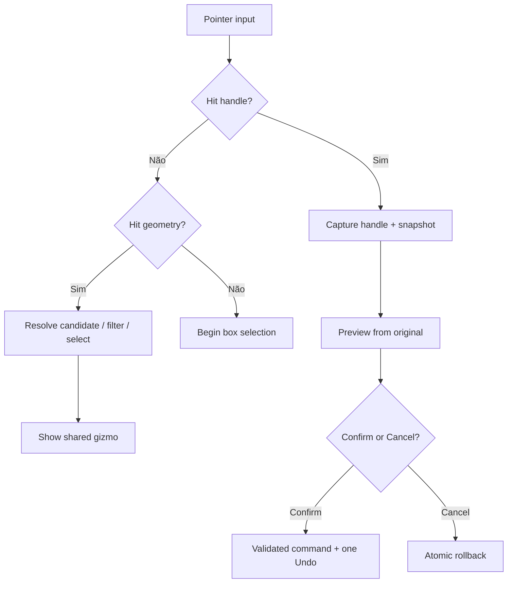
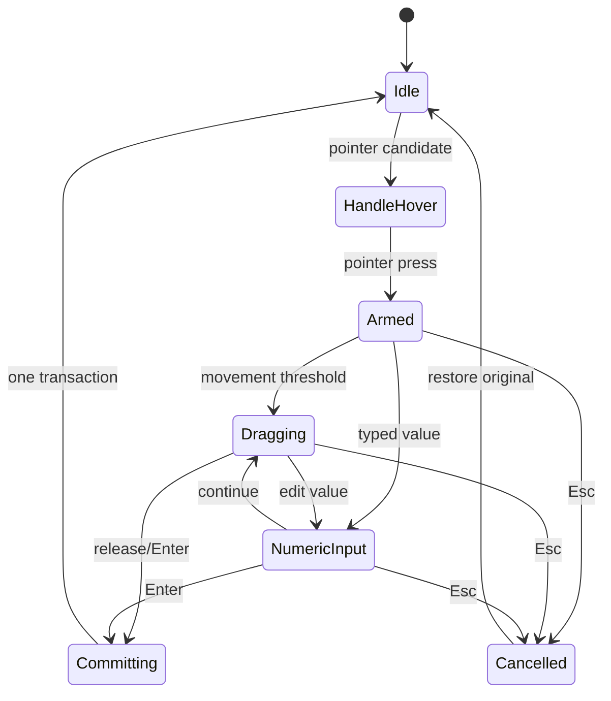
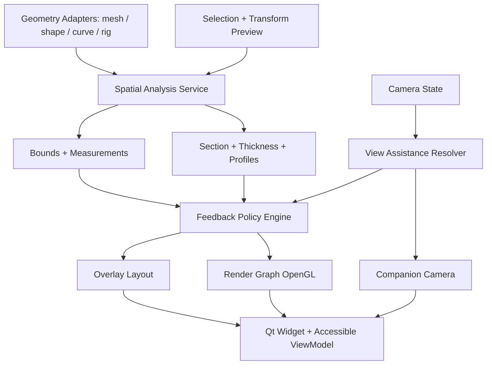
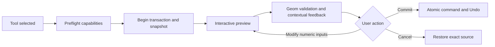
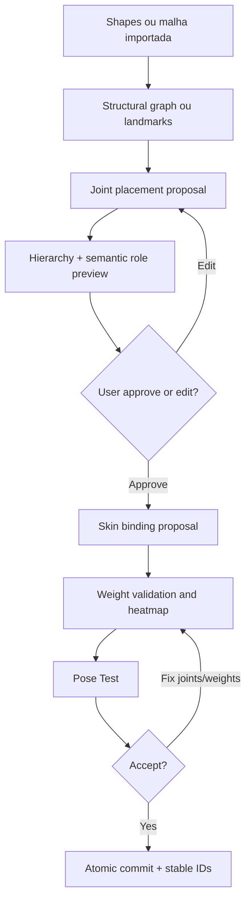
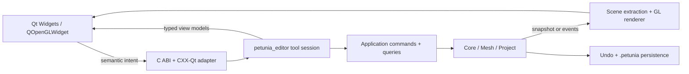

# PETUNIA3D — ESPECIFICAÇÃO CONSOLIDADA PARA CODE AGENTS

**Versão:** 2026-10-15 · **Baseline:** WASDst/petunia3d `main` @ `92c22caa23f96f85f18e72a5e962a1d8831694db` · **Stack:** Qt 6 Widgets + CXX-Qt + Rust + OpenGL 3.3.

> Documento unificado para leitura e colagem em code agent. Esta versão contém todos os capítulos técnicos e diagramas **Mermaid**. As ilustrações SVG vinculadas aparecem completas no [pacote ZIP](PETUNIA3D_DOCUMENTACAO_COMPLETA_CODE_AGENT.zip), na pasta `assets/`. Os links de SVG relativos funcionam ao usar a versão deste arquivo dentro do pacote.

**Regra mestra:** decisões aprovadas != funcionalidades implementadas. O agente deve confrontar código, branch, permissões e documentação canônica antes de editar; não realizar push, merge ou deploy sem autorização específica.

## Sumário executivo

- Seleção: SEL-001 a SEL-007 (gizmo universal, picking contextual, pivô independente, protected drag, snapping, seleção heterogênea e UI adaptativa).
- Percepção: VSP-001 a VSP-005 (Clay, Volume Frame, Depth Assist, Companion View, Section/Thickness/Organic Profile).
- Operações: VSP-006 derivada (previews e diagnósticos não destrutivos, sem correção silenciosa).
- Rig: RIG-001 a RIG-012 (RigMesh como inspiração, assisted/manual/live opt-in, proteção de ajustes e pose-aware modeling).
- Integração atual: Qt 6 Widgets + CXX-Qt, `petunia_editor`, OpenGL 3.3; saneamento da documentação/CI Slint legado.

---

<!-- chapter: 00_AGENT_INSTRUCTIONS.md -->

## 00 — Instruções normativas para o code agent

> **Leia antes de modificar código.** Esta é uma especificação de implementação progressiva, não um pedido para implementar tudo imediatamente. Contexto-base: `WASDst/petunia3d`, `main` SHA `92c22caa23f96f85f18e72a5e962a1d8831694db` na auditoria em 15/10/2026. Revalide o SHA no começo do trabalho.

## 0.1 Objetivo verificável

Entregar incrementalmente um editor 3D **shape-first**, profissional e acessível, no qual manipular a geometria e compreender sua profundidade/volume seja intuitivo. Usuários iniciantes devem conseguir criar humanoides, animais e criaturas por volumes e evoluir até ferramentas avançadas. A base de rig deve permitir **automático assistido**, **live incremental opt-in** e **inteiramente manual**.

## 0.2 Ordem de trabalho e autoridade

1. Inspecionar `git status --short --branch`, `git rev-parse HEAD`, branch upstream, mudanças não commitadas, worktrees e CI. Não descartar trabalho de outros agentes.
2. Ler o `AGENTS.md` **atual** e `website/docs/16-code-agents/{index,reading-navigation,implementation-protocol}.md`, `website/docs/manifest.json` e `website/docs/00-philosophy/decision-register.md`.
3. Confrontar os documentos com `Cargo.toml`, `src/main.rs`, `crates/ui-cxxqt/`, `crates/editor/`, `crates/render/` e commit de migração Qt. A documentação histórica Slint não prevalece sobre a migração explícita para Qt.
4. Identificar implementação real por símbolo, caminho, callers, testes, entrada FFI, persistência, eventos e invariantes. Criar **gap matrix**: existente/verificado, existente/não verificado, parcial, ausente, bloqueado.
5. Redigir plano de menor mudança por *vertical slice*; **Reuse → Refactor → Move → Rewrite (último recurso)**.
6. Implementar a menor fatia funcional com testes e atualização de docs/tracker. Parar antes de expandir escopo ou refazer arquitetura sem autorização.
7. Relatar SHA, paths, comandos executados, resultados `pass/fail/blocked/not run`, evidências de UI e limitações; não alegar execução que não ocorreu.

**Permissões:** não realizar push/merge/rebase/force push/deploy sem autorização explícita. Não confundir entregar docs com autorização para alterar a `main`. Não remover APIs legadas que ainda possam ter consumidores antes de inventariar chamadas.

## 0.3 Stack e responsabilidades reais a preservar

| Camada | Base observada | Orientação |
|---|---|---|
| Interface principal | Qt 6 Widgets/C++ em `crates/ui-cxxqt/cpp/` | Widgets e acessibilidade nativa, docking, inputs, barras; sem kernels geométricos |
| Bridge | `crates/ui-cxxqt/src/bridge/`, `src/editor.rs`, `cpp/petunia_editor_api.h` | Converter intents/DTOs tipados; validar fronteiras FFI, threads e ownership |
| Editor toolkit-neutro | `crates/editor/` | Tool sessions, overlays semânticos, preferências, input e view models |
| Application/Core | `crates/application/`, `crates/core/` | Autoridade de documento, regras, commands, Undo/Redo, revisão |
| Geometria | `crates/mesh/`, `crates/project/` | Seções, medição, malha, shape, rig, pesos, IK e serialização |
| Renderer | `crates/render/`, `ui-cxxqt/src/render/` | OpenGL 3.3/glow; scene extraction e QOpenGLWidget; fallback existente |
| UI alternativa | arquivos QML/Qt Quick presentes | Não assumir que são a shell principal |

**Não transportar as antigas propostas Qt/QML ou WGPU como requisitos da stack atual.** A arquitetura de capacidades deve ser independente da API gráfica, mas implementações iniciais devem usar OpenGL e Qt Widgets.

## 0.4 Invariantes não negociáveis

- Documento com um só escritor. Ferramentas/GUI/CLI/MCP enviam intents e comandos; nenhuma mutação direta em widget/slot ou renderizador.
- Mutação relevante deve passar por comando validado, transação, undo e redo; cancelamento restaura estado inicial. Preview não modifica silenciosamente o documento persistente.
- `SelectionSet`, `ResolvedTransformTargets`, `ActiveElement`, `Pivot`, `GizmoDisplayLocation` e `Orientation` são conceitos distintos.
- Arrasto da geometria **não a move** por padrão (SEL-004); somente alça/comando explícito.
- Snap automático somente nos contextos aprovados (pivô, Point-to-Point), demais operações suaves por padrão.
- Projeções/medidas informativas não podem interceptar picking da geometria sem mecanismo explícito de interação.
- Inspeção de seção não cria faces reais; apenas `Create Geometry from Section` explícito poderá produzir geometria.
- Referências não sobreviverão à mudança topológica por reutilização de índices: IDs estáveis ou invalidar claramente.
- Geometria avaliada vs original devem ser distinguíveis; medida aproximada rotulada; algoritmo indisponível não fabrica dados.
- Manual override de rig protegido; desligar autorig nunca apaga skeleton existente.
- Nenhuma automação impede edição manual ou altera o material final sem solicitação.
- Windows/Linux, GPU modesta, funcionamento offline, baixo ruído visual, alto contraste, navegação por teclado e redução de movimento são requisitos de aceitação.

## 0.5 Precauções de engenharia

- Evitar `panic!`, `unwrap`, `expect` em produção para entradas não confiáveis; validar NaN/Inf, limites de dimensão, degenerescência, excesso de memória, grafos cíclicos e refs inválidas.
- Não executar cálculos longos no thread UI Qt; jobs por revisão, canceláveis; resultados stale não sobrescrevem o estado atual.
- OpenGL só no contexto e thread corretos, respeitando `QOpenGLWidget` e perda/recriação de contexto.
- Erros atravessando FFI com contrato tipado e propriedade de memória explícita; não emitir exceptions C++ atravessando C ABI.
- Chaves e gestures devem ser semânticas e configuráveis; sem keycodes hardcoded na geometria.
- Fallback gráfico, headless CLI e MCP não devem perder capacidade de domínio ao adicionar UI nova.
- Diagnósticos não devem tratar uma escolha artística como erro anatômico.

## 0.6 Problemas presentes na baseline, para investigação e saneamento

> Achados da leitura GitHub + CI de 2026-10-15. Revalidar ao iniciar. **Não são prova de que a UI Qt não funciona**.

- Commit `584f83573d3049009524b4718c6f1194b58f1b8a` remove Slint, cria crate `petunia_editor`, define `petunia_ui_cxxqt::widgets::run()` como entrada. `main` verificada: `92c22ca`.
- `README.md`, `PROJECT_STATE.md`, `crates/ui-cxxqt/README.md` e trechos de `AGENTS.md` ainda descrevem Slint/Qt experimental ou branches anteriores. Reconciliar canonicamente, sem apagar compromissos de segurança.
- `.github/workflows/ui-slint.yml` ainda executa `cargo fmt -p petunia_ui_slint` e falha porque a crate foi removida; migrar gate para Qt/Editor e checar dependências de runner Qt.
- `bible-check` falhou com 7 artefatos gerados defasados (`docs/generated/*`, shortcuts); `docs-generate` com revisão de diff.
- VitePress falhou por 15 links mortos, majoritariamente navegação e research; corrigir os links reais sem desligar indiscriminadamente a verificação.
- Nome histórico `SlintUiBridge` persiste em código de `petunia_editor`/adapter Qt: renomear com cuidado, após mapear callers, e **não** como prerequisito de funcionalidades se houver risco desproporcional.
- Testes declarados no commit da migração: 116 `petunia_editor`, 21 `editor_parity`, 10 `bridge_test`, `cargo check --workspace`; são relatos do commit, não execução desta documentação.

## 0.7 Comandos de reconhecimento (adapte ao estado real)

```bash
git status --short --branch
git rev-parse HEAD
rg -n 'SlintUiBridge|slint|petunia_ui_cxxqt|QOpenGLWidget|QtViewportRenderer' \
    README.md AGENTS.md Cargo.toml crates src website/docs .github/workflows
rg -n 'Rig|Skin|Pose|Selection|Gizmo|Snap|Section|Thickness|Undo' \
    crates/core crates/project crates/editor crates/render crates/ui-cxxqt
CARGO_BUILD_JOBS=2 cargo check --workspace --locked
CARGO_BUILD_JOBS=2 cargo test -p petunia_editor --lib
CARGO_BUILD_JOBS=2 cargo test -p petunia_ui_cxxqt --test editor_parity -- --test-threads=1
CARGO_BUILD_JOBS=2 cargo test -p petunia_ui_cxxqt --test bridge_test -- --test-threads=1
```

**Não execute tudo cegamente:** conferir recursos livres (`df -h .`, `free -h`), toolchain, Qt nativo, status Git e os gates exigidos pelo protocolo canônico atual. Testes Qt com estado global devem ser serializados quando necessário. Não confundir offscreen com teste nativo de QOpenGLWidget.

## 0.8 Template obrigatório de entrega do agente

```markdown
### Objetivo e baseline
- Branch / HEAD inicial / HEAD final / working tree
### Gap Matrix
- Existente verificado, parcial, ausente, bloqueado (com paths)
### Implementado nesta fatia
- Comandos, UX, APIs, dados, módulos e alterações
### Evidências
- Comando de teste; resultado pass/fail/not run/blocked; logs/prints/capturas
### Compatibilidade
- Undo, save/load, export, Win/Linux, acessibilidade, performance
### Pendências, riscos e próximo slice
- Nenhum componente anunciado como pronto sem gate correspondente
```


---

<!-- chapter: 01_DECISION_REGISTER.md -->

## 01 — Registro consolidado das decisões aprovadas

**Status:** decisões aprovadas pelo responsável durante a especificação, independentemente do estado de implementação. **NÃO** inferir que o código possui todos os recursos. Este arquivo é fonte do produto; os demais capítulos detalham algoritmos, interações, testes e riscos.

## 1.1 Seleção e transformação — SEL-001 a SEL-007

| ID | Aprovação | Regras imperativas |
|---|---|---|
| **SEL-001** | Gizmo universal integrado e contextual | Combinar Move/Rotate/Scale em um mesmo manipulador compacto e permanente quando há seleção válida; operações especializadas são contextuais, não um amontoado de alças. Referências Shapr3D e Rhino Gumball. |
| **SEL-002** | Seleção geométrica contextual | Escolha direta entre objeto/face/aresta/vértice/shape com prioridade de picking; pré-highlight; filtros; ambiguidade tratada; oclusão; Select Through explícito; evitar Edit Mode obrigatório. |
| **SEL-003 A** | Pivô/orientação automáticos + controle manual | Gizmo posiciona-se conforme tipo selecionado; `TransformPivot`, `GizmoDisplayPosition` e `OrientationFrame` independentes. Suporte World/Local/Normal/View/Custom/Auto; pivô manual persistente quando válido. Congelar frame durante drag. |
| **SEL-004 A** | Arrasto protegido | Arrastar geometria **não** transforma automaticamente. Só alças ou comando transform ativo; área vazia = box selection; Esc cancela transação; navegação explícita e separada; valor numérico; uma interação = um Undo. |
| **SEL-005 B** | Snapping equilibrado contextual | Pivô e Point-to-Point podem usar snap automático; Move/Rotate/Scale comuns suaves por padrão, snap explícito/temporário. Snap Engine único: vértice, aresta, midpoint, face, eixo, grade, superfície, distância, ângulo; tolerâncias e histerese. |
| **SEL-006 C** | Seleção heterogênea e gizmo compartilhado | Um gizmo compartilhado por padrão, troca rápida para pivôs individuais; seleção mista de objetos e subelementos, `ActiveElement`, ordem de seleção, conjuntos transformáveis resolvidos sem duplicar vértices; hierarquias sem transformações duplas; ações incompatíveis identificadas. |
| **SEL-007 B** | Universal compacto adaptativo | Move/Rotate/Scale sempre acessíveis, controles secundários visualmente discretos, ênfase no hover/drag; barra contextual separada, reposicionável/fixável; alças visuais independentes do hit testing; tamanho, contraste, DPI e teclado configuráveis. |

### Detalhes fixados por essas decisões

- **Prioridade de picking recomendada:** gizmo efetivamente habilitado sob o ponteiro > vértice próximo > aresta próxima > face > objeto. Filtros e candidatos por profundidade/oclusão podem alterar a elegibilidade, não gerar ações escondidas.
- **Pivot default:** objeto = centro do bbox; face = centro geométrico + normal; aresta = midpoint + tangente; vértice = posição; seleção múltipla = centro de bounds; edição individual usa referências por componente/região.
- **Pivôs compartilhados:** Rotate/Scale orbitam/escalam também o arranjo dos elementos; pivôs individuais preservam posições de origem em operações por elemento. Componentes de uma mesma mesh conexa devem ser agrupados em ilhas conforme política da operação.
- **Mescla objeto + parte:** seleção do objeto inteiro prevalece sobre seleção simultânea de parte dele para transform global; hierarquia e elementos repetidos não multiplicam a transformação. Componentes da malha referem-se a vértices únicos deduplicados.
- **Preview:** snapshot inicial + transformação derivada; nunca aplicar incrementalmente a cada frame ao resultado do frame anterior (evita drift); Esc = rollback atômico.
- **Operações contextuais:** face (Extrude, Offset, Inset, Bevel), aresta (Bevel, Chamfer, Loop, Bridge), objeto (Align, Duplicate, Group, Mirror) — filtradas por capacidades reais, com ações parcialmente compatíveis explicitadas.
- **Estética:** convenção inicial X vermelho, Y verde, Z azul, mas não confiar somente em cores; círculos/arcos, setas, planos e cubos de escala; controles com hit regions mais amplas do que o desenho quando possível sem conflitos.

## 1.2 Percepção espacial — VSP-001 a VSP-005

| ID | Aprovação | Regras imperativas |
|---|---|---|
| **VSP-001 B** | Assistência espacial contextual adaptativa | Sombreamento e silhueta discretos. Mostrar informações relevantes conforme seleção/ação, não todos os overlays. Companion View sugerida; abertura automática opcional. Preferências do usuário predominam. |
| **VSP-002 B** | Clay Soft adaptativo | Key/fill suaves, silhueta discreta, cavity leve, realce geométrico conforme contexto. Modos Clay Soft/Form/Technical/MatCap; controle manual persistente; iluminação de trabalho independente das luzes da cena. |
| **VSP-003 B** | Volume Frame compacto adaptativo | Ao selecionar, limites discretos + resumo dimensional. Durante transformação, destaque à dimensão afetada. Expansão sob demanda ou pinning; referenciais World/Local/Custom/Structural; medidas exatas/aproximadas/indisponíveis/desatualizadas. |
| **VSP-004 B** | Depth Assist contextual equilibrado | Feedback discreto quando profundidade pouco legível; comparação espacial precisa sob demanda; Companion View sugerida, fixável, auto-abertura apenas opt-in; não mover câmera principal. |
| **VSP-005 C** | Inspeção não destrutiva primeiro, edição contextual explícita | Section Assist, Thickness Analysis e Organic Profiles informativos por padrão; em shapes com perfis paramétricos editáveis, `Edit Profile` explícito; preserve representação de origem, histórico, transações e Undo/Redo. |

### VSP-002: regras adicionais de sombreamento e contorno

- Clay Soft é **modo de trabalho**, não material da cena nem fonte de iluminação exportada.
- Light Rig de modelagem com `camera-relative` ou `world-fixed`; inspeção de luz separada da câmera, sem modificar luzes autorais.
- Contornos categorizados: silhouette, feature edge, suggestive contour (avançado), occluded edges (inspeção), interactive outlines (hover/active/selected). Silhueta e feature edges antes de contornos de curvatura complexos.
- Cavity/Ridge distintos por escala; macroforma preferencial em blockout; microdetalhe opcional em escultura.
- `Geometry Truth` como modo/diagnóstico diferenciar geometria real, normais suavizadas, normal maps, sombras e interferência real.

### VSP-003: regras adicionais de dimensão

- Não confundir `World AABB`, bounds locais e bounds orientados por frame do objeto (nem supor PCA exata para todos os casos).
- Avaliação padrão das dimensões sobre geometria **evaluated** quando suportada; `source` e parâmetros originais disponíveis de modo distinto.
- Alterar **medida exibida** não implica alterar geometria; `Transform Dimension` e `Edit Shape Parameter` são operações distintas.
- Perfis orgânicos usam linha central e seção local. Áreas somente quando contornos válidos fechados; múltiplos contornos conservados. Sem inventar anatomia em malhas importadas.
- Medidas transient, pinned e document annotation possuem persistência distinta; referências revisadas em alteração topológica.

### VSP-004: regras adicionais de profundidade

- Distinguir distância euclidiana, deslocamento projetado em um eixo, profundidade na câmera, distância mínima entre superfícies, contato e interseção volumétrica.
- `Depth X-Ray` não altera política de Select Through. `Depth Map` exige legenda e espaço de referência; depth buffer das superfícies visíveis não implica mapa de tudo que está oculto.
- Companion View é uma câmera secundária com seleção/preview compartilhados e estado de câmera independente; ortográfica por padrão, pinned ou temporária, manipulável por teclado; sem sugestão repetitiva e sem mudar de orientação durante drag.
- Heurística pode estimar variação projetada via jacobiana da câmera ou método equivalente. Auto-view não é obrigatória; usuário mantém controle.

### VSP-005: regras adicionais de seção/espessura

- Separar `GPU clipping`, interseção geométrica plano-superfície e `Geometry Split` real. Seção sintética **não é face selecionável** como geometria modelável.
- Seção plana pode ter zero, um ou vários contornos; buracos e contornos abertos não devem ser preenchidos como sólido fechado fictício.
- `Wall Thickness`, `Directional Thickness`, `Section Width/Depth` e `Shape Diameter` são grandezas diferentes. Qualidade e método sempre rastreáveis.
- `Thickness Probe`, mapas de espessura, seções de membros, inspeção de perfil ao longo de linhas centrais manuais ou estruturais; sem exigência de extração automática de skeleton para MVP.
- Controle de plano de corte separado do gizmo universal; coordenadas próprias, inversão de lado e entrada numérica; seções salvas/nomeadas permitidas; Companion View de VSP-004 reaproveitada.

## 1.3 Modelagem — VSP-006 (decisões derivadas pelo responsável)

**Contexto:** após aprovar VSP-005 C, o responsável autorizou explicitamente tomar decisões adicionais coerentes. Estas **não** significam implementação existente.

| ID interno | Diretriz derivada |
|---|---|
| MF-001 | Previews não destrutivas e reversíveis para operações de geometria. |
| MF-002 | Extrude/Inset/Bevel: região ativa, estado anterior, direção/parâmetro dominante. |
| MF-003 | Boolean: resultado ghosted, volumes de interseção e diagnósticos separados de efeitos visuais. |
| MF-004 | Mirror/Symmetry: plano discreto e mapeamento de correspondência; não impor simetria. |
| MF-005 | Deformações orgânicas: campo de influência, silhueta, referências dimensionais. |
| MF-006 | Avisos geométricos contextuais, sem interrupção e sem corrigir automaticamente. |
| MF-007 | Ações incompatíveis detectadas na fase de prévia; nada é silenciosamente ignorado. |
| MF-008 | Ativar ajuda não muda ferramentas/keymaps e não altera dados sem comando explícito. |

## 1.4 Petunia Smart Rig — RIG-001 a RIG-012

| ID | Decisão aprovada | Obrigação |
|---|---|---|
| RIG-001 | Autorig opcional | Rig nunca obrigatório para modelar. |
| RIG-002 | Assisted Auto-Rig como padrão *do fluxo de autorig* | Sugerir skeleton/joints/pesos e permitir revisar/corrigir antes de confirmar. |
| RIG-003 | Live Auto-Rig opt-in | Rig evolui incrementalmente com alterações compatíveis de partes estruturais, mediante ativação explícita. |
| RIG-004 | Rig manual completo | Usuário pode começar do zero, adicionar/editar/remover joints e pesos sem IA ou preset. |
| RIG-005 | Manual Overrides protegidos | Correções e bloqueios manuais prevalecem sobre regeneração. |
| RIG-006 | Rig incremental ligado a Structural Shape Graph | Partes/volumes têm identidade e papéis semânticos distintos da mesh renderizada. |
| RIG-007 | Weights por regiões afetadas | Recalcular incrementalmente quando possível, globalmente apenas com motivo e preview. |
| RIG-008 | Pose Test durante modelagem | Pode experimentar poses antes de finalizar a forma, preservando rest pose. |
| RIG-009 | Geração/bind/regeneração transacionais | Preview, confirmação, cancel, Undo/Redo atômicos. |
| RIG-010 | IA opcional | Nenhum serviço externo nem GPU de IA obrigatório para workflow básico. |
| RIG-011 | Anatomias variadas | Humanoides, quadrúpedes, aves, peixes, criaturas não convencionais, estruturas personalizadas. |
| RIG-012 | Off nunca apaga rig | Desabilitar autoatualização, desabilitar deformação e remover rig são três operações diferentes. |

**Decisões adicionais de coerência:** edição de hierarquia e `RigRole`, IK, weight painting, simetria, influência rígida por parte, preview de proteção; preservação de `bone_id` e animações na evolução; para formas importadas, presets/landmarks e IA opcional. Nenhuma topologia nova pode reatribuir pesos silenciosamente a índices reutilizados.

## 1.5 O que não foi decidido / restrições de projeto

- Nenhum keymap completo, tamanho definitivo de hit target, valores absolutos de tolerância de snap, frames por segundo garantidos, algoritmo definitivo de contornos, kernel CAD definitivo ou provedores de IA obrigatórios foram aprovados. São itens **a prototipar, medir e validar**, não valores normativos.
- Não há autorização implícita para substituir Qt Widgets, OpenGL ou o formato `.petunia`.
- A abordagem Shape Skeleton/Structural Shape Graph é aprovada como direção de produto, mas sua API, forma persistida e geometria de blend precisam ser validadas contra o domínio atual.
- O status de `RIG`/VSP/SEL é **Approved**; implementação deve ser marcada por recurso após auditoria, jamais por aprovação documental.


---

<!-- chapter: 02_SELECTION_TRANSFORM.md -->

## 02 — Selection & Transform System (SEL-001 a SEL-007)

**Status:** UX aprovada. **Objetivo:** manipulação direta por seleção contextual e gizmo universal, precisa, previsível, reversível, com suporte a geometria heterogênea.


## 2.1 Jornada do usuário

1. Pointer hover identifica componente elegível; prehighlight mostra entidade e tipo.
2. Clique escolhe elemento conforme filtros de seleção e oclusão; clique/duplo clique conforme gramática configurável, sem Edit Mode obrigatório.
3. O `SelectionManager` atualiza `SelectionSet`, `ActiveElement` e `selection_order`; comunica resolução ao gizmo.
4. O `GizmoController` calcula frame default pelo tipo (objeto/face/aresta/vértice/múltiplo), mas respeita escolha manual do pivô.
5. Usuário inicia Move/Rotate/Scale por alça ou comando explícito. Drag sobre a geometria pura nunca inicia transformação.
6. `TransformSession` captura snapshot/targets/dados de origem, calcula preview a partir do original, admite valor numérico; snap apenas no contexto aprovado.
7. `Enter`/release confirmado aplica um comando atômico; `Esc` reverte; restaura seleção/estado de câmera quando apropriado.



## 2.2 Modelo de seleção

```rust
// Pseudocódigo de contrato — adaptar aos tipos do repositório.
struct SelectionState {
    members: Vec<SelectionRef>,           // conjunto sem duplicatas + ordem
    active: Option<SelectionRef>,
    filters: SelectionFilters,
    select_through: bool,
    revision: SelectionRevision,
}
enum SelectionRef {
    Object(ObjectId),
    Vertex { object: ObjectId, vertex: StableVertexRef },
    Edge { object: ObjectId, edge: StableEdgeRef },
    Face { object: ObjectId, face: StableFaceRef },
    Shape { object: ObjectId, shape: ShapeId },
}
```

**Semantics:** identidade de componente deve carregar `object_id`, tipo, referência persistente ou marca de revisão topológica. Se o core atual usa índices, introduzir camada de referência estável/remapeamento **sem reescrever de imediato todo o mesh kernel**. Preserve a ordem e o elemento ativo, mas não use ordem para deduzir duplicação de transformações.

**Picking:** `eligible_candidate = geometry_hits ∩ active_filters ∩ visibility_rules ∩ lock_rules`. Ordenar candidatos por prioridade do handle explícito, tipo de componente e tolerância em pixels, respeitando profundidade. Empates visuais exigem menu/ciclo de candidatos ou um critério estável. Highlight e hit result devem usar o mesmo snapshot de cena para evitar click-on-something-else.

**Box selection:** clique no vazio e drag pode iniciar window vs crossing conforme direção configurada. Shift/Ctrl/Alt exatos devem ser integrados ao keymap atual; comportamento aditivo/subtrativo/toggle precisa de testes, não de hardcode no Qt.

## 2.3 Selection Resolver e topologia

Separar seleção imutável de **resolved transform targets**. Uma face selecionada expande para seus vértices, uma aresta para seus endpoints e cada vértice entra uma única vez. Em edição de objeto inteiro, transformar o nó/instância do objeto; **não** alterar novamente suas subpartes já cobertas.

| Combinação | Resolução |
|---|---|
| Faces adjacentes em mesma malha | Deduplicar vértices compartilhados |
| Face + aresta da face | Mesmo vértice alterado uma vez |
| Objeto + face do próprio objeto | Objeto inteiro domina na transformação global |
| Pai + filho selecionados | Resolver espaço e hierarquia para não aplicar transform duplicado |
| Mesh + shape paramétrico | Cada adapter aplica operação preservando representação |
| Elemento bloqueado | Proibir ou mostrar compatibilidade parcial explicitamente; nunca ignorar silenciosamente |

Para **Individual Origins**, agrupar componentes contíguos por ilha/região conforme operação; aplicar transform individual ao elemento lógico e não a cada face isolada com centros conflitantes.

## 2.4 Pivot, orientação e frame

Três conceitos independentes: (1) `TransformPivot`: centro matemático de rotate/scale; (2) `GizmoDisplayPosition`: centro desenhado na tela; (3) `OrientationFrame`: base dos eixos X/Y/Z da operação. Eles podem coincidir no default, mas não devem ser fundidos em uma única propriedade.

| Seleção | Pivô auto | Referência de orientação |
|---|---|---|
| Objeto | bbox center ou pivot do objeto conforme preferência | Local/World |
| Face | centróide geométrico | normal/tangente; fallback estável |
| Aresta | midpoint | tangente + frame escolhido |
| Vértice | posição | local/World/View |
| Múltipla | bbox agregada | World ou ActiveElement |
| Shape paramétrico | ponto definido por adapter | frame estrutural se existente |

**Frame stability:** durante drag congele ponto, orientação, câmera de referência, alça capturada, seleção e limites. Evitar que mudanças de normal/câmera façam alças pularem durante preview. Se o usuário mudar manualmente o modo World/Local fora de drag, recomputar previsivelmente.

**Pivô manual:** manipulação de pivô é uma ferramenta independente: snap automático aqui pode ocorrer; não movimenta geometria, nem modifica o `3D Cursor` global. `Reset Pivot` deve restaurar configuração explícita e ser desfeito quando alterar documento persistente.

## 2.5 Gizmo universal e hit testing

Controles essenciais: seta por eixo (Move 1D), pequeno plano de dois eixos (Move 2D), arco por eixo (Rotate), cubo por eixo (Scale), uniforme e pivô. Visual simplificado, sem esconder operações em modo padrão; barra contextual separada e reposicionável. Implementar `HandleId` tipado: `MoveAxis(X)`, `MovePlane(XY)`, `RotateAxis(Z)`, `ScaleAxis(Y)`, `ScaleUniform`, `EditPivot`, etc.

**Camadas:** desenho GL/Qt; hit regions em coordenadas físicas/tela; `GizmoController` resolve identidade; `TransformController` calcula transform. Não inferir hover de cor renderizada. Hit region maior que alça visível onde não colidir com outra; prioridade e histerese evitam alternância de hit em pixels adjacentes.

**Estados:** Idle, Hover, Pressed, Dragging, SnapTarget, PivotEditing, Disabled. Durante Dragging destacar alça ativa, atenuar demais, exibir referência original + valor editável e rótulo de referencial. Não utilizar animações elásticas ou deslocamento de layout inesperado. Alças essenciais preservadas em HiDPI e zoom extremo.

## 2.6 Snap Engine central

Tipos: vertex, endpoint, midpoint, edge, face/plane, axis, grid, surface, intersection, distance, angle, scale increment, Point-to-Point. Candidate query deve suportar `space`, `intent`, `exclusions` (elementos transformados), `world_hit`, `screen_distance`, `priority`, `revision`, `confidence` (heurística, sem promessa estatística).

- Configuração ordinária: transformações livres suaves. Ativar snap por toggle temporário/atalho explícito; pivô/Point-to-Point podem solicitar auto snap.
- Ranking: restrição ativa > elegibilidade geométrica > prioridade semântica > distância em tela/profundidade. Histerese evita pular entre candidatos próximos.
- Preview indica alvo e tipo de snap antes do commit; tolerância deriva de viewport/DPI/pref e escala, não de coordenada de mundo fixa sem critério.
- Toda transformação conserva precisão numérica; snap não arredonda internamente ao número de casas exibidas.

## 2.7 Transform session e Undo/Redo



**Snapshot:** selection IDs + target resolver outputs + initial geometry/world transforms + pivot/frame + document revision + modifier evaluations. Compute previews against initial snapshot (never cumulative delta on altered preview). Deny stale transaction on external document edit; define safe cancellation/rebase policy. For topological ops, delta structure may include created/deleted stable IDs and remapping. One atomic Undo across heterogeneous objects.

**Scale semantics:** Shared rotates/scales arrangement about global pivot; Individual scales each component/shape/origin without moving object centers. Move applies common world/local delta respecting transform space. No silent parametric-to-mesh conversion.

## 2.8 Operations contextuais

`ContextualCapabilityResolver`: recebe `SelectionSet`, resolved targets, type capabilities, locks and state. Produz `{enabled, compatible_targets, incompatible_targets, reason, preview_support}`. Para seleção parcialmente compatível, apresentar opção explícita de aplicar somente a compatíveis e confirmar quais serão afetadas. Nunca filtrar silenciosamente.

**Toolbar:** independente do gizmo, 4 ações principais + menu `More` por contexto (valores apenas de design, validar UX); movível/fixável; sem cobrir picking; capacidade de teclado e comando por busca. Barra muda após mudança de seleção, nunca durante drag.

## 2.9 Acoplamento com o código atual

Locais observados: `crates/editor/src/lib.rs` (`GizmoModel`, `ViewportRenderState`), `crates/editor/src/bridge/gizmo.rs`, `crates/editor/src/viewport_intents.rs`, `crates/ui-cxxqt/cpp/petunia_gl_widget.{h,cpp}`, `crates/ui-cxxqt/src/render/opengl_viewport.rs`, `crates/core/` seleção e command dispatcher. Reusar os tipos existentes; auditar especialmente o risco de duplicação de lógica de hit testing em Rust e C++.

**Primeira fatia:** registrar hit result tipado com testes de prioridade e arrasto protegido; conectá-lo ao gizmo atual; preservar Undo existente. Evoluir depois para pivot independente, snapping e seleção heterogênea.

## 2.10 Testes representativos

1. Drag sobre face sem alça = nunca Move; drag vazio = box select.
2. Esc durante move numérico/drag cancela sem alterar documento nem Undo stack.
3. Face+aresta compartilhada não move vértice duas vezes.
4. Objeto+face dele mesmo não aplica duas transformações.
5. Pai+filho selecionados não sofrem transform duplicado.
6. Shared rotate muda disposição; Individual Origins preserva centros.
7. Snap para pivô e Point-to-Point funciona; ordinary Move não snap sem ativação.
8. Seleção de geometria oculta respeita Select Through e filtro; X-Ray visual não equivale a Select Through.
9. Barra não cobre gizmo; teclado alterna controle; HiDPI mantém hit target.
10. Save/load e undo preservam pivôs manuais persistentes quando aplicável.

**Critério de entrega:** teste de domínio + integração Qt + teste manual de picking sob o viewport. Não afirmar qualidade de UX apenas por testes unitários.


---

<!-- chapter: 03_VIEWPORT_PERCEPTION.md -->

## 03 — Viewport Spatial Perception System (VSP-001 a VSP-005)

**Status:** UX aprovada. Integra VSP-001 B (assistência adaptativa), VSP-002 B (Petunia Clay), VSP-003 B (Volume Frame), VSP-004 B (Depth/Companion), VSP-005 C (Section/Thickness/Profiles — inspeção padrão, edição contextual explícita).


## 3.1 Princípios de percepção

A viewport ajuda a responder: **o que está selecionado? como é o volume? como muda? o que está à frente/atrás? quanto mede? como se conecta?**. Ninguém deve precisar dominar topologia antes de usar formas estruturais, mas a ferramenta preserva profundidade profissional.

As pistas visuais incluem sombreamento direcional, silhuetas, contornos de relevância, sombra de contato/oclusão moderada, guias dimensionais, referências de transformação, seções e vistas complementares. Efeitos estéticos nunca servem como *prova* de contato/interseção: para isso usar geometria.

**Perfis globais de auxílio:** `Essential` (limpo), `Assisted` (padrão para iniciantes, adapta à operação), `Analytical` (dimensões, seções e análise expandidas). Presets de visualização específicos `Clay Soft`, `Clay Form`, `Clay Technical`, `Clay MatCap`; ajustes manuais persistentes prevalecem sobre sugestões automáticas.

**Orçamento de atenção:** por padrão um valor central e até duas informações secundárias destacadas no gesto; overlays adicionais sob demanda ou pin. Alternâncias automáticas não surpreendem o usuário, não movem câmera, não reposicionam painéis durante drag.

## 3.2 Petunia Clay — VSP-002

Clay é um **shading mode de trabalho**, independente de materiais e das luzes reais do documento. Não exporta a aparência técnica como material autoral sem ação explícita.

### Variantes

| Perfil | Objetivo | Default sugerido |
|---|---|---|
| Soft | Ler macroforma; iniciantes, shape-first | key/fill suaves, leve cavity, silhueta discreta |
| Form | Ler convexidades, concavidades e sculpt | contrastes locais um pouco mais fortes, light inspect |
| Technical | Ler arestas/contornos, diferenças topológicas | features edges, desenhos técnicos opcionais |
| MatCap | Ler transições de superfície via reflexão dependente da vista | matcap separado de PBR, materiais autorais intactos |

### Luz e forma

`ModelingLightRig` com iluminação key, fill, rim opcional e ambient. Dois comportamentos de referência: `CameraRelative` (padrão Soft, aspecto relativamente estável ao orbitar) e `WorldFixed` (realça mudanças da forma em relação às luzes). `InspectLight` permite girar iluminação técnica independente da câmera. Inclinação de key ~25° acima da visão é **hipótese de UX** a validar, não constante comprovada universal.

**Contornos:** silhouette externa, feature edges e vincos relevantes, suggestive contours posterior e com estabilidade temporal, occluded edges apenas em inspeção, interaction outlines (seleção/hover/ativo) com prioridade superior aos contornos geométricos. Evitar full wireframe permanente. Desenho independente de hit test. Tamanhos lógicos iniciais exemplificativos: silhouette 1–1,5px, hover 2px, selected 2–2,5px, active 2,5–3px; escalar para DPR/acessibilidade.

**Cavity/ridge:** separar macro cavity de micro cavity, controlar força. Blockout orgânico prioriza macroforma; details de sculpt apenas em modo requerido. Não exagerar SSAO/contact shadows a ponto de simular superfícies conectadas. `Geometry Truth` (diagnóstico) distingue superfície real, normais interpoladas, normal maps, sombras e interpenetração real.

**Renderização:** usar scene depth/normals/IDs quando disponíveis, GL 3.3; pós-processamento de borda/cavity escalável; robustez HiDPI, AA e pixel snapping; lidar com representação paramétrica avaliando bounds corretamente. Não impor vários render passes quando puder combinar trabalho.

## 3.3 Volume Guides & Dimensional Feedback — VSP-003

### Comportamento visual

- Seleção: limites/bbox discretos + resumo de dimensões; sem três cotas grandes obrigatórias.
- Scale: enfatizar dimensão efetivamente afetada e variação versus original.
- Move: deslocamento e destino; esconder medidas constantes.
- Rotate: ângulo/pivô; não reportar aumento de World AABB como aumento físico do objeto.
- Inspeção: permitir três dimensões completas, pinning e anotação de documento explícita.
- Shapes orgânicos: referência estrutural + seções locais; não assumir que bbox é espessura anatômica.

### Referenciais

| Frame | Semântica | Nota de precisão |
|---|---|---|
| `World` | AABB alinhada a eixos globais | dimensão muda com rotação física |
| `ObjectLocal` | bounds nos eixos do objeto | considerar matrizes e escala real, inclusive pais |
| `Custom` | frame orientado pelo usuário | deve ser armazenado/validado |
| `Structural` | eixos de parte semântica ou membro | somente quando houver dados estruturais |
| `View` | frame da câmera para diagnósticos | não chamar de largura física do objeto sem explicação |

Extensão ao longo de um eixo unitário `u` do frame: `L(u) = max(dot(p,u)) - min(dot(p,u))`, para pontos relevantes da geometria avaliada. Para mesh triangular fechada, vértices suficientes para bounds lineares; NURBS paramétrica pode requerer cálculo de extremos ou amostragem marcada. PCA não garante menor OBB nem orientação estável em corpos quase simétricos.

**Source vs evaluated:** medição default sobre geometria avaliada; distinguir da cage/source paramétrica e dos parâmetros autorais. `Measure` (consulta) ≠ `Transform Dimension` (Scale até alvo) ≠ `Edit Shape Parameter` (altera definição). Parâmetros unitários e sem escala física: não inventar centímetros para uma cena sem unidades.

**Qualidade:** `ExactForRepresentation`, `Approximate { method, bound? }`, `Unavailable { reason }`, `Stale { revision }`. Exatidão sobre mesh baixa não significa exatidão do objeto físico pretendido. UI usa `≈`, unidade e frame; valores internos preservam precisão original, sem arredondar geometria para mostrar número.

**Pinning:** transient durante gesto; pinned em sessão/vista; annotation explícita salva no arquivo quando suportada. Referências de vert/edge/face devem sobreviver por IDs/mapeamento ou invalidar, nunca remapear por índices reciclados.

### Scale-to-dimension

Se uma dimensão de referência for conhecida e dependência linear com o fator for válida, `factor = target/current`; se `current=0` ou houver restrições/modificadores não lineares, bloquear com explicação ou resolver por procedimento específico. Alterar apenas dimensão escolhida no referencial correto; oferecer escala uniforme separadamente.

## 3.4 Depth Assist & Spatial Comparison — VSP-004

**Depth Hints** contextuais; **Depth Ruler** ao transformar/inspecionar; **Depth X-Ray** explícito; **Depth Map** analítico temporário com escala/legenda, referencial e validação de near/far. X-Ray visual **não** liga `Select Through` (SEL-002).

### Medidas espaciais: todas distintas

1. Distância ponto a ponto (euclidiana) de referências identificadas.
2. Delta em eixo/plane/frame escolhido.
3. Delta em profundidade de câmera (não confundir com distâncias entre objetos).
4. Distância mínima entre superfícies (0 inclui tangência e intersecção).
5. Contato segundo tolerância de análise explícita.
6. Interferência/volume comum apenas entre sólidos válidos e algoritmo que comprove interseção.

Objetos extensos podem ocupar intervalos de profundidade sobrepostos. Não declarar que A está inteiramente atrás de B usando apenas seus centros.

### Companion View

Uma segunda vista **ortográfica por padrão**, sincronizada com documento, seleção, preview e referências, mas com câmera própria. Pode ser aberta manualmente, sugerida (default), automática somente opt-in, fixada até fechar. Usuário escolhe plano frontal/lateral/superior/local/estrutural/custom. Vista temporária não deve roubar foco nem disparar manipulação e edição por padrão; edição direta na companion é recurso posterior.

**Projeção informativa:** dado ponto `p`, vetor de transformação `d` e projeção `π`, considerar variação `Δs ≈ Jπ(p) · d · Δt` em pixels; pequeno deslocamento projetado, variação aparente de escala e oclusão ajudam a diagnosticar ambiguidade. Para câmera ortográfica, mover ao longo do vetor da visão pode ser invisível. Avaliar candidates maximizando projeção do deslocamento e visibilidade, evitando flip. Congelar orientação enquanto arrasta, histerese ao sugerir, supressão de repetição.

**UI:** painel pequeno ~25% largura como hipótese de partida, redimensionável/pin/dock (Qt existente já suporta split/PiP); zoom/framing independente; label explícita de orientação, referências com marcador correspondente nas duas vistas. Não cobrir gizmo nem seleção, não trocar de canto durante drag. Abrir sob demanda sem mover câmera principal.

**Render cost:** resolução proporcional ao widget Qt; reuse VBO/scene caches, OpenGL context safety; FBO separado por superfície; qualidade reduzida opcional; renderização sob demanda em idle; teste no hardware alvo. Frequência reduzida somente como fallback, sem atrasar preview principal.

## 3.5 Section Assist — VSP-005

**Política C:** inspeção por padrão; edição contextual explícita de perfil paramétrico compatível.


### Fluxo de seção

1. Selecionar shape/mesh/sólido/conjunto; ativar `Inspect Section`.
2. `SectionPlane` gerado de seleção/face/eixo local ou frame custom, com centro indicado.
3. `MovePlane` e `RotatePlane` próprios, Flip, posição numérica, `Section Only`, `Ghost`, `Cutaway`, Section+Background.
4. Visualização GPU por clipping + interseção geométrica quando necessário. Contornos/áreas exibidos conforme qualidade.
5. Companion View perpendicular ao plano, baseada no controlador VSP-004.
6. Pinning de seções nomeadas, vários planos previstos na arquitetura; um plano ativo no MVP.
7. Não criar geometria real ao clicar em preenchimento sintético; `Create Geometry from Section` é comando separado.

### Três operações diferentes

- `ClippingVisualization`: descartar pixels de um lado do plano; rápido e não cria superfície real.
- `PlaneGeometryIntersection`: produzir polilinhas e regiões reais para medição; malhas abertas podem gerar linhas abertas; holes/múltiplos contornos preservados.
- `GeometrySplit`: mutação de documento/topologia; comando separado com preview, validação e Undo.

Planos coincidentes com faces, vertices/edges tangentes e geometria degenerada exigem regras robustas de tolerância para não gerar loops falsos ou preenchimento inconsistente. Contornos abertos não implicam área fechada. Solid closed/manifold autoriza área interna sob algoritmo validado. Curva, B-rep, mesh e SDF exigem adapters diferentes; conversão para mesh não pode ser destrutiva e invisível.

### Plane policy

`SectionPlane` pode ser `WorldAnchored` ou `ObjectAnchored`, explicitamente rotulado. O primeiro permanece no mundo quando o objeto move; o segundo acompanha transform do objeto. Alteração de topologia pode invalidar anchors ou queries; sem vinculação silenciosa ao índice reutilizado.

### Edição contextual de perfil

Shape estrutural com `EditableProfile` pode oferecer `Edit Profile`, entrando em sessão separada que altera **parâmetros do shape**, mantendo IDs/histórico. Mesh genérica expõe inspeção, não atributos paramétricos inventados. `Edit Profile` usa a mesma gramática de transação/Cancel/Undo aprovada SEL-004.

## 3.6 Thickness Analysis

### Glossário técnico obrigatório

| Tipo | Definição | Limite |
|---|---|---|
| `WallThickness` | distância entre paredes pareadas | pareamento requer geometria e orientação confiáveis |
| `DirectionalThickness` | primeiro hit/interseções ao longo da direção consultada | pode detectar parede não correspondente; não é espessura mínima |
| `MinFeatureThickness` | menor dimensão local com definição formal | algoritmo e condições devem ser documentados |
| `SectionWidth/Depth` | extensão transversal da seção em frames próprios | não é espessura de parede |
| `ShapeDiameterEstimate` | escala local aproximada de volume | descritor, não medida física exata |

`ThicknessProbe` usa seleção e ray query (BVH onde existente) com ponto inicial, normal/direção, tolerância; apresentar método/qualidade e setas entre referências. `ThicknessHeatmap` deve fornecer escala/legenda, limiar manual e paleta acessível; evitar limites automáticos genéricos de impressão. Para malhas abertas ou auto-intersectadas, medir apenas quando o método é semanticamente válido; mostrar unavailable/ambiguous.

## 3.7 Organic Volume Inspection

**Modelo:** caminho/linha central + estações de seção transversais; cada estação tem `origin`, tangente, eixo transversal U/V, contornos (zero/um/múltiplos), área se fechada, perímetro, width, depth, aspect ratio, offset de centro e qualidade.

**Sources de path:** TwoPointAxis, MultiPointPath, StructuralAxis (quando shape fornece), extraction automática de medial/skeleton apenas futura. Para curvas, usar transporte paralelo com frame inicial conhecido e prevenção de flips; em bifurcação, segmentos com junction explícita, não frame único falso.

**Humanóides/animais:** torso em diferentes alturas, braço ombro→cotovelo→pulso, perna quadril→joelho→tornozelo, animal torso→garupa, pata, pescoço e cauda. Não deduzir landmarks humanos de malha arbitrária. Proporção voluntária, não “erro anatômico” automático. Comparações de duas seções indicam diferença absoluta e relativa com eixo/frame nomeado.

## 3.8 Arquitetura e serviços



`SpatialAnalysisService` (consultas sem UI), `BoundsResolver`, `DepthRelationSolver`, `SectionIntersectionService`, `SectionTopologyResolver`, `ThicknessAnalyzer`, `ShapeProfileAnalyzer`, `FeedbackPolicyEngine`, `OverlayLayoutManager`, `CompanionCameraResolver`, `ViewportAppearanceController` (profile), `ModelingLightRig`, `ContourRenderer`, `AccessibleInspector`.

No código atual: conferir `crates/editor/src/lib.rs` `ViewportRenderState` (shading, xray, studio_light_follows_camera, matcap, AO, selection_rgb); `crates/render/src/gl/`; `crates/ui-cxxqt/src/render/opengl_viewport.rs` para multiplas superfícies/câmeras; `petunia_gl_widget.cpp` e `petunia_overlay_cards.cpp` para HUD e shading. **Reusar antes de criar módulos duplicados**. Renderer é OpenGL, não WGPU como principal.

### DTOs conceituais

```rust
// Esboço; compilar somente após adaptar tipos reais do projeto.
enum Quality { ExactForRepresentation, Approximate { error_bound: Option<f64> }, Unavailable, Stale }
enum SpatialFrame { World, Object(ObjectId), Custom(FrameId), Camera(ViewportId), Structural(StructuralId) }
struct Measurement { value: f64, unit: Unit, frame: SpatialFrame, quality: Quality, geometry_revision: Revision }
struct SectionPlane { origin: Vec3d, normal: UnitVec3d, orientation: UnitQuatd }
struct SectionResult { contours: Vec<Polyline3>, closed_regions: Vec<Region2>, quality: Quality, revision: Revision }
struct CompanionState { mode: CompanionMode, camera: CameraPose, framing: Option<GeometryRef>, pinned: bool }
```

## 3.9 Cache, precauções e invalidation

- Queries referem-se à geometria avaliada e revisão apropriada; resultados antigos recusados.
- Distinguir atualização barata de bounds sob transform de recomputação cara de seções após edição topológica; cache por `{object, evaluated_revision, frame, query_parameters}`.
- Exports/Undo/Save/Load não capturam estados transitórios de preview como geometria persistida.
- Overlays podem ser 2D (Qt/QPainter) ou 3D (GL), mas picking não deve depender de rótulo desenhado.
- Contornos matemáticos e preenchimento de seção devem preservar buracos e regiões desconectadas. Graphics clipping não garante cálculo de seção exata.
- Se a seção manual for associada a objeto em uma hierarquia, transformar anchor sem erro por inversão singular (escala zero).

## 3.10 Qualidade de UX e testes

Testes: comparar dois objetos aparentemente coincidentes em vista frontal, Move em profundidade pouco visível, escala local/global rotacionada, split companion sem alterar câmera principal, clipping de mesh aberta e de sólido com furo, seção que coincide com face plana, thickness em casca oca, perfil curvo sem flip, invalidar pinned measure após edição topológica. Testar em viewport normal/HiDPI, baixo contraste e software fallback, teclados e leitor de tela quando possível.

**Métricas UX sugeridas:** erro espacial absoluto, número de órbitas de câmera, tempo, passos Undo, taxa de conclusão e conforto/carga cognitiva; testes contra baseline sem assistência para evitar só melhorar aparência estética.


---

<!-- chapter: 04_MODELING_OPERATION_FEEDBACK.md -->

## 04 — VSP-006: Modeling Operations Feedback

**Status:** detalhamento **derivado** da delegação do responsável após VSP-005 C. Política aprovada: previews não destrutivas, feedback proporcional ao contexto, operações explícitas, sem autocorreções silenciosas. Ajustes finos de algoritmos estão propostos.


## 4.1 Princípio transversal

Cada operação de modelagem publica os mesmos quatro estágios: **Intenção → Preview → Precisão/diagnósticos → Confirmar/Cancelar**. O sistema visual nunca reconstrói o resultado independente do kernel geométrico; ele consome `OperationPreview` e diagnósticos calculados pelo domínio.



**Contrato mínimo `OperationFeedback`:** `operation_id`, `transaction_id`, `targets`, `source_revision`, `preview_revision`, `operation_frame`, `pivot`, `active_dimension`, `numeric_value`, `preview_geometry_handle`, `ghost_source`, `markers`, `warnings`, `quality`, `commit_enabled`. Tipos e nomes são sugestivos, não uma API já existente.

## 4.2 Tabela por operação

| Operação | Prévia essencial | Medida principal | Feedback de integridade |
|---|---|---|---|
| Move | origem ghost, vetor e eixo/plane | deslocamento signed | snap target, bloqueios, limites |
| Rotate | arco, eixo, pivot, posição anterior | ângulo signed | gimbal/frame, locks |
| Scale | shape/bounds original e novo | dimensão final ou fator | zero/negative scale, modificadores |
| Extrude | faces laterais e tampa translúcidas, direção | distância signed | degenerações, self intersection, manifold se exigido |
| Inset | contorno original + interno, correspondência | offset | colapso de arestas, inversões |
| Bevel/Chamfer | volume suavizado e feature edges | largura e segmentos | self-intersection, raio acima do permitido |
| Subdivide | realce de novas arestas/patches | níveis | densidade estimada, custo |
| Loop Cut | caminho potencial sobre malha | posição/percentual | loops que terminam em poles, ambiguidade |
| Bridge | pares de bordas, conectores previstos | segmentos/twist | número de componentes incompatível |
| Boolean | operandos diferenciados, resultado + interseção | tipo de operação | superfícies não fechadas, regiões incertas |
| Mirror/Symmetry | plano, cópia ghost, correspondência | plano/offset | normais negativas, fusão seam |
| Shape Builder | áreas reconhecidas e seleção de regiões | área/espessura quando aplicável | topologia, contornos abertos |
| Draw Profile/Loft | perfis originais, casca prevista | largura/altura/raio | cruzamentos, regiões desconectadas |
| Sculpt/Push/Pull | cursor pincel, falloff, deformação preview | raio/força | self-intersection, densidade, simetria |
| Smooth/Relax | antes/depois da região | intensidade/iterações | shrinkage de volume e constraints |
| Remesh/Decimate | prévia com densidade reduzida | target edge size/faces | perdas topológicas, UV, vertex IDs/weights |
| Skinning/Pose | skeleton, weights, silhouette ghost | ângulo/peso | joint range, bind validity |

## 4.3 Atenção visual e hierarquia dos overlays

- **Um indicador principal**, até dois secundários no perfil assistido (regra de design testável, não limite físico da UI).
- Numeric overlay ancorado perto do handle ativo, não no centro da geometria crucial.
- Status de erro/aviso com ícone + texto além da cor; distinguir `informativo`, `incerteza`, `inválido para esta operação`.
- A barra contextual não muda posição durante o drag; overlays visuais não capturam eventos de mouse se não são controles.
- Feedback em tempo real pode ser estimado; mostrar `≈` e atualizar análise rigorosa após commit. Nunca anunciar medição aproximada como exata.
- Redução de movimento preserva feedback importante por mudança imediata de contorno/label, sem flashing/elastics.

## 4.4 Exemplo: Extrude de um braço estilizado

1. Usuário seleciona uma face; hover sinaliza `Face` e normal, com candidato de `Extrude` se compatível.
2. Inicia `Extrude` via contexto/atalho; preview geométrica exibe face original em ghost, tampa e laterais novas, direção, deslocamento numérico.
3. Caso direção esteja quase paralela à câmera, VSP-004 oferece Companion View sem movimentar a principal.
4. VSP-003 destaca extrude distance; VSP-005 pode mostrar seções da extrusão apenas sob demanda.
5. Preflight detecta degeneração e identifica local; não manipula parâmetros em silêncio.
6. Enter aplica `ExtrudeCmd` uma vez. Esc reverte snapshot sem alterações persistentes. Uma transação = um Undo.

## 4.5 Exemplo: Boolean para shapes sobrepostos

- Colorir semanticamente operação A∪B, A−B ou A∩B apenas na preview e com legenda.
- Mostrar ghost dos operandos e contorno da interseção; não afirmar contato só por AO ou sombras visuais.
- Verificar tipo de entrada suportado (malha manifold, shape etc.) antes de escolher algoritmo; permitir auto-cleanup somente com opção explícita e preview.
- Preservar proveniência de elementos, materiais, UV/rig refs quando pipeline suportar; se inválido, bloquear ou pedir decisão explícita.

## 4.6 Exemplo: Mirror/Symmetry em personagem

- Plano visível com pattern discreto; seleção espelhada ghost.
- Exibir `paired`, `unpaired` e `locked` com contorno/símbolo além de cores.
- Não forçar correção de assimetria artística.
- Persistir mirror enquanto operador não destrutivo quando representação permitir; `apply` explícito altera topologia e atualiza rig refs.

## 4.7 Exemplo: Sculpt e deformação orgânica

- Pincel mostra tamanho aparente em pixels + raio em unidades definidas e influência projetada; indicador de pressão/caneta opcional.
- Surface/cavity e silhouette complementam preview, sem confundir normal map e relevo real.
- Preserve controles de força, falloff, simetria e máscara; preview em cache, commit por stroke/gesto transacional quando aplicável.
- Avisar shrinkage/volume loss de Smooth ou deformações quando método puder estimar; oferecer comparação before-after sob demanda.

## 4.8 Command boundary e locks

O dispatcher deve validar `can_execute` com contexto real e `OperationCapabilityMatrix`. Se só parte da seleção for compatível, comunicar conjuntos afetados/não afetados e exigir escolha explícita de operação parcial. Operações com geometric mutation devem ser atômicas quanto à porção comprometida; não commit parcial oculto em erros.

**Undo invariants:** confirmação aplica resultado derivado de snapshot inicial e revisão; erro ou Esc mantém documento anterior; undo/redo restauram topologia, IDs, modificadores, materiais/UV/rig quando afetados, além de estados semânticos necessários.

## 4.9 Fases

**P0:** normalizar `OperationPreview` e unidade de feedback, sem reescrever kernels; Move/Rotate/Scale/Extrude/Inset/Bevel com before/after numérico e cancel.

**P1:** Boolean/Bridge/Mirror/Shape Builder, avisos por capacidade, relação com Companion e seções.

**P2:** esculturas e deformações com volume/silhouette, region diagnostics, preview de remesh e impactos de topologia.

**P3:** adaptação baseada em observabilidade real, testes comparativos UX, ferramentas de análise avançada.


---

<!-- chapter: 05_SMART_RIG.md -->

## 05 — Petunia Smart Rig: Auto-Rig, RigMesh incremental e edição manual

**Status:** visão de produto aprovada (RIG-001 a RIG-012). Implementação incremental e algoritmos descritos abaixo são **propostas técnicas** a validar. Fonte de inspiração: Borosan et al., [RigMesh — Automatic Rigging for Part-Based Shape Modeling and Deformation](https://cragl.cs.gmu.edu/rigmesh/) (SIGGRAPH Asia 2012). **Nunca** reutilizar binários/código/recursos do RigMesh sem licença explícita; reconstruir com algoritmo próprio a partir de referências públicas.


## 5.1 Objetivo de UX

Rig evolui com modelagem shape-first, mas sem impor rigging ou conhecimento prévio de ossos. O usuário cria torso, cabeça, patas e cauda; Petunia sugere skeleton/juntas/pesos; permite testar pose ainda no blockout; artista edita, bloqueia, apaga ou gera manualmente. Funciona offline sem IA externa obrigatória.

**Modos:**

- `Manual/Off`: não gerar, não modificar automaticamente; rigs existentes preservados.
- `Assisted`: padrão **ao solicitar rig**; preview de bones e pesos, landmarks corrigíveis, confirmação explícita; comportamento padrão fora da ferramenta é sem autorig.
- `Live`: opt-in; rig incremental diante de operações estruturais **compatíveis**; bloqueios manuais prevalecem; alterações destrutivas ou grande propagação precisam preview/confirm ou resolução de conflito.

**Três comandos distintos:** `DisableAutoUpdates`, `DisableRigDeformation`, `RemoveRig`. O primeiro nunca apaga rig, o segundo não apaga animações, o terceiro exige confirmação e compatibilidade com referências dependentes.

## 5.2 O que já existe na baseline (observado, não certificado por runtime)

- `crates/project/src/rig.rs`: estruturas de Skeleton, Bones, Skin/weights e bind/rest matrices.
- `crates/core/src/rig_commands.rs`: operações de rig no sistema de comandos.
- `crates/project/src/ik.rs`, `crates/project/src/posing.rs`: IK e avaliação de pose.
- Presets: humanoide/quadrúpede/multileg/serpente/peixe/ave, conforme documentação/código visitados.
- `crates/core/src/animate_session.rs`, exportação glTF, animação/posing existentes.
- `docs/bible/specs/p3d-137-auto-rig.md`: heurísticas de fitting e atribuição de weights; lacunas de landmarks e correção.
- `crates/editor/src/animate.rs` e Qt timeline atual integram apresentação.

**Risco de baseline:** peso por proximidade de bone e fitting de bbox não equivalem a RigMesh incremental. Avaliar deformação quando modificadores/topologia alteram a mesh. Há nomes e comentários Slint herdados apesar de shell Qt atual; não duplicar regra em C++.

## 5.3 Structural Shape Graph (SSG)

SSG representa partes **semânticas e estruturais**, independente da geometria avaliada:

```text
CharacterGraph
 ├─ BodyPart(torso)  ── ParentRoot
 │   ├─ BodyPart(neck) ── head
 │   ├─ Joint(shoulder.L) ── upper_arm.L ── elbow.L ── forearm.L ── wrist.L
 │   ├─ Joint(shoulder.R) ── upper_arm.R ── elbow.R ── forearm.R ── wrist.R
 │   ├─ pelvis/hip.L ── upper_leg.L ── knee.L ── shin.L ── ankle.L
 │   └─ pelvis/hip.R ── upper_leg.R ── knee.R ── shin.R ── ankle.R
 └─ OptionalBranches: tail, horns, wings, extra_legs, antennae
```

- Identidade `PartId`, `JointId`, `BoneId`, `GeometrySourceId`, `Revision` duráveis; sem dependência de índice temporário.
- `Part`: tipo semântico opcional, frame, comprimento, perfil/centro do volume, pontos de conexão, shapes dependentes, parâmetros e mirror pairing quando presente.
- `Joint`: parent-child estrutural, ponto/limites, bind/rest orientation, constraints, manual lock e provenance (manual/auto/assisted).
- `Connection`: relação articulada, rígida, fusion/blend ou sobreposta sem fusion; não pressupor que aparência contínua implica mesh manifold.
- `Adapter`: Shape-first proporciona dados ricos; malha importada sem estrutura suporta landmarks manuais ou fitting opcional com qualidade declarada.
- Não impor bipedalidade, hierarquia humana, rig role obrigatório ou ausência de ciclos sem validação. Skeleton de deformação deve ser grafo acíclico/rooted, mas geometria pode ter conexões estruturais complexas; modelar a correspondência explicitamente.

## 5.4 Pipeline de geração assistida



### Fase A — Anatomia/preset

Usuário escolhe bípede, quadrúpede, ave, peixe, multileg, serpente ou custom. São *templates editáveis*, não regras absolutas; malha importada pode ser anatomicamente incomum. Ref por eixos/fitting, landmarks explícitos, hierarquia, centro de segmentos.

### Fase B — Preview e correção

Joints sugeridos como ghost (visual diferente de bones confirmados); labels com papel e orientação. O usuário move, divide, apaga, cria, reparenta e fixa joints **antes** de bind; botões confirmar/cancel. Qt panels não alteram mesh diretamente.

### Fase C — Skin weights

MVP: per-part rigid + método de proximidade existente com limites e normalização. Avançar para Bone Heat, Bounded Biharmonic (se viável), DQS (com fallback LBS), melhor blending nas junções. Não afirmar que Heat/BBW foram implementados. Guardar weights indexados por referências reconciliadas após modificador/topologia, e informar quando remapeamento exato não é possível.

### Fase D — Pose Test

Criar poses provisórias sem destruir Rest Pose nem animações. Mostrar skeleton, eixo/ângulo, hints de clipping, before/after, volume loss quando estimável; rotação/IK mediante comandos transacionais. Se usuário edita *shape base* com personagem posado, pedir contexto claro: `Edit Rest Shape`, `Edit Pose` ou `Corrective Deformation`.

## 5.5 Atualização incremental (diferença central em relação ao autorig atual)

**Algoritmo conceitual:** mudança em SSG → `ChangeSet` tipado → dependências (partes, joints, mesh regions, influence maps, poses, animation bindings) → construir plano de atualização mínimo → preview de mudanças → aplicar atomically e invalidar derivados.

| Delta geométrico | Ação proposta no rig | Requisitos |
|---|---|---|
| Translação de parte rígida | atualizar frame se auto e não locked | manter rest/current distintamente |
| Alongar membro | ajustar juntas livres e bind space | respeitar locked e preservar IDs |
| Alterar espessura sem alongar | atualizar pesos próximos, não mover juntas por padrão | preservar deformação esperada |
| Adicionar cauda | sugerir nova cadeia e role | nenhuma intervenção em ossos existentes não relacionados |
| Adicionar asa | sugerir cadeia e possíveis subdivisões | anat custom permitida |
| Remover membro | análise de dependências; confirmar delete/detach/migrate | nunca deletar clipes silenciosamente |
| Fundir volumes | reconciliar skin no seam e topology map | preview before/after |
| Subdividir/Remesh | transferir weights por correspondência espacial validada | não reutilizar vertex indices cegamente |
| Mudar apenas material/UV | sem rig recalculation | dependências precisas |
| Mover joint manualmente | override/lock; recalcular zonas afetadas quando solicitado | override preservado |

### Regra de override

Overrides possuem tipos: `LockPosition`, `LockOrientation`, `LockParent`, `LockLength`, `LockWeights(region)`, `ManualBone`, `IgnoreAutoGeneration(part)`. No MVP, começar com `Auto/Manual/Locked` por joint e `ManualWeightMask` básico. Decidir colisão: prioridade `manual_locked > explicit_current_user_action > assisted_suggestion > live_auto`. Se atualização automática não puder preservar lock, parar e mostrar conflito com escolhas `keep manual`, `recompute specific`, `cancel`; jamais sobrescrever silenciosamente.

### Idempotência/revisões

Reaplicar o mesmo `RigUpdatePlan` à mesma revisão não deve duplicar joints ou weights. IDs e `source_revision` validam estado; cancelar restaura skeleton e mesh original e não altera animation track. Jobs de weight solve no background em Rust (thread separado do Qt), versionados/canceláveis.

## 5.6 Skinning, geometria e deformação

- `Linear Blend Skinning` (LBS) já observado na base; fornecer opção `Rigid Per Part` para low-poly segmentado. `Dual Quaternion Skinning` (DQS) é futuro opcional para twists/volume, com limitações em escala não uniforme.
- Weights normalizados (soma =1 ou regras explícitas para vértice sem influência), índices válidos, número máximo de influências conforme pipeline de export.
- Preservar inversas de bind para rest pose; `skin_matrix = posed_global * inverse_bind` dentro da convenção existente; nunca transpor/converter matrices por suposição entre glam, C++ e glTF.
- Com modifiers: pesos referem-se a um domínio de mesh bem definido (authoring cage/evaluated mesh), com correspondência/bake explícito; não pintar pesos sobre estrutura de índice efêmera.
- Exports glTF/GLB: skins, joints, weights, clips; respeitar escala e handedness, validar animações/round-trip. Objetos static e rigs não devem perder import/export existente.
- IK: mantenha TwoBone/FABRIK/LookAt existentes quando adequados, evitando reimplementar; pose invertida, zero-length bones, constraints e chain invalid devem retornar erro estável.

## 5.7 UI do Rig Editor no Qt

**Layout recomendado:** `Rig & Bones` (outliner hierárquico), `Properties` (rest pose/transform/role/lock), `Skin Weights` (heatmap, paint/smooth), `Auto-Rig` (manual/assisted/live; preview/regenerate), `Pose Test` (FK/IK, poses salvas). Qt Widgets e `PetuniaDockManager`, preferencialmente componentes reutilizáveis.

**No viewport:** skeleton overlay independente da malha, cores configuráveis, xray opcional, labels ao hover, joints clicáveis por hit ID; alças de edição do rig distintas do gizmo de objeto; Companion View ajuda a posicionar cotovelo/joelho em profundidade; Section Assist confirma joint dentro de massa; Weight Paint heatmap com legenda e indicador não apenas cromático.

**Progresso/status:** `Ready`, `Previewing`, `Solving`, `Needs Review`, `Conflict`, `Committed`, `Cancelled`, `Unsupported`. Durante Live Mode, alterações triviais podem ser incorporadas conforme política explicitamente ligada; mudanças com risco para animações requerem confirmação sem popups repetitivos.

## 5.8 Contratos conceituais Rust

```rust
// Interfaces para design review; não afirmam compilação no projeto atual.
enum RigMode { Manual, Assisted, Live }
enum Provenance { Artist, Assisted, LiveGenerated }
enum OverridePolicy { Auto, Manual, Locked }
struct StructuralPart { id: PartId, source: GeometrySourceId, frame: Frame3, landmarks: Vec<LandmarkId> }
struct JointBinding { joint: JointId, part: PartId, role: Option<RigRole>, policy: OverridePolicy }
struct RigChangeSet { revision: GeometryRevision, changes: Vec<StructuralChange> }
struct RigUpdatePlan { expected_revision: Revision, affected_joints: Vec<JointId>, affected_regions: Vec<MeshRegionId>, conflicts: Vec<RigConflict> }
trait RigSuggestionEngine { fn suggest(&self, input: &RigInput) -> Result<RigProposal, RigError>; }
trait RigIncrementalUpdater { fn plan(&self, graph: &StructuralGraph, rig: &Skeleton, changes: &RigChangeSet) -> Result<RigUpdatePlan, RigError>; }
```

A lógica funcional pertence aos módulos Rust existentes (`core`, `project`, `mesh` conforme ownership) ou a módulo `rig` extraído **somente se a auditoria justificar**. Qt recebe DTOs imutáveis de preview e despacha intents. Nunca construir skeleton no slot C++ do painel.

## 5.9 Roadmap e critérios de entrega

1. **Base**: auditar skeleton, LBS, IK, posing, glTF, modifiers e rotas Qt. Corrigir regressões comprovadas; testes para rest pose/weights/undo.
2. **Rig Editor manual**: bones/joints/reparent, rig role, locks, painting e pose view; salvar/carregar.
3. **Assisted Auto-Rig**: landmarks, fitting de templates, preview/correção, commit, proteção de overrides.
4. **SSG**: structural IDs, segments, conexões/shape profiles e storage migrável; sem quebrar import/export.
5. **Incremental Live**: delta graph, localized recompute, conflitos, idempotência, privacy de edições manuais.
6. **Advanced deformations**: melhores pesos, DQS opcional, corretivos, retarget/export validado.
7. **IA opcional**: investigação de UniRig e similares como provider plugin (licença/dependências/hardware aprovados à parte), sem cloud obrigatória.

### Testes RIG essenciais

- Ativar/desativar Auto sem remover skeleton; remoção explícita com Undo.
- Gerar rig assistido, reposicionar joint, confirmar e salvar/carregar.
- Locked shoulder não se move quando torso alarga; informe conflito se impossível.
- Adicionar cauda em Live cria apenas cadeia correspondente; reexecutar delta não duplica.
- Alterar material não roda solve de weights.
- Remesh preserva/revalida weights; falhas de remap não reatribuem indices aleatórios.
- Pose Test não altera bind/rest e transação cancel restaura tudo.
- Export glTF de rig e animações preserva correspondência de joints/skins.
- Mesh aberta e criatura não anatômica suportam manual, sem suposições de template obrigatório.
- Linux/Windows e fallback sem GPU de IA continuam funcionais.

**Critério de UX:** usuário iniciante cria torso + quatro patas + cauda, recebe rig sugerido, corrige uma articulação, testa pose, altera comprimento de pata sem perder correção manual e pode desligar live sem perder o rig.


---

<!-- chapter: 06_ARCHITECTURE_INTEGRATION.md -->

## 06 — Arquitetura concreta: integração Qt 6 Widgets / CXX-Qt / Rust / OpenGL

**Baseline consultada:** `WASDst/petunia3d`, `main` SHA `92c22caa23f96f85f18e72a5e962a1d8831694db` em 2026-10-15. O estado pode mudar; conferir imediatamente antes de editar.


## 6.1 Estado factual do código na baseline

O commit [`584f835`](https://github.com/WASDst/petunia3d/commit/584f83573d3049009524b4718c6f1194b58f1b8a) registra **remoção do Slint do workspace**, extração de `crates/editor` (`petunia_editor`) e uso da UI Qt Widgets como única shell principal. `src/main.rs` chama `petunia_ui_cxxqt::widgets::run()`. `Cargo.toml` inclui `crates/editor` e `crates/ui-cxxqt`, não `ui-slint`.

| Componente observado | Caminho / relação |
|---|---|
| Binário principal | `src/main.rs` |
| Qt Widgets shell | `crates/ui-cxxqt/cpp/petunia_main_window.{h,cpp}` |
| Viewport Widget Qt | `crates/ui-cxxqt/cpp/petunia_gl_widget.{h,cpp}` (`QOpenGLWidget` + wrapper) |
| Docking | `crates/ui-cxxqt/cpp/petunia_dock_manager.{h,cpp}` (`QDockWidget`) |
| Bridge C/C++ | `crates/ui-cxxqt/cpp/petunia_editor_api.h` e funções extern C Rust |
| Ponte CXX-Qt | `crates/ui-cxxqt/src/bridge/shell.rs` |
| Qt editor adapter | `crates/ui-cxxqt/src/editor.rs` (`QtEditor`, nomes legados presentes) |
| Qt viewport GL | `crates/ui-cxxqt/src/render/opengl_viewport.rs` (`QtViewportRenderer`) |
| Editor neutro | `crates/editor/src/lib.rs`, `crates/editor/src/bridge/`, `viewport_intents.rs`, `overlay.rs`, `numeric.rs` |
| Render | `crates/render/src/gl/`, `frame.rs`, `scene.rs`, `extract.rs` |
| Core e commands | `crates/core/`, `crates/commands/`, `crates/application/` |
| Geometria e documento | `crates/mesh/`, `crates/project/` |
| Rig, IK, posing | `crates/project/src/{rig,ik,posing}.rs`, `crates/core/src/rig_commands.rs` |
| Qt Quick preview | `crates/ui-cxxqt/qml/` (não confundir com shell produção) |

O README e diversos docs ainda contêm informações antigas. O `AGENTS.md` observado é específico de branch anterior, tem regras de segurança importantes mas menciona Slint/main bloqueada; **não escolher unilateralmente quais instruções ignorar**. O agente deve reconciliar a fonte canônica mediante decisão humana vigente, preservando não-negociáveis (segurança, single-writer, revisão, low-end) e não autorizar escrita/merge sem permissão.

## 6.2 Boundaries de responsabilidade



**Qt/C++:** desenho de widgets, docking, foco, rolagem, entrada caneta/mouse/teclado, menus, QPainter overlays leves, GL context lifecycle; **não** faz soluções geométricas, fitting ou mutação direta de meshes.

**Editor Rust:** modela estados de interação, input normalizado, `ToolSession`, hotkeys semânticas, estado transient, DTOs de feedback, coordenadas logicas/físicas.

**Application + Core:** valida capacidades e permissões, executa comandos transacionais e queries, gera eventos e atualiza seleção, modificadores e revisão.

**Mesh/Project:** geometria autoral/avaliada, identidade, kernels de interseção e rig/skin, formato e migrações.

**Render:** apenas desenha um snapshot imutável e sobreposições, sem autoridade para mutações nem inferência de semântica de seleção a partir do que pintou.

## 6.3 Relação com APIs existentes

`crates/editor/src/lib.rs` contém `ViewportRenderState` com shading/selection/X-Ray/wireframe/studio light/matcap/AO e `GizmoModel` projetado em pixels. Reutilizar e estender, evitando recriação paralela em `ui-cxxqt`. Há referências herdadas a Slint em nomes/docstrings; renomear com mapa de callers, não no meio de uma mudança ampla de UX.

`QtViewportRenderer` gerencia `HashMap` de superfícies, contextos e câmeras separadas. **Reutilizar este mecanismo** para Companion View, verificando o caso em que Picture-in-Picture compartilha câmera primária — isso deve mudar se a Companion exigir câmera distinta. A própria UI possui splitter e PiP. Verificar thread affinity GL, recriação de surface e cleanup.

`petunia_gl_widget.cpp` desenha overlays e manipula hits do gizmo. O objetivo futuro é concentrar **semântica** de hit/pointer/commands no Rust e usar Qt como adaptador, sem quebrar gestos existentes. Mapear previamente handlers e estados em C++ para evitar decisões duplicadas.

`PetuniaDockManager` abstrai docas; Companion View e Rig Inspector podem usar o mesmo manager e presets de workspace, sem criar sistema próprio de docking.

## 6.4 Contratos recomendados (exemplos, não código compilado)

### Command/Query

```rust
struct EditorIntent { action: ActionId, target: Option<StableGeometryRef>, args: IntentArgs }
struct ToolSession { id: SessionId, source_revision: Revision, selection: SelectionSnapshot, mode: ToolMode }
enum ToolOutcome { Preview(PreviewDescriptor), Committed(CommandReceipt), Cancelled, Rejected(Reason) }
trait DomainQueryService { fn measure(&self, query: &MeasurementQuery) -> Result<Measurement, QueryError>; }
```

`intent` do Qt traduzido uma vez em `CommandDispatcher`. Query não altera o documento; comando altera com `expected_revision`. Os nomes dos tipos devem se ajustar ao domínio atual e à documentação canônica.

### Viewport Frame

```rust
struct ViewportFrameInput {
    viewport_id: ViewportId,
    camera: CameraSnapshot,
    document_revision: Revision,
    geometry: EvaluatedSceneHandle,
    selection: SelectionSnapshot,
    gizmo: GizmoOverlay,
    spatial_feedback: Vec<FeedbackPrimitive>,
    inspection: Option<InspectionOverlay>,
}
```

O consumidor render pode receber estruturas mais compactas; não usar JSON a cada frame se custo for significativo. Contratos C/C++ devem possuir buffers, tamanhos, ownership e estrutura de erro explícitos, evitando panics em ponteiros nulos.

### Feedback primitives

`WorldLine`, `ScreenLabel`, `Polyline3D`, `ReferencePlane`, `SegmentArrow`, `BoxFrame`, `PoseGhost`, `SectionContour`, `RigJointMarker`, `ThicknessSample`, `WarningMarker`. Cada item tem `id`, `anchor(s)`, `priority`, `visibility_policy`, `interactive_hit_id?` (apenas se interativo) e `accessible_label`.

## 6.5 Threading e GPU

- Qt GUI/main thread possui `QApplication`, Widgets e `QOpenGLWidget`. Render somente quando o contexto GL correto estiver current no thread owner.
- Renderizar textura offscreen/FBO no contexto correspondente, liberar os recursos enquanto contexto ainda está disponível; testes de resize e recreação.
- Workers Rust podem calcular BVHs/seções/weights pesados em paralelo a UI; retornar por canal seguro ao controlador com revisão/token/cancel.
- Evitar copiar toda mesh ao Qt; usar snapshot de cena, DTOs leves e handles de recursos.
- Multiview tem orçamento separado, e não deve comprometer latência de gizmo no viewport principal. Preview numérico deve manter prioridade.
- O software fallback existente deve ser preservado; técnicas GL avançadas podem degradar gracefully, sem bloquear modelagem.

## 6.6 Persistência e compatibilidade

O formato `.petunia` possui dados/documento. Novas representações `ManualPivot`, `PinnedAnnotation`, `SectionPlane`, `StructuralGraph`, `RigOverrides` requerem versão/migração/round-trip testado. Distinguir `DocumentState` persistente, `EditorSession` transient e `UserPreferences`. Pinned em sessão pode não ser documento; anotação explícita pode persistir. **Não regravar projetos antigos invalidando sem aviso.**

Rig original (bones, animation, skins) deve ser preservado em mudanças de esquema. Criar fixtures de arquivo antigo e novo. Proibir índices temporários de viewport como identidade serializada.

## 6.7 CI observada em 15/10/2026

| Workflow | Resultado de `main` consultado | Diagnóstico |
|---|---|---|
| UI Architecture Guard | success | Gate de arquitetura passou |
| Supply Chain | success | cargo-deny passou |
| UI Slint | failure | `petunia_ui_slint` não é membro Cargo; workflow legado |
| Canonical Notebook | failure | 7 arquivos de docs gerados em drift; `xtask docs-generate` |
| Deploy Documentation Site | failure | VitePress reportou 15 links mortos |

**Diretriz:** fase zero corrige workflow Slint legado para Qt/editor, revalida docs generated/nav e atualiza README/AGENTS/PROJECT_STATE. Nada disso prova runtime Qt quebrado. Não silenciar CI com `continue-on-error` nem ignorar deadlinks indiscriminadamente.

## 6.8 Gates mínimos por alteração

| Mudança | Verificações obrigatórias |
|---|---|
| Core/selection | testes domain, undo, referência revision, fuzz/proptest quando viável |
| Mesh/section | fixtures complexos manifold/open/holes, tolerâncias, benchmark |
| Render GL | screenshot/golden por hardware/fallback; recreate context, HiDPI |
| Qt widgets | `editor_parity`, `bridge_test`, smoke nativo, teclado/teclado virtual/foco |
| Rig | skinning reference, bind inverse, pose cancel, glTF round-trip |
| Persistência | fixtures backwards compatibility e migração versionada |
| Docs/CI | manifesto, docs-generate, links, progress, workflows substituídos |

**Provas e estados**: `pass`, `fail`, `blocked`, `not run`. O fato de existir método, teste ou commit não certifica a experiência nativa no Linux e Windows.


---

<!-- chapter: 07_ACCESSIBILITY_UX.md -->

## 07 — Acessibilidade, cognição espacial e interação profissional

**Status:** princípios aprovados + contratos sugeridos para implementação. Público: iniciantes e especialistas; Windows/Linux; pessoas com diferentes capacidades de percepção espacial, visão, mobilidade e atenção.

## 7.1 Filosofia

**Não reduzir capacidades; reduzir a exposição simultânea de complexidade.** Profissionais permanecem rápidos via comandos/atalhos; iniciantes recebem feedback contextual, informações descritas em linguagem natural, previews não destrutivas e pistas espaciais. O sistema nunca assume que corpo humanoide/animal deve seguir proporção “correta”.

## 7.2 Visão e cor

- Sinais essenciais redundantes: cor + espessura de linha, forma, textura/hachura ou texto.
- X/Y/Z com convenção RGB como default, mas labels visíveis sob demanda e paletas alternativas.
- Handles/límites selecionados devem ter contraste adequado sobre fundos claros/escuros/Clay/MatCap/textura; metas baseadas em WCAG 2.2 (não afirmar conformidade web de app Qt sem auditoria específica).
- Slider para espessura de contorno, tamanho de alça, escala de UI e texto, cavity, AO, grid, motion; configurações específicas para reduções de estímulo visual.
- Mapas de espessura/depth/weights sempre com legenda numérica e gradientes perceptualmente ordenados ou faixas identificadas; não depender de red-green único.
- Foco visual evidente para teclado, independentemente da seleção geométrica.

## 7.3 Movimento, teclado, caneta e entrada numérica

- Nenhuma operação essencial só por drag: clique em handle + valor + Enter, fields tabuláveis, comandos via palette, ajustes incrementais.
- Drag protegido SEL-004; input device normalized no editor, respeitando DPIs, stylus pressure/tilt quando relevante sem exigir caneta.
- Área real de hit test suficientemente grande sem colisão com vizinhas; alternativa de navegar por alças ativas por teclado.
- Cancela (`Esc`) e Undo em qualquer preview, com mensagem que indique que documento não mudou.
- Gestos multietapas sem timeouts surpreendentes; keymap configurável e busca de ferramentas por nome/objetivo.
- Assistência espacial e popup companion não devem roubar foco de campos numéricos.

## 7.4 Modelo de informação para leitores de tela

Viewport GL/QPainter é principalmente visual. Criar modelo semântico paralelo exposto ao Qt Accessibility (`QAccessible` e propriedade de widgets apropriada), usando `AccessibleSelectionModel`, `AccessibleMeasurementModel`, `AccessibleInspectionModel`, `AccessibleRigModel`.

O modelo deve incluir: entidade, tipo, IDs/nomes, eixo/frame, medida/unidade/qualidade, status da operação, erro, descrição do botão e disponibilidade. Anúncios durante drag devem ser **debitados/limitados**; não falar a cada frame. Valores dinâmicos com consulta on-demand e, quando adequado, live region discreta.

Exemplos:

- “Braço esquerdo selecionado; objeto; Move pelo eixo local X; alteração mais 3 centímetros; prévia, Enter para aplicar, Esc para cancelar”.
- “Espessura aproximada 4,2 milímetros; raycast direcional; não implica espessura mínima”.
- “Companion View lateral sugerida; pressione atalho configurado para abrir”.

## 7.5 Perfis e persistência

Presets `Essential`, `Assisted`, `Analytical`, `Organic` (pode ser preset específico, não novo sistema de modo):

| Perfil | Comportamento |
|---|---|
| Essential | Clay/iluminação legível + gizmo, sem cotas fixas automáticas |
| Assisted | Volume Frame discreto, feedback de operação e sugestões não intrusivas |
| Analytical | Medidas e seções ampliadas sob controle do usuário |
| Organic | Clay Form opcional, simetria visual, shape profile, silhueta e companions |

Sempre permitir alterações individuais e persistência de preferências manuais. Mudar uma ferramenta não redefine shading escolhido. Auto mode explicitamente ligado é exceção deliberada, não default.

## 7.6 Overlay Layout Manager

Ordena prioridades sem cobrir a região manipulada: gizmo/handle ativo > seleção > rótulo numérico principal > indicação de snap relevante > avisos > cotas secundárias > elementos técnicos decorativos. Anchors 3D projetados no viewport e offsets em screen space; rótulos com histerese no posicionamento para não “tremer”. Cotas interativas possuem hit ID separado; puramente informativas são click-through.

Ao caber pouco conteúdo (mobile/small window/high zoom), compactar em status bar/painel semântico. Nunca cortar valor numericamente essencial apenas para preservar aparência; oferecer expand.

## 7.7 Testes com participantes

Não alegar que recurso “ajuda iniciantes” até testar. Comparar viewport sem assistência / com Volume+Depth / com Companion+Section. Tarefas representativas: alinhar braço em profundidade, escalar torso à medida certa, formar quatro patas, cortar seção, corrigir weights e pose. Medir conclusão, erro dimensional, tempo, órbitas de câmera, retries/Undo, conforto e carga subjetiva. Segmentar por experiência técnica e preferências de feedback quando possível; evitar concluir “melhor para todos” com amostra pequena.

## 7.8 Heurísticas de não intrusão

- Companion View **sugerida**, nunca autoabertura sem opt-in (VSP-004).
- Repetir sugestões apenas após mudança real no contexto e cooldown funcional, sem sugerir na mesma operação continuamente.
- Não orbitar ou dar zoom automático no meio do drag.
- Modo de análise explícito pode exibir mais overlays, mas ao sair restaura escolha de aparência anterior.
- Geometry Truth e Inspect Section não desativam material/rig de forma persistente.
- Informação numérica oculta não é excluída: sempre acessível no inspector, por comando ou por pin.


---

<!-- chapter: 08_IMPLEMENTATION_ROADMAP.md -->

## 08 — Roadmap executável por vertical slices e dependências

**Finalidade:** orientar planning/issue/PR do code agent. Não implementar tudo em um único PR. Prioridade mede benefício para experiência + risco + dependências; não é declaração de conclusão.

## 8.1 Política operacional

Cada slice: (1) baseline/contratos e gap; (2) teste de caracterização ou regressão; (3) domínio pequeno e commands; (4) ViewModel; (5) Qt/GL; (6) Undo/cancel e save/load quando necessário; (7) acessibilidade; (8) evidência funcional/manual e docs/tracker. Executar gating de recursos antes de iniciar outro domínio.

Sem push/merge automático. Reconciliar docs e flows de CI primeiro. Dados de projeto existentes são prioritários; nenhuma migração incompatível sem fixtures/backups e aprovação explícita.

## 8.2 Matriz de épicos

| Fase | Épico / Id sugerido | Dependência | Entregável mínimo verificável | Prioridade |
|---|---|---|---|---|
| 0 | **DOC-QT-001** Fonte da verdade e CI Qt | main atual | AGENTS/README/decisions/CI/tracker coerentes, sem Slint como produção | P0 |
| 0 | **BASE-001** Inventário & testes base | DOC-QT | gap matrix de seleção, gizmo, render, rig; testes críticos caracterizados | P0 |
| 1 | **SEL-CORE-001** Picking/active element | BASE | candidate typed, hit priority, filters, active element | P0 |
| 1 | **SEL-TRANS-001** Transactions | SEL-CORE | protected drag, begin/preview/commit/cancel, 1 Undo | P0 |
| 1 | **SEL-GIZMO-001** Gizmo universal | SEL-TRANS | Move/Rotate/Scale+Pivot com hit separado do visual | P0 |
| 1 | **SEL-SNAP-001** Snap Engine | SEL-TRANS | Pivot/Point-to-Point auto + transforms suaves default | P0 |
| 1 | **VSP-CLAY-001** Clay Soft + silhouette | BASE | modo de trabalho e contorno leve funcional no Qt GL | P0 |
| 1 | **VSP-DIM-001** Bounds e medida | SEL-CORE | world/local/evaluated, frame legível e escala em preview | P0 |
| 2 | **SEL-MULTI-001** Heterogeneous resolver | SEL-GIZMO | subcomponent dedup, individual origins e hierarchy policy | P1 |
| 2 | **VSP-DEPTH-001** Depth comparison | VSP-DIM | axis delta/distances + quality label | P1 |
| 2 | **VSP-COMP-001** Companion manual | VSP-CLAY | Qt second camera synchronized document/selection | P1 |
| 2 | **VSP-SEC-001** Section visualization | VSP-COMP | 1 clipping plane non-destructive + flip, normal view | P1 |
| 2 | **MF-001** Feedback de operações | SEL-TRANS | Extrude/Inset/Bevel etc. use common preview contract | P1 |
| 3 | **VSP-SEC-002** Geometry section | VSP-SEC-001 | contornos múltiplos/holes/open + labels validado | P1 |
| 3 | **VSP-COMP-002** Smart suggestions | VSP-COMP-001 | heuristic projection + opt-in auto | P1 |
| 3 | **VSP-THICK-001** Thickness probe | VSP-SEC-002 | explicit & directional method + quality | P2 |
| 3 | **VSP-PROF-001** Organic profiles | VSP-SEC-002 | manual centerline + stations stable frames | P2 |
| 3 | **RIG-MAN-001** Manual Rig Editor | BASE | joint/hierarchy/weights/pose with Undo | P1 |
| 3 | **RIG-AUTO-001** Assisted autorig | RIG-MAN | landmark/preset preview/correction/commit | P1 |
| 4 | **SSG-001** Structural Shape Graph | VSP-PROF/RIG-AUTO | serializable parts with stable IDs+connections | P2 |
| 4 | **RIG-LIVE-001** Incremental Rigging | SSG/RIG-AUTO | localized rig delta, override/lock policy | P2 |
| 4 | **RIG-ADV-001** Advanced weights/pose | RIG-LIVE | solver improvements, deformation QA & export | P2 |
| 5 | **VSP-ADV-001** Surface Flow/contours | VSP-CLAY | curvature/temporal coherence when justified | P3 |
| 5 | **RIG-AI-001** Optional provider | RIG-MAN/RIG-AUTO | offline baseline intact, plugin isolated | P3 |

## 8.3 Fase 0: saneamento após migração Qt

1. Conferir `AGENTS.md`, `website/docs/00-philosophy/decision-register.md` (procurar ADR-C11), `website/docs/manifest.json`, `16-code-agents` e `Cargo.toml` atual.
2. Atualizar docs que dizem Slint atual; remover/rotular claramente históricos sem destruir proveniência.
3. Substituir CI `ui-slint.yml` por gate Qt/Editor com Qt 6 dev e OpenGL headless adequado. Preservar demais gates. Se CI requer Qt instalado, configurar explicitamente no runner.
4. Corrigir artefatos gerados drift com `xtask docs-generate` e revisar diff.
5. Corrigir 15 deadlinks no VitePress (não ignorá-los em massa).
6. Adicionar link deste pacote ao caderno canônico, **se usuário autorizar edit de repo**; reformatar como documentos do `website/docs/`/manifest conforme padrão local.
7. Auditar `SlintUiBridge` como nome legado e outras fronteiras; não promover renames arriscados sem caso.

**Definição de pronto da fase 0:** README/AGENTS/decisions coerentes com Qt + todos os workflows essenciais configurados e verdes ou impedimentos claramente evidenciados; snapshot baseline e tracker atualizados; compilação sozinha não certifica Qt nativa.

## 8.4 Guias de fatiamento por feature

### Selection/Gizmo

Primeiro separação de hit test vs render; depois transação segura; depois frame de pivô; então heterogênea e snap. Testar no ambiente GL Qt com zoom/HiDPI e cancel.

### Petunia Clay

Começar Soft com iluminação independente e silhouette pass, sem trocar de material do documento. Extrair parâmetros em Rust DTO, UI Qt com preferências persistentes. Cavity macro e MatCap em segunda rodada; evitar exigir versão GL >3.3.

### Volume/Companion

Reusar bounds disponíveis e retorno semântico. Disponibilizar painel de medida acessível antes de dezenas de overlays. Para Companion reutilizar viewport secundária existente, confirmar câmera independente do PiP. Introduzir sugestão contextual somente após resolução manual estável.

### Section/Thickness/Profile

Clipping GL leve primeiro; num segundo PR extração de contornos geométricos e holes; somente depois thickness/organic profiles. Section Only temporário e logs explicativos; shapes/malhas abertas não recebem preenchimento fictício.

### Smart Rig

Auditar primeiramente rig+IK+LBS+export/undo existente. Rig Editor manual vem antes de autorig live: corrigir pesos e joints precisa estar disponível independentemente de automação. Depois assisted landmark/weight preview. SSG só após migrar persistência e provar round-trip; incremental com simulações de resize/add/remove, bloqueios manuais e transações.

## 8.5 Acceptance por slice

Cada entrega precisa especificar: objetivo observável; paths afetados; comandos/queries; testes de domínio; teste de bridge; teste GL/manual quando pertinente; impacto no arquivo `.petunia`; comportamento keyboard/a11y; benchmark se GPU/cálculo pesado; docs/revisão/CI; bugs ou limitações descobertas.

### Exemplo de task card

```yaml
task:
  id: "VSP-COMP-001"
  goal: "Abrir uma Companion View ortográfica com câmera própria e seleção sincronizada"
  baseline_sha: "<git rev-parse HEAD em execução>"
  branch: "<branch autorizada pelo usuário>"
  code_map: ["crates/ui-cxxqt/src/render/opengl_viewport.rs", "crates/ui-cxxqt/cpp/petunia_main_window.cpp", "crates/editor/src/view_model.rs"]
  invariants:
    - "câmera principal não muda"
    - "mesmo documento, uma autoridade de seleção"
    - "Qt GL context/thread correto"
    - "fecha ou fixa sem perder seleção"
  tests:
    - "selection and preview visible in both views"
    - "reset/resize/DPI/context recreation"
    - "keyboard and focus"
    - "low-end performance"
  non_goals: ["reabrir gizmo", "trocar OpenGL por WGPU", "implementar rig"]
  permission_scope: "sem push/merge até autorização"
```

## 8.6 Riscos e mitigação

- **Fragmentação de UI/contexto:** DTOs semânticos e única authority; não duplicar hit/selection em Rust e Qt.
- **Performance:** caches por revisão, atualização diferenciada fast/deferred, segundo viewport apenas quando necessário.
- **Geometria ambígua:** quality methods e reason, nunca false exactness.
- **Topologia/rig quebrados:** estáveis refs e versioned migrations, testes de mesh modifier/pose/export.
- **Usuário iniciante sobrecarregado:** perfis adaptativos, não intrusão, comparação empírica de UX.
- **CI herdada Slint:** saneamento de workflows/docs em fase zero.
- **Escopo inflado:** vertical slice pequeno, sem framework genérico novo sem necessidade.


---

<!-- chapter: 09_ACCEPTANCE_TEST_MATRIX.md -->

## 09 — Matriz de testes e aceite

**Princípio:** `Approved != Implemented != Verified`. Testes sugeridos são especificação, não execuções realizadas. Na entrega de code agents, reportar `pass/fail/blocked/not run` para cada conjunto exercitado.

## 9.1 Seleção / gizmo

| Test ID | Setup e ação | Resultado esperado |
|---|---|---|
| SEL-T01 | Drag sobre face sem alça | não inicia Move; mantém geometria |
| SEL-T02 | Pointer vazio + drag | box selection; modo crossing/window configurável |
| SEL-T03 | Hover sobre vertex/edge/face próximos | candidato correto, destaque coerente e sem flicker |
| SEL-T04 | Alternar Select Through | oclusão/picking alterado só quando ativado |
| SEL-T05 | Gizmo + mesh coexistem na tela | hit de handle explícito prevalece |
| SEL-T06 | Esc durante Move numérico | rollback exato, Undo stack não incrementada |
| SEL-T07 | Face e aresta sobrepostas selecionadas | deduplicação de vertex updates |
| SEL-T08 | Pai + filho selecionados | nenhuma dupla transformação hierárquica |
| SEL-T09 | Shared/Individual rotate | centros/arranjos mudam segundo política |
| SEL-T10 | Auto snap pivot; move smooth | snap só nos contextos decididos |
| SEL-T11 | Local/World/Normal/View e frame congelado | orientação previsível durante drag |
| SEL-T12 | Mesh + shape paramétrico | sem conversão silenciosa; undo atômico |
| SEL-T13 | Zoom extremo e HiDPI | gizmo com hit targets estáveis |
| SEL-T14 | Hover toolbar/controles de frame | overlays não bloqueiam seleção involuntariamente |

## 9.2 Percepção espacial / render

| Test ID | Setup e ação | Resultado esperado |
|---|---|---|
| VSP-T01 | Clay Soft vs material | documento/materiais idênticos ao sair |
| VSP-T02 | orbitar busto | sombreamento/contornos legíveis, sem flashing |
| VSP-T03 | fundo claro/escuro | seleção e contornos distinguíveis |
| VSP-T04 | scale de torso olhando frontal | dimensão relevante e preview original legíveis |
| VSP-T05 | rotacionar objeto com bbox | world/local diferença correta |
| VSP-T06 | multi selection | bounds agregada sem duplicar geometria |
| VSP-T07 | source mesh vs evaluated modifier | medida rotulada por representação |
| VSP-T08 | zero dimension + scale to dimension | erro estável sem divisão por zero |
| VSP-T09 | unidades genéricas da cena | não inventar cm/m |
| VSP-T10 | pinned measure + topology edit | remap válido ou invalidação clara |
| VSP-T11 | Depth Comparison ponto-ponto | distância euclidiana e delta por eixo corretos |
| VSP-T12 | contato vs interseção | tangência não classificada automaticamente como volume comum |
| VSP-T13 | Depth X-Ray vs Select Through | visibilidade não altera picking sem ação |
| VSP-T14 | Companion View manual | câmera principal inalterada, seleção sincronizada |
| VSP-T15 | Companion durante undo/cancel | ambas as views restauradas corretamente |
| VSP-T16 | Suggested companion | sugestão contextual, não popups repetitivos |
| VSP-T17 | Qt GL resize/context recreate | recursos liberados/recriados sem crash |

## 9.3 Section, Thickness e Organic Profiles

| Test ID | Setup e ação | Resultado esperado |
|---|---|---|
| SEC-T01 | cortar cubo manifold | região preenchida/contorno correto |
| SEC-T02 | cortar plane open mesh | linhas, sem face interior inventada |
| SEC-T03 | cortar toro com furo | anéis internos mantidos, sem fechar buraco |
| SEC-T04 | plane coincide with face/edge/vertex | sem segmentos duplicados/loop falso |
| SEC-T05 | cut intersects 3 disconnected limbs | componentes separados, medidas por componente |
| SEC-T06 | move/rotate/flip plane | update e cancel determinísticos |
| SEC-T07 | clipping vs geometry split | clipping não altera documento nem seleção de face sintética |
| SEC-T08 | section object anchored/world anchored | transforma segundo semântica escolhida |
| SEC-T09 | cross section hollow shell | não confunde parede com diâmetro externo |
| THI-T01 | paired surface measurement | references e unidades explicitadas |
| THI-T02 | directional ray curved surface | método/estimativa e possível ambiguidade rotulados |
| THI-T03 | thin heatmap com limiar configurado | escala/legenda acessíveis e sem valores arbitrários |
| ORG-T01 | 3 stations em antebraço | width/depth variam segundo contorno real |
| ORG-T02 | path curvo cauda | frames sem flips espontâneos |
| ORG-T03 | bifurcação torso+braço | segmentos distintos, sem single axial line falsa |
| ORG-T04 | parametric profile edit | comando explícito, histórico e undo preservados |

## 9.4 Modeling Feedback

| Test ID | Operação | Resultado esperado |
|---|---|---|
| MF-T01 | Extrude positivo/negativo | distância signed, ghost, cap/sides preview |
| MF-T02 | Inset colapsando topologia | diagnóstico antes de commit e sem crash |
| MF-T03 | Bevel além do raio válido | feedback de constraint e solução sem corromper mesh |
| MF-T04 | Boolean open operands | incompatibilidade explícita, sem autocorreção oculta |
| MF-T05 | Mirror torso assimétrico | preview sem impor simetria automática |
| MF-T06 | Sculpt stroke | brush footprint e valor de influência corretos |
| MF-T07 | Remesh com skin bind | alerta remap necessário antes de commit |
| MF-T08 | partial selection incompatible | targets afetados/ignorados explicitamente, confirmação |

## 9.5 Smart Rig

| Test ID | Setup e ação | Resultado esperado |
|---|---|---|
| RIG-T01 | desativar auto | bones/weights/animações preservados |
| RIG-T02 | manual create/reparent joint | skeleton válido e Undo/Redo |
| RIG-T03 | rig preset com landmark manual | preview editável antes de bind |
| RIG-T04 | pose test e Esc | restaura rest/current corretamente |
| RIG-T05 | live append cauda duas vezes no mesmo event | no duplicate bones via idempotência |
| RIG-T06 | move locked joint via upstream resize | lock preservado ou conflito explícito |
| RIG-T07 | change material only | no weight solver/incremental graph change |
| RIG-T08 | merge/Remesh de mesh skinned | weights rebind/remap ou erro claro, nunca indices reutilizados |
| RIG-T09 | IK cadeia degenerada | no panic/NaN, erro estável |
| RIG-T10 | paint weights manual mask + live | override preservado |
| RIG-T11 | glTF export + reload | joints, bind, weights, clips correspondem |
| RIG-T12 | save/load .petunia projeto legado | preserva dados antigos sem perda |
| RIG-T13 | modelo criatura não humanoide | modo manual funcional sem rig template |
| RIG-T14 | preview com 2 poses e alteração base | explicit Rest/Pose/Corrective semantics |

## 9.6 Matriz de plataforma e acesso

| Categoria | Casos de aceite |
|---|---|
| Linux | Qt 6 nativo, GL 3.3, software fallback, X11/Wayland conforme suporte |
| Windows | Qt nativo, resolução/HiDPI, input tablets e GL availability |
| GPU modesta | sem AO avançado, gizmo/seleção/medidas continuam funcionais |
| Foco teclado | F6/atalhos configurados, tab order, fallback input numérico, Esc |
| Leitor de tela | AccessibleMeasurement/Selection/RigModel, informação não só GL |
| Redução de movimento | sem transições/depth pulses importantes obrigatórios |
| Persistência | preferences vs session vs document annotations separadas |
| Segurança | entrada malformada, NaN, negative scale, topologia inválida, huge model |

## 9.7 Evidências recomendadas por PR

- Testes unitários de serviço Rust e regras de transação (incluindo property/fuzz quando útil).
- Fixtures geométricas sintéticas: cube, torus, open plane, hollow cylinder, connected/unconnected limb, 3-part quadruped, skinned mesh with modifier.
- Testes de integração CXX-Qt com `bridge_test`/`editor_parity` e focused commands.
- Capturas de viewport Qt nativo com estado `before`, `preview`, `after`, `cancel`, em 100% e escala HiDPI; metas de interação não podem ser comprovadas apenas por screenshot.
- Testes de perda de contexto GL/resize/múltiplas viewports com evidência.
- Benchmark reproduzível de 1k, 100k e 1M triângulos (somente se ambiente comportar) e cargas de rig; não inventar FPS.
- Logs com SHA, OS, versões Qt/Rust, comandos completos, retorno, link ou path da evidência; estados `pass / fail / blocked / not run`.


---

<!-- chapter: 10_REFERENCES_GLOSSARY.md -->

## 10 — Referências externas, repositório e glossário

> Links abaixo servem como referência de conceito, documentação ou pesquisa. Não significam licença para reutilizar código, ícones, screenshots ou recursos proprietários. Diagramas SVG deste pacote são originais. Bibliotecas/algoritmos precisam de revisão de licença compatível com GPL-3.0-or-later e dependências de distribuição antes de integração.

## 10.1 Repositório e fontes de verdade

- Código: https://github.com/WASDst/petunia3d
- Commit de migração Qt: https://github.com/WASDst/petunia3d/commit/584f83573d3049009524b4718c6f1194b58f1b8a
- `src/main.rs`, `Cargo.toml`, `crates/editor/`, `crates/ui-cxxqt/`, `crates/render/`, `crates/project/`, `crates/core/`.
- `AGENTS.md`, `website/docs/manifest.json`, `website/docs/00-philosophy/decision-register.md`, `website/docs/16-code-agents/implementation-protocol.md`, `website/progress/tasks.json` (revalidar toda revisão).
- CI vista em 15/10/2026: https://github.com/WASDst/petunia3d/actions
- Qt doc de integração histórica: `website/docs/09-ui/qt-integration.md` (tem texto pré-migração; reconciliar).

## 10.2 Referências de produto e UX

- Shapr3D — seção e medição: https://support.shapr3d.com/hc/en-us (buscar `Section View` e `Measure mode` na documentação oficial).
- Rhino — Gumball, clipping planes e display modes: https://docs.mcneel.com/rhino/8/help/en-us/
- Blender — viewport shading, overlays, skinning, curves: https://docs.blender.org/manual/en/latest/
- SketchUp — Scale e Measurements: https://help.sketchup.com/en/sketchup/scaling-geometry
- Autodesk Fusion — section, interference e inspect: https://help.autodesk.com/view/fusion360/ENU/
- Nomad Sculpt — manual de shading e sculpt: https://nomadsculpt.com/manual/
- ZBrush — MatCap/ZSpheres: https://help.maxon.net/zbr/en-us/
- 3D Slicer — layout/slice linked views: https://slicer.readthedocs.io/en/latest/
- VRoid Studio — editor de personagens: https://vroid.com/en/studio
- MakeHuman — humanoides paramétricos: http://www.makehumancommunity.org/
- Substance 3D Modeler — volumes/primitive workflows: https://helpx.adobe.com/substance-3d-modeler/

## 10.3 Pesquisa e algoritmos

- Borosan et al., *RigMesh: Automatic Rigging for Part-Based Shape Modeling and Deformation* (SIGGRAPH Asia 2012): https://cragl.cs.gmu.edu/rigmesh/
- Igarashi et al., *Teddy: A Sketching Interface for 3D Freeform Design* (SIGGRAPH 1999): https://doi.org/10.1145/311535.311602
- DeCarlo et al., *Suggestive Contours for Conveying Shape* (SIGGRAPH 2003): https://gfx.cs.princeton.edu/gfx/pubs/DeCarlo_2003_SCF/index.php
- Shapira et al., *Consistent Mesh Partitioning and Skeletonisation using the Shape Diameter Function* (2008): consultar publicação original/ACM; SDF aqui **não** é Signed Distance Field.
- *Pop-up depth views for improving 3D target acquisition* (Graphics Interface 2011): https://graphicsinterface.org/proceedings/gi2011/gi2011-6/
- libigl tutorial (skinning/BBH/mesh processing): https://libigl.github.io/tutorial/
- CGAL Polygon Mesh Processing / Polygon_mesh_slicer: https://doc.cgal.org/latest/Polygon_mesh_processing/index.html
- UniRig open-source research: https://github.com/VAST-AI-Research/UniRig (avaliar licença/dependências/condições específicas antes de usar)
- RigAnything — pesquisa Adobe: https://research.adobe.com/publication/riganything-template-free-autoregressive-rigging-for-diverse-3d-assets/
- WCAG 2.2, contraste não textual e arrasto (princípios adaptáveis, não certificação Qt): https://www.w3.org/TR/WCAG22/
- Qt Accessibility (referência técnica atual): https://doc.qt.io/qt-6/accessible.html
- Qt QOpenGLWidget: https://doc.qt.io/qt-6/qopenglwidget.html
- CXX-Qt: https://kdab.github.io/cxx-qt/

## 10.4 Glossário normativo

| Termo | Definição neste pacote |
|---|---|
| **SelectionSet** | refs selecionadas, preservadas sem duplicatas e com ordem |
| **ActiveElement** | elemento ativo dentro da seleção; não é toda seleção |
| **ResolvedTransformSet** | targets válidos de transformação após expansão/deduplicação |
| **Pivot** | centro matemático de Rotate/Scale; não é necessariamente posição visual do gizmo |
| **Orientation Frame** | eixos operacionais Local/World/Normal/Custom/etc. |
| **Gizmo** | manipulador universal de Move/Rotate/Scale/Pivot |
| **Snap Candidate** | entidade elegível para restrição/encaixe durante determinada operação |
| **Evaluated Geometry** | geometria após stack de modificadores/avaliação disponível à visualização |
| **Volume Frame** | limites e cotas dimensinais em referencial nomeado |
| **Companion View** | câmera secundária ortográfica ou custom sincronizada, independente da principal |
| **Clipping Plane** | plano que oculta pixels no renderer sem mudar a geometria |
| **Section Contour** | resultado geométrico de interseção plano-superfície |
| **Thickness** | grandeza definida por método/associação, não sinônimo de largura de objeto |
| **Organic Profile** | seção transversal em frame ao longo de linha central |
| **Structural Shape Graph** | estrutura de partes e conexões, independente da malha renderizada |
| **Rest Pose** | estado de referência do rig/bind, distinto da pose atual |
| **Auto-Rig Assisted** | gerar propostas, corrigir, confirmar explicitamente |
| **Live Auto-Rig** | atualizar por mudanças de shape compatíveis, ativado manualmente |
| **Manual Override** | proteção de joints/weights/articulação definidos pelo artista |
| **Rig Role** | classificação semântica de joint (por exemplo, ombro, cotovelo) |
| **Skin Weights** | influência dos joints sobre vértices/superfícies |
| **LBS/DQS** | Linear Blend Skinning / Dual Quaternion Skinning |
| **ExactForRepresentation** | medida determinada para geometria atual, sem implicar realidade física perfeita |
| **Transient/Pinned/Annotation** | dado durante gesto / fixado na sessão / persistido explicitamente no documento |
| **Vertical Slice** | recurso mínimo fim-a-fim com domínio, UI, testes e evidência |

## 10.5 Legibilidade e proveniência das imagens

Os arquivos SVG em `assets/` representam esquemas de arquitetura e UX feitos para esta documentação. Não são captura de tela nem indicam implementação. Em testes de produto, preferir fixtures 3D e screenshots produzidos no próprio Petunia3D, ou assets com atribuição/licença explícita conforme `AGENTS.md`.


---
