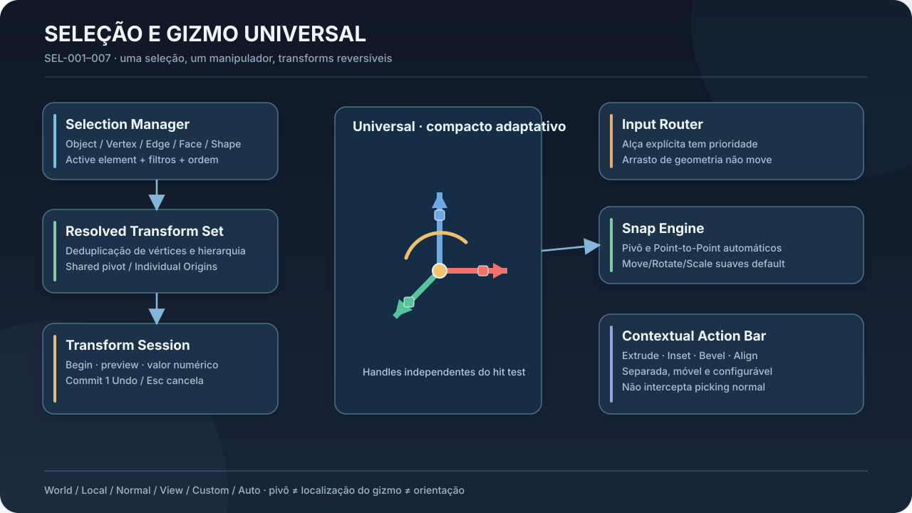
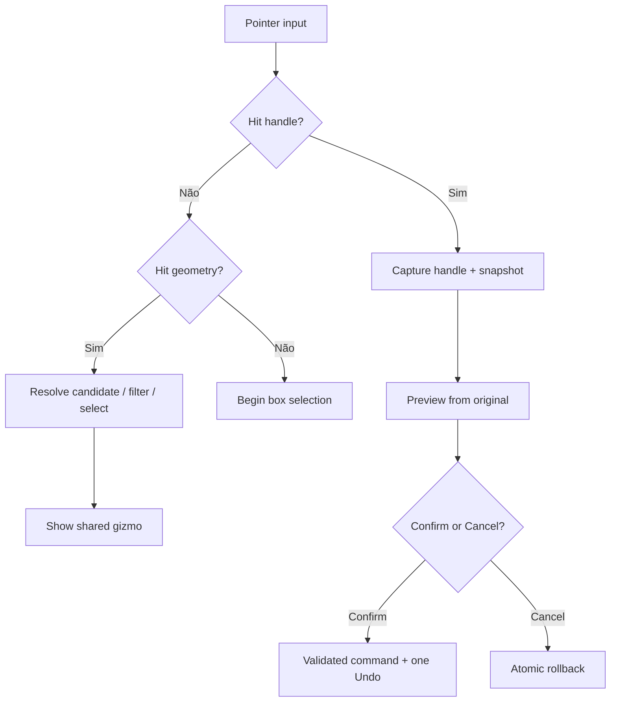
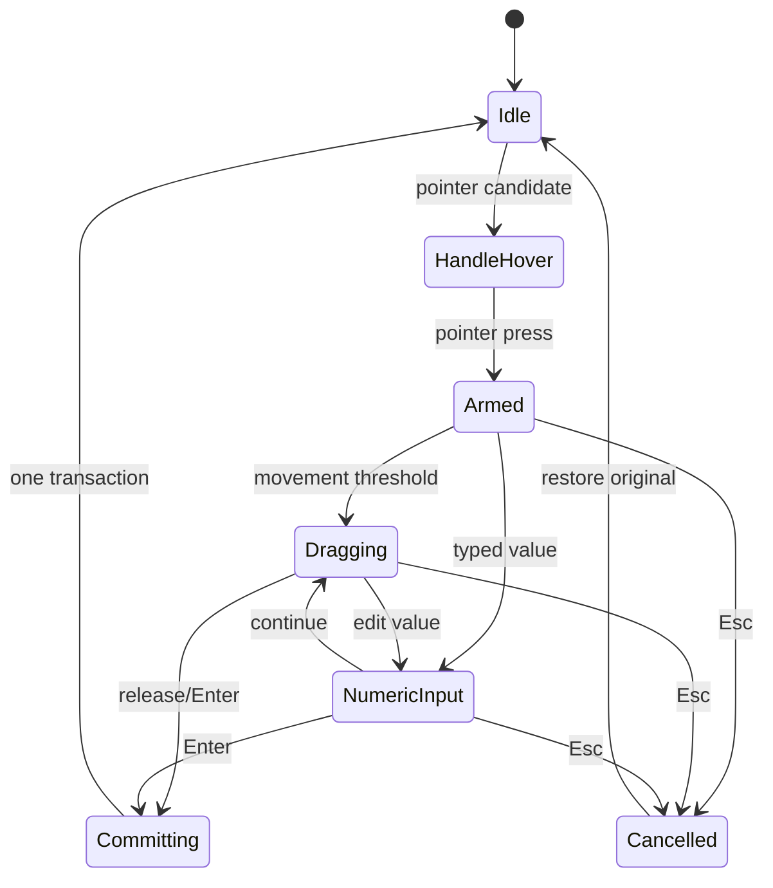

# 02 — Selection & Transform System (SEL-001 a SEL-007)

**Status:** UX aprovada. **Objetivo:** manipulação direta por seleção contextual e gizmo universal, precisa, previsível, reversível, com suporte a geometria heterogênea.



## 2.1 Jornada do usuário

1. Pointer hover identifica componente elegível; prehighlight mostra entidade e tipo.
2. Clique escolhe elemento conforme filtros de seleção e oclusão; clique/duplo clique conforme gramática configurável, sem Edit Mode obrigatório.
3. O `SelectionManager` atualiza `SelectionSet`, `ActiveElement` e `selection_order`; comunica resolução ao gizmo.
4. O `GizmoController` calcula frame default pelo tipo (objeto/face/aresta/vértice/múltiplo), mas respeita escolha manual do pivô.
5. Usuário inicia Move/Rotate/Scale por alça ou comando explícito. Drag sobre a geometria pura nunca inicia transformação.
6. `TransformSession` captura snapshot/targets/dados de origem, calcula preview a partir do original, admite valor numérico; snap apenas no contexto aprovado.
7. `Enter`/release confirmado aplica um comando atômico; `Esc` reverte; restaura seleção/estado de câmera quando apropriado.



## 2.2 Modelo de seleção

```rust
// Pseudocódigo de contrato — adaptar aos tipos do repositório.
struct SelectionState {
    members: Vec<SelectionRef>,           // conjunto sem duplicatas + ordem
    active: Option<SelectionRef>,
    filters: SelectionFilters,
    select_through: bool,
    revision: SelectionRevision,
}
enum SelectionRef {
    Object(ObjectId),
    Vertex { object: ObjectId, vertex: StableVertexRef },
    Edge { object: ObjectId, edge: StableEdgeRef },
    Face { object: ObjectId, face: StableFaceRef },
    Shape { object: ObjectId, shape: ShapeId },
}
```

**Semantics:** identidade de componente deve carregar `object_id`, tipo, referência persistente ou marca de revisão topológica. Se o core atual usa índices, introduzir camada de referência estável/remapeamento **sem reescrever de imediato todo o mesh kernel**. Preserve a ordem e o elemento ativo, mas não use ordem para deduzir duplicação de transformações.

**Picking:** `eligible_candidate = geometry_hits ∩ active_filters ∩ visibility_rules ∩ lock_rules`. Ordenar candidatos por prioridade do handle explícito, tipo de componente e tolerância em pixels, respeitando profundidade. Empates visuais exigem menu/ciclo de candidatos ou um critério estável. Highlight e hit result devem usar o mesmo snapshot de cena para evitar click-on-something-else.

**Box selection:** clique no vazio e drag pode iniciar window vs crossing conforme direção configurada. Shift/Ctrl/Alt exatos devem ser integrados ao keymap atual; comportamento aditivo/subtrativo/toggle precisa de testes, não de hardcode no Qt.

## 2.3 Selection Resolver e topologia

Separar seleção imutável de **resolved transform targets**. Uma face selecionada expande para seus vértices, uma aresta para seus endpoints e cada vértice entra uma única vez. Em edição de objeto inteiro, transformar o nó/instância do objeto; **não** alterar novamente suas subpartes já cobertas.

| Combinação | Resolução |
|---|---|
| Faces adjacentes em mesma malha | Deduplicar vértices compartilhados |
| Face + aresta da face | Mesmo vértice alterado uma vez |
| Objeto + face do próprio objeto | Objeto inteiro domina na transformação global |
| Pai + filho selecionados | Resolver espaço e hierarquia para não aplicar transform duplicado |
| Mesh + shape paramétrico | Cada adapter aplica operação preservando representação |
| Elemento bloqueado | Proibir ou mostrar compatibilidade parcial explicitamente; nunca ignorar silenciosamente |

Para **Individual Origins**, agrupar componentes contíguos por ilha/região conforme operação; aplicar transform individual ao elemento lógico e não a cada face isolada com centros conflitantes.

## 2.4 Pivot, orientação e frame

Três conceitos independentes: (1) `TransformPivot`: centro matemático de rotate/scale; (2) `GizmoDisplayPosition`: centro desenhado na tela; (3) `OrientationFrame`: base dos eixos X/Y/Z da operação. Eles podem coincidir no default, mas não devem ser fundidos em uma única propriedade.

| Seleção | Pivô auto | Referência de orientação |
|---|---|---|
| Objeto | bbox center ou pivot do objeto conforme preferência | Local/World |
| Face | centróide geométrico | normal/tangente; fallback estável |
| Aresta | midpoint | tangente + frame escolhido |
| Vértice | posição | local/World/View |
| Múltipla | bbox agregada | World ou ActiveElement |
| Shape paramétrico | ponto definido por adapter | frame estrutural se existente |

**Frame stability:** durante drag congele ponto, orientação, câmera de referência, alça capturada, seleção e limites. Evitar que mudanças de normal/câmera façam alças pularem durante preview. Se o usuário mudar manualmente o modo World/Local fora de drag, recomputar previsivelmente.

**Pivô manual:** manipulação de pivô é uma ferramenta independente: snap automático aqui pode ocorrer; não movimenta geometria, nem modifica o `3D Cursor` global. `Reset Pivot` deve restaurar configuração explícita e ser desfeito quando alterar documento persistente.

## 2.5 Gizmo universal e hit testing

Controles essenciais: seta por eixo (Move 1D), pequeno plano de dois eixos (Move 2D), arco por eixo (Rotate), cubo por eixo (Scale), uniforme e pivô. Visual simplificado, sem esconder operações em modo padrão; barra contextual separada e reposicionável. Implementar `HandleId` tipado: `MoveAxis(X)`, `MovePlane(XY)`, `RotateAxis(Z)`, `ScaleAxis(Y)`, `ScaleUniform`, `EditPivot`, etc.

**Camadas:** desenho GL/Qt; hit regions em coordenadas físicas/tela; `GizmoController` resolve identidade; `TransformController` calcula transform. Não inferir hover de cor renderizada. Hit region maior que alça visível onde não colidir com outra; prioridade e histerese evitam alternância de hit em pixels adjacentes.

**Estados:** Idle, Hover, Pressed, Dragging, SnapTarget, PivotEditing, Disabled. Durante Dragging destacar alça ativa, atenuar demais, exibir referência original + valor editável e rótulo de referencial. Não utilizar animações elásticas ou deslocamento de layout inesperado. Alças essenciais preservadas em HiDPI e zoom extremo.

## 2.6 Snap Engine central

Tipos: vertex, endpoint, midpoint, edge, face/plane, axis, grid, surface, intersection, distance, angle, scale increment, Point-to-Point. Candidate query deve suportar `space`, `intent`, `exclusions` (elementos transformados), `world_hit`, `screen_distance`, `priority`, `revision`, `confidence` (heurística, sem promessa estatística).

- Configuração ordinária: transformações livres suaves. Ativar snap por toggle temporário/atalho explícito; pivô/Point-to-Point podem solicitar auto snap.
- Ranking: restrição ativa > elegibilidade geométrica > prioridade semântica > distância em tela/profundidade. Histerese evita pular entre candidatos próximos.
- Preview indica alvo e tipo de snap antes do commit; tolerância deriva de viewport/DPI/pref e escala, não de coordenada de mundo fixa sem critério.
- Toda transformação conserva precisão numérica; snap não arredonda internamente ao número de casas exibidas.

## 2.7 Transform session e Undo/Redo



**Snapshot:** selection IDs + target resolver outputs + initial geometry/world transforms + pivot/frame + document revision + modifier evaluations. Compute previews against initial snapshot (never cumulative delta on altered preview). Deny stale transaction on external document edit; define safe cancellation/rebase policy. For topological ops, delta structure may include created/deleted stable IDs and remapping. One atomic Undo across heterogeneous objects.

**Scale semantics:** Shared rotates/scales arrangement about global pivot; Individual scales each component/shape/origin without moving object centers. Move applies common world/local delta respecting transform space. No silent parametric-to-mesh conversion.

## 2.8 Operations contextuais

`ContextualCapabilityResolver`: recebe `SelectionSet`, resolved targets, type capabilities, locks and state. Produz `{enabled, compatible_targets, incompatible_targets, reason, preview_support}`. Para seleção parcialmente compatível, apresentar opção explícita de aplicar somente a compatíveis e confirmar quais serão afetadas. Nunca filtrar silenciosamente.

**Toolbar:** independente do gizmo, 4 ações principais + menu `More` por contexto (valores apenas de design, validar UX); movível/fixável; sem cobrir picking; capacidade de teclado e comando por busca. Barra muda após mudança de seleção, nunca durante drag.

## 2.9 Acoplamento com o código atual

Locais observados: `crates/editor/src/lib.rs` (`GizmoModel`, `ViewportRenderState`), `crates/editor/src/bridge/gizmo.rs`, `crates/editor/src/viewport_intents.rs`, `crates/ui-cxxqt/cpp/petunia_gl_widget.{h,cpp}`, `crates/ui-cxxqt/src/render/opengl_viewport.rs`, `crates/core/` seleção e command dispatcher. Reusar os tipos existentes; auditar especialmente o risco de duplicação de lógica de hit testing em Rust e C++.

**Primeira fatia:** registrar hit result tipado com testes de prioridade e arrasto protegido; conectá-lo ao gizmo atual; preservar Undo existente. Evoluir depois para pivot independente, snapping e seleção heterogênea.

## 2.10 Testes representativos

1. Drag sobre face sem alça = nunca Move; drag vazio = box select.
2. Esc durante move numérico/drag cancela sem alterar documento nem Undo stack.
3. Face+aresta compartilhada não move vértice duas vezes.
4. Objeto+face dele mesmo não aplica duas transformações.
5. Pai+filho selecionados não sofrem transform duplicado.
6. Shared rotate muda disposição; Individual Origins preserva centros.
7. Snap para pivô e Point-to-Point funciona; ordinary Move não snap sem ativação.
8. Seleção de geometria oculta respeita Select Through e filtro; X-Ray visual não equivale a Select Through.
9. Barra não cobre gizmo; teclado alterna controle; HiDPI mantém hit target.
10. Save/load e undo preservam pivôs manuais persistentes quando aplicável.

**Critério de entrega:** teste de domínio + integração Qt + teste manual de picking sob o viewport. Não afirmar qualidade de UX apenas por testes unitários.
