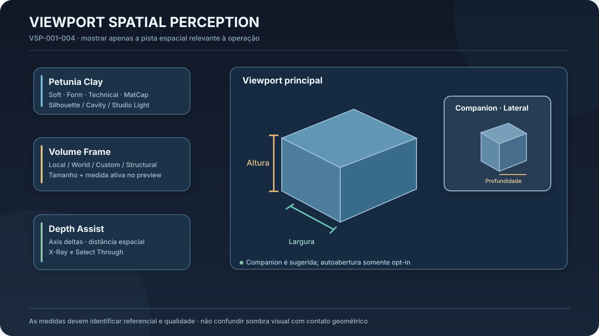
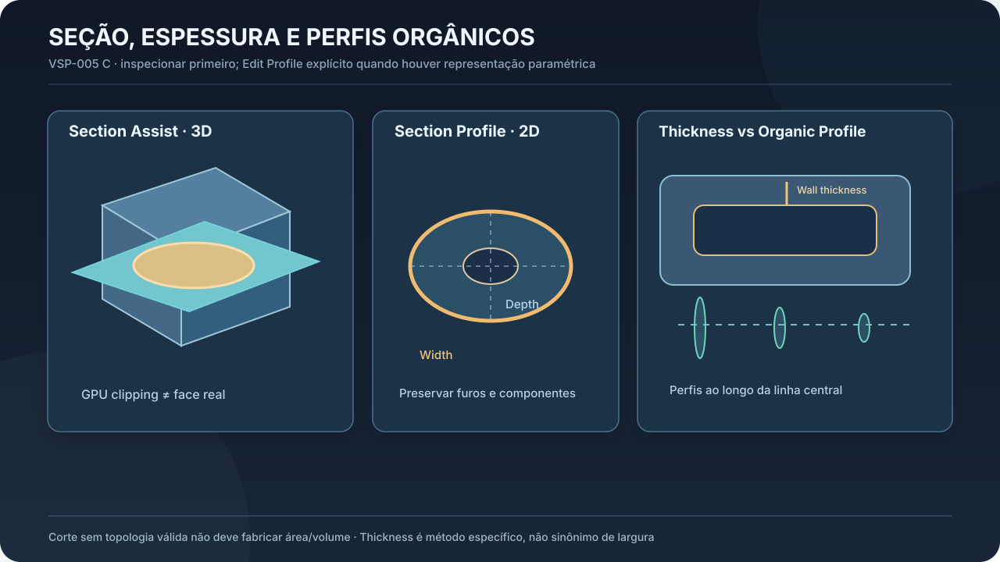
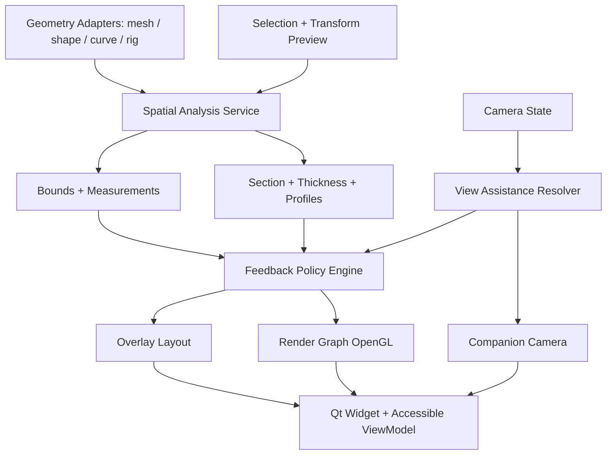

# 03 — Viewport Spatial Perception System (VSP-001 a VSP-005)

**Status:** UX aprovada. Integra VSP-001 B (assistência adaptativa), VSP-002 B (Petunia Clay), VSP-003 B (Volume Frame), VSP-004 B (Depth/Companion), VSP-005 C (Section/Thickness/Profiles — inspeção padrão, edição contextual explícita).




## 3.1 Princípios de percepção

A viewport ajuda a responder: **o que está selecionado? como é o volume? como muda? o que está à frente/atrás? quanto mede? como se conecta?**. Ninguém deve precisar dominar topologia antes de usar formas estruturais, mas a ferramenta preserva profundidade profissional.

As pistas visuais incluem sombreamento direcional, silhuetas, contornos de relevância, sombra de contato/oclusão moderada, guias dimensionais, referências de transformação, seções e vistas complementares. Efeitos estéticos nunca servem como *prova* de contato/interseção: para isso usar geometria.

**Perfis globais de auxílio:** `Essential` (limpo), `Assisted` (padrão para iniciantes, adapta à operação), `Analytical` (dimensões, seções e análise expandidas). Presets de visualização específicos `Clay Soft`, `Clay Form`, `Clay Technical`, `Clay MatCap`; ajustes manuais persistentes prevalecem sobre sugestões automáticas.

**Orçamento de atenção:** por padrão um valor central e até duas informações secundárias destacadas no gesto; overlays adicionais sob demanda ou pin. Alternâncias automáticas não surpreendem o usuário, não movem câmera, não reposicionam painéis durante drag.

## 3.2 Petunia Clay — VSP-002

Clay é um **shading mode de trabalho**, independente de materiais e das luzes reais do documento. Não exporta a aparência técnica como material autoral sem ação explícita.

### Variantes

| Perfil | Objetivo | Default sugerido |
|---|---|---|
| Soft | Ler macroforma; iniciantes, shape-first | key/fill suaves, leve cavity, silhueta discreta |
| Form | Ler convexidades, concavidades e sculpt | contrastes locais um pouco mais fortes, light inspect |
| Technical | Ler arestas/contornos, diferenças topológicas | features edges, desenhos técnicos opcionais |
| MatCap | Ler transições de superfície via reflexão dependente da vista | matcap separado de PBR, materiais autorais intactos |

### Luz e forma

`ModelingLightRig` com iluminação key, fill, rim opcional e ambient. Dois comportamentos de referência: `CameraRelative` (padrão Soft, aspecto relativamente estável ao orbitar) e `WorldFixed` (realça mudanças da forma em relação às luzes). `InspectLight` permite girar iluminação técnica independente da câmera. Inclinação de key ~25° acima da visão é **hipótese de UX** a validar, não constante comprovada universal.

**Contornos:** silhouette externa, feature edges e vincos relevantes, suggestive contours posterior e com estabilidade temporal, occluded edges apenas em inspeção, interaction outlines (seleção/hover/ativo) com prioridade superior aos contornos geométricos. Evitar full wireframe permanente. Desenho independente de hit test. Tamanhos lógicos iniciais exemplificativos: silhouette 1–1,5px, hover 2px, selected 2–2,5px, active 2,5–3px; escalar para DPR/acessibilidade.

**Cavity/ridge:** separar macro cavity de micro cavity, controlar força. Blockout orgânico prioriza macroforma; details de sculpt apenas em modo requerido. Não exagerar SSAO/contact shadows a ponto de simular superfícies conectadas. `Geometry Truth` (diagnóstico) distingue superfície real, normais interpoladas, normal maps, sombras e interpenetração real.

**Renderização:** usar scene depth/normals/IDs quando disponíveis, GL 3.3; pós-processamento de borda/cavity escalável; robustez HiDPI, AA e pixel snapping; lidar com representação paramétrica avaliando bounds corretamente. Não impor vários render passes quando puder combinar trabalho.

## 3.3 Volume Guides & Dimensional Feedback — VSP-003

### Comportamento visual

- Seleção: limites/bbox discretos + resumo de dimensões; sem três cotas grandes obrigatórias.
- Scale: enfatizar dimensão efetivamente afetada e variação versus original.
- Move: deslocamento e destino; esconder medidas constantes.
- Rotate: ângulo/pivô; não reportar aumento de World AABB como aumento físico do objeto.
- Inspeção: permitir três dimensões completas, pinning e anotação de documento explícita.
- Shapes orgânicos: referência estrutural + seções locais; não assumir que bbox é espessura anatômica.

### Referenciais

| Frame | Semântica | Nota de precisão |
|---|---|---|
| `World` | AABB alinhada a eixos globais | dimensão muda com rotação física |
| `ObjectLocal` | bounds nos eixos do objeto | considerar matrizes e escala real, inclusive pais |
| `Custom` | frame orientado pelo usuário | deve ser armazenado/validado |
| `Structural` | eixos de parte semântica ou membro | somente quando houver dados estruturais |
| `View` | frame da câmera para diagnósticos | não chamar de largura física do objeto sem explicação |

Extensão ao longo de um eixo unitário `u` do frame: `L(u) = max(dot(p,u)) - min(dot(p,u))`, para pontos relevantes da geometria avaliada. Para mesh triangular fechada, vértices suficientes para bounds lineares; NURBS paramétrica pode requerer cálculo de extremos ou amostragem marcada. PCA não garante menor OBB nem orientação estável em corpos quase simétricos.

**Source vs evaluated:** medição default sobre geometria avaliada; distinguir da cage/source paramétrica e dos parâmetros autorais. `Measure` (consulta) ≠ `Transform Dimension` (Scale até alvo) ≠ `Edit Shape Parameter` (altera definição). Parâmetros unitários e sem escala física: não inventar centímetros para uma cena sem unidades.

**Qualidade:** `ExactForRepresentation`, `Approximate { method, bound? }`, `Unavailable { reason }`, `Stale { revision }`. Exatidão sobre mesh baixa não significa exatidão do objeto físico pretendido. UI usa `≈`, unidade e frame; valores internos preservam precisão original, sem arredondar geometria para mostrar número.

**Pinning:** transient durante gesto; pinned em sessão/vista; annotation explícita salva no arquivo quando suportada. Referências de vert/edge/face devem sobreviver por IDs/mapeamento ou invalidar, nunca remapear por índices reciclados.

### Scale-to-dimension

Se uma dimensão de referência for conhecida e dependência linear com o fator for válida, `factor = target/current`; se `current=0` ou houver restrições/modificadores não lineares, bloquear com explicação ou resolver por procedimento específico. Alterar apenas dimensão escolhida no referencial correto; oferecer escala uniforme separadamente.

## 3.4 Depth Assist & Spatial Comparison — VSP-004

**Depth Hints** contextuais; **Depth Ruler** ao transformar/inspecionar; **Depth X-Ray** explícito; **Depth Map** analítico temporário com escala/legenda, referencial e validação de near/far. X-Ray visual **não** liga `Select Through` (SEL-002).

### Medidas espaciais: todas distintas

1. Distância ponto a ponto (euclidiana) de referências identificadas.
2. Delta em eixo/plane/frame escolhido.
3. Delta em profundidade de câmera (não confundir com distâncias entre objetos).
4. Distância mínima entre superfícies (0 inclui tangência e intersecção).
5. Contato segundo tolerância de análise explícita.
6. Interferência/volume comum apenas entre sólidos válidos e algoritmo que comprove interseção.

Objetos extensos podem ocupar intervalos de profundidade sobrepostos. Não declarar que A está inteiramente atrás de B usando apenas seus centros.

### Companion View

Uma segunda vista **ortográfica por padrão**, sincronizada com documento, seleção, preview e referências, mas com câmera própria. Pode ser aberta manualmente, sugerida (default), automática somente opt-in, fixada até fechar. Usuário escolhe plano frontal/lateral/superior/local/estrutural/custom. Vista temporária não deve roubar foco nem disparar manipulação e edição por padrão; edição direta na companion é recurso posterior.

**Projeção informativa:** dado ponto `p`, vetor de transformação `d` e projeção `π`, considerar variação `Δs ≈ Jπ(p) · d · Δt` em pixels; pequeno deslocamento projetado, variação aparente de escala e oclusão ajudam a diagnosticar ambiguidade. Para câmera ortográfica, mover ao longo do vetor da visão pode ser invisível. Avaliar candidates maximizando projeção do deslocamento e visibilidade, evitando flip. Congelar orientação enquanto arrasta, histerese ao sugerir, supressão de repetição.

**UI:** painel pequeno ~25% largura como hipótese de partida, redimensionável/pin/dock (Qt existente já suporta split/PiP); zoom/framing independente; label explícita de orientação, referências com marcador correspondente nas duas vistas. Não cobrir gizmo nem seleção, não trocar de canto durante drag. Abrir sob demanda sem mover câmera principal.

**Render cost:** resolução proporcional ao widget Qt; reuse VBO/scene caches, OpenGL context safety; FBO separado por superfície; qualidade reduzida opcional; renderização sob demanda em idle; teste no hardware alvo. Frequência reduzida somente como fallback, sem atrasar preview principal.

## 3.5 Section Assist — VSP-005

**Política C:** inspeção por padrão; edição contextual explícita de perfil paramétrico compatível.


### Fluxo de seção

1. Selecionar shape/mesh/sólido/conjunto; ativar `Inspect Section`.
2. `SectionPlane` gerado de seleção/face/eixo local ou frame custom, com centro indicado.
3. `MovePlane` e `RotatePlane` próprios, Flip, posição numérica, `Section Only`, `Ghost`, `Cutaway`, Section+Background.
4. Visualização GPU por clipping + interseção geométrica quando necessário. Contornos/áreas exibidos conforme qualidade.
5. Companion View perpendicular ao plano, baseada no controlador VSP-004.
6. Pinning de seções nomeadas, vários planos previstos na arquitetura; um plano ativo no MVP.
7. Não criar geometria real ao clicar em preenchimento sintético; `Create Geometry from Section` é comando separado.

### Três operações diferentes

- `ClippingVisualization`: descartar pixels de um lado do plano; rápido e não cria superfície real.
- `PlaneGeometryIntersection`: produzir polilinhas e regiões reais para medição; malhas abertas podem gerar linhas abertas; holes/múltiplos contornos preservados.
- `GeometrySplit`: mutação de documento/topologia; comando separado com preview, validação e Undo.

Planos coincidentes com faces, vertices/edges tangentes e geometria degenerada exigem regras robustas de tolerância para não gerar loops falsos ou preenchimento inconsistente. Contornos abertos não implicam área fechada. Solid closed/manifold autoriza área interna sob algoritmo validado. Curva, B-rep, mesh e SDF exigem adapters diferentes; conversão para mesh não pode ser destrutiva e invisível.

### Plane policy

`SectionPlane` pode ser `WorldAnchored` ou `ObjectAnchored`, explicitamente rotulado. O primeiro permanece no mundo quando o objeto move; o segundo acompanha transform do objeto. Alteração de topologia pode invalidar anchors ou queries; sem vinculação silenciosa ao índice reutilizado.

### Edição contextual de perfil

Shape estrutural com `EditableProfile` pode oferecer `Edit Profile`, entrando em sessão separada que altera **parâmetros do shape**, mantendo IDs/histórico. Mesh genérica expõe inspeção, não atributos paramétricos inventados. `Edit Profile` usa a mesma gramática de transação/Cancel/Undo aprovada SEL-004.

## 3.6 Thickness Analysis

### Glossário técnico obrigatório

| Tipo | Definição | Limite |
|---|---|---|
| `WallThickness` | distância entre paredes pareadas | pareamento requer geometria e orientação confiáveis |
| `DirectionalThickness` | primeiro hit/interseções ao longo da direção consultada | pode detectar parede não correspondente; não é espessura mínima |
| `MinFeatureThickness` | menor dimensão local com definição formal | algoritmo e condições devem ser documentados |
| `SectionWidth/Depth` | extensão transversal da seção em frames próprios | não é espessura de parede |
| `ShapeDiameterEstimate` | escala local aproximada de volume | descritor, não medida física exata |

`ThicknessProbe` usa seleção e ray query (BVH onde existente) com ponto inicial, normal/direção, tolerância; apresentar método/qualidade e setas entre referências. `ThicknessHeatmap` deve fornecer escala/legenda, limiar manual e paleta acessível; evitar limites automáticos genéricos de impressão. Para malhas abertas ou auto-intersectadas, medir apenas quando o método é semanticamente válido; mostrar unavailable/ambiguous.

## 3.7 Organic Volume Inspection

**Modelo:** caminho/linha central + estações de seção transversais; cada estação tem `origin`, tangente, eixo transversal U/V, contornos (zero/um/múltiplos), área se fechada, perímetro, width, depth, aspect ratio, offset de centro e qualidade.

**Sources de path:** TwoPointAxis, MultiPointPath, StructuralAxis (quando shape fornece), extraction automática de medial/skeleton apenas futura. Para curvas, usar transporte paralelo com frame inicial conhecido e prevenção de flips; em bifurcação, segmentos com junction explícita, não frame único falso.

**Humanóides/animais:** torso em diferentes alturas, braço ombro→cotovelo→pulso, perna quadril→joelho→tornozelo, animal torso→garupa, pata, pescoço e cauda. Não deduzir landmarks humanos de malha arbitrária. Proporção voluntária, não “erro anatômico” automático. Comparações de duas seções indicam diferença absoluta e relativa com eixo/frame nomeado.

## 3.8 Arquitetura e serviços



`SpatialAnalysisService` (consultas sem UI), `BoundsResolver`, `DepthRelationSolver`, `SectionIntersectionService`, `SectionTopologyResolver`, `ThicknessAnalyzer`, `ShapeProfileAnalyzer`, `FeedbackPolicyEngine`, `OverlayLayoutManager`, `CompanionCameraResolver`, `ViewportAppearanceController` (profile), `ModelingLightRig`, `ContourRenderer`, `AccessibleInspector`.

No código atual: conferir `crates/editor/src/lib.rs` `ViewportRenderState` (shading, xray, studio_light_follows_camera, matcap, AO, selection_rgb); `crates/render/src/gl/`; `crates/ui-cxxqt/src/render/opengl_viewport.rs` para multiplas superfícies/câmeras; `petunia_gl_widget.cpp` e `petunia_overlay_cards.cpp` para HUD e shading. **Reusar antes de criar módulos duplicados**. Renderer é OpenGL, não WGPU como principal.

### DTOs conceituais

```rust
// Esboço; compilar somente após adaptar tipos reais do projeto.
enum Quality { ExactForRepresentation, Approximate { error_bound: Option<f64> }, Unavailable, Stale }
enum SpatialFrame { World, Object(ObjectId), Custom(FrameId), Camera(ViewportId), Structural(StructuralId) }
struct Measurement { value: f64, unit: Unit, frame: SpatialFrame, quality: Quality, geometry_revision: Revision }
struct SectionPlane { origin: Vec3d, normal: UnitVec3d, orientation: UnitQuatd }
struct SectionResult { contours: Vec<Polyline3>, closed_regions: Vec<Region2>, quality: Quality, revision: Revision }
struct CompanionState { mode: CompanionMode, camera: CameraPose, framing: Option<GeometryRef>, pinned: bool }
```

## 3.9 Cache, precauções e invalidation

- Queries referem-se à geometria avaliada e revisão apropriada; resultados antigos recusados.
- Distinguir atualização barata de bounds sob transform de recomputação cara de seções após edição topológica; cache por `{object, evaluated_revision, frame, query_parameters}`.
- Exports/Undo/Save/Load não capturam estados transitórios de preview como geometria persistida.
- Overlays podem ser 2D (Qt/QPainter) ou 3D (GL), mas picking não deve depender de rótulo desenhado.
- Contornos matemáticos e preenchimento de seção devem preservar buracos e regiões desconectadas. Graphics clipping não garante cálculo de seção exata.
- Se a seção manual for associada a objeto em uma hierarquia, transformar anchor sem erro por inversão singular (escala zero).

## 3.10 Qualidade de UX e testes

Testes: comparar dois objetos aparentemente coincidentes em vista frontal, Move em profundidade pouco visível, escala local/global rotacionada, split companion sem alterar câmera principal, clipping de mesh aberta e de sólido com furo, seção que coincide com face plana, thickness em casca oca, perfil curvo sem flip, invalidar pinned measure após edição topológica. Testar em viewport normal/HiDPI, baixo contraste e software fallback, teclados e leitor de tela quando possível.

**Métricas UX sugeridas:** erro espacial absoluto, número de órbitas de câmera, tempo, passos Undo, taxa de conclusão e conforto/carga cognitiva; testes contra baseline sem assistência para evitar só melhorar aparência estética.
