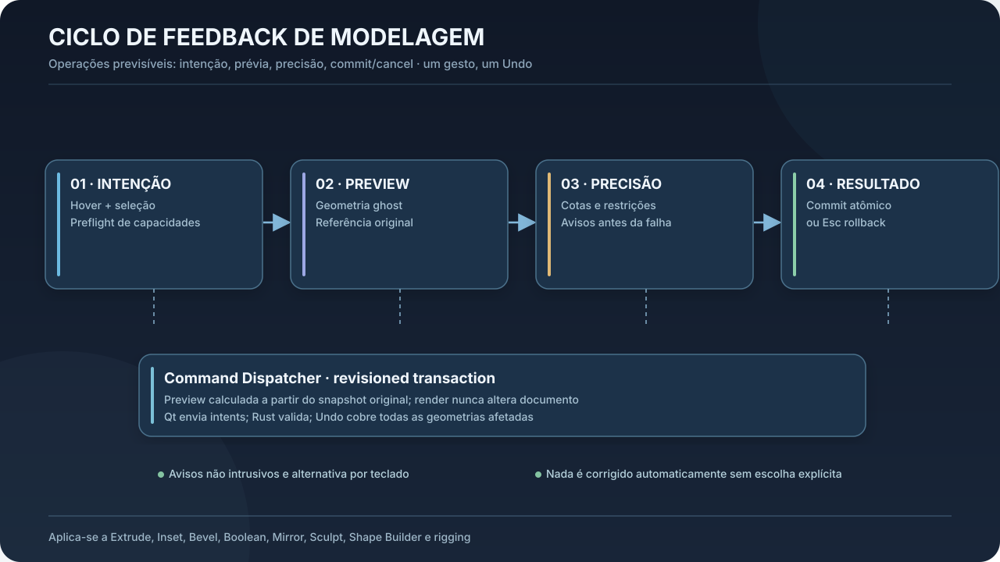
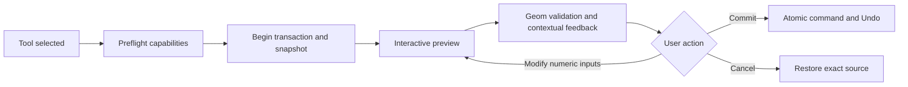

# 04 — VSP-006: Modeling Operations Feedback

**Status:** detalhamento **derivado** da delegação do responsável após VSP-005 C. Política aprovada: previews não destrutivas, feedback proporcional ao contexto, operações explícitas, sem autocorreções silenciosas. Ajustes finos de algoritmos estão propostos.

## 4.1 Princípio transversal

Cada operação de modelagem publica os mesmos quatro estágios: **Intenção → Preview → Precisão/diagnósticos → Confirmar/Cancelar**. O sistema visual nunca reconstrói o resultado independente do kernel geométrico; ele consome `OperationPreview` e diagnósticos calculados pelo domínio.

**Contrato mínimo `OperationFeedback`:** `operation_id`, `transaction_id`, `targets`, `source_revision`, `preview_revision`, `operation_frame`, `pivot`, `active_dimension`, `numeric_value`, `preview_geometry_handle`, `ghost_source`, `markers`, `warnings`, `quality`, `commit_enabled`. Tipos e nomes são sugestivos, não uma API já existente.

## 4.2 Tabela por operação

| Operação | Prévia essencial | Medida principal | Feedback de integridade |
|---|---|---|---|
| Move | origem ghost, vetor e eixo/plane | deslocamento signed | snap target, bloqueios, limites |
| Rotate | arco, eixo, pivot, posição anterior | ângulo signed | gimbal/frame, locks |
| Scale | shape/bounds original e novo | dimensão final ou fator | zero/negative scale, modificadores |
| Extrude | faces laterais e tampa translúcidas, direção | distância signed | degenerações, self intersection, manifold se exigido |
| Inset | contorno original + interno, correspondência | offset | colapso de arestas, inversões |
| Bevel/Chamfer | volume suavizado e feature edges | largura e segmentos | self-intersection, raio acima do permitido |
| Subdivide | realce de novas arestas/patches | níveis | densidade estimada, custo |
| Loop Cut | caminho potencial sobre malha | posição/percentual | loops que terminam em poles, ambiguidade |
| Bridge | pares de bordas, conectores previstos | segmentos/twist | número de componentes incompatível |
| Boolean | operandos diferenciados, resultado + interseção | tipo de operação | superfícies não fechadas, regiões incertas |
| Mirror/Symmetry | plano, cópia ghost, correspondência | plano/offset | normais negativas, fusão seam |
| Shape Builder | áreas reconhecidas e seleção de regiões | área/espessura quando aplicável | topologia, contornos abertos |
| Draw Profile/Loft | perfis originais, casca prevista | largura/altura/raio | cruzamentos, regiões desconectadas |
| Sculpt/Push/Pull | cursor pincel, falloff, deformação preview | raio/força | self-intersection, densidade, simetria |
| Smooth/Relax | antes/depois da região | intensidade/iterações | shrinkage de volume e constraints |
| Remesh/Decimate | prévia com densidade reduzida | target edge size/faces | perdas topológicas, UV, vertex IDs/weights |
| Skinning/Pose | skeleton, weights, silhouette ghost | ângulo/peso | joint range, bind validity |

## 4.3 Atenção visual e hierarquia dos overlays

- **Um indicador principal**, até dois secundários no perfil assistido (regra de design testável, não limite físico da UI).
- Numeric overlay ancorado perto do handle ativo, não no centro da geometria crucial.
- Status de erro/aviso com ícone + texto além da cor; distinguir `informativo`, `incerteza`, `inválido para esta operação`.
- A barra contextual não muda posição durante o drag; overlays visuais não capturam eventos de mouse se não são controles.
- Feedback em tempo real pode ser estimado; mostrar `≈` e atualizar análise rigorosa após commit. Nunca anunciar medição aproximada como exata.
- Redução de movimento preserva feedback importante por mudança imediata de contorno/label, sem flashing/elastics.

## 4.4 Exemplo: Extrude de um braço estilizado

1. Usuário seleciona uma face; hover sinaliza `Face` e normal, com candidato de `Extrude` se compatível.
2. Inicia `Extrude` via contexto/atalho; preview geométrica exibe face original em ghost, tampa e laterais novas, direção, deslocamento numérico.
3. Caso direção esteja quase paralela à câmera, VSP-004 oferece Companion View sem movimentar a principal.
4. VSP-003 destaca extrude distance; VSP-005 pode mostrar seções da extrusão apenas sob demanda.
5. Preflight detecta degeneração e identifica local; não manipula parâmetros em silêncio.
6. Enter aplica `ExtrudeCmd` uma vez. Esc reverte snapshot sem alterações persistentes. Uma transação = um Undo.

## 4.5 Exemplo: Boolean para shapes sobrepostos

- Colorir semanticamente operação A∪B, A−B ou A∩B apenas na preview e com legenda.
- Mostrar ghost dos operandos e contorno da interseção; não afirmar contato só por AO ou sombras visuais.
- Verificar tipo de entrada suportado (malha manifold, shape etc.) antes de escolher algoritmo; permitir auto-cleanup somente com opção explícita e preview.
- Preservar proveniência de elementos, materiais, UV/rig refs quando pipeline suportar; se inválido, bloquear ou pedir decisão explícita.

## 4.6 Exemplo: Mirror/Symmetry em personagem

- Plano visível com pattern discreto; seleção espelhada ghost.
- Exibir `paired`, `unpaired` e `locked` com contorno/símbolo além de cores.
- Não forçar correção de assimetria artística.
- Persistir mirror enquanto operador não destrutivo quando representação permitir; `apply` explícito altera topologia e atualiza rig refs.

## 4.7 Exemplo: Sculpt e deformação orgânica

- Pincel mostra tamanho aparente em pixels + raio em unidades definidas e influência projetada; indicador de pressão/caneta opcional.
- Surface/cavity e silhouette complementam preview, sem confundir normal map e relevo real.
- Preserve controles de força, falloff, simetria e máscara; preview em cache, commit por stroke/gesto transacional quando aplicável.
- Avisar shrinkage/volume loss de Smooth ou deformações quando método puder estimar; oferecer comparação before-after sob demanda.

## 4.8 Command boundary e locks

O dispatcher deve validar `can_execute` com contexto real e `OperationCapabilityMatrix`. Se só parte da seleção for compatível, comunicar conjuntos afetados/não afetados e exigir escolha explícita de operação parcial. Operações com geometric mutation devem ser atômicas quanto à porção comprometida; não commit parcial oculto em erros.

**Undo invariants:** confirmação aplica resultado derivado de snapshot inicial e revisão; erro ou Esc mantém documento anterior; undo/redo restauram topologia, IDs, modificadores, materiais/UV/rig quando afetados, além de estados semânticos necessários.

## 4.9 Fases

**P0:** normalizar `OperationPreview` e unidade de feedback, sem reescrever kernels; Move/Rotate/Scale/Extrude/Inset/Bevel com before/after numérico e cancel.

**P1:** Boolean/Bridge/Mirror/Shape Builder, avisos por capacidade, relação com Companion e seções.

**P2:** esculturas e deformações com volume/silhouette, region diagnostics, preview de remesh e impactos de topologia.

**P3:** adaptação baseada em observabilidade real, testes comparativos UX, ferramentas de análise avançada.
