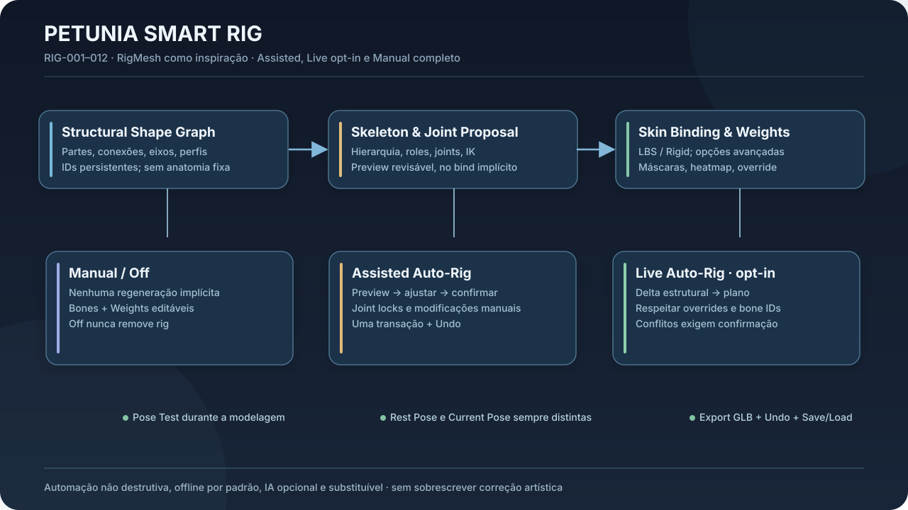
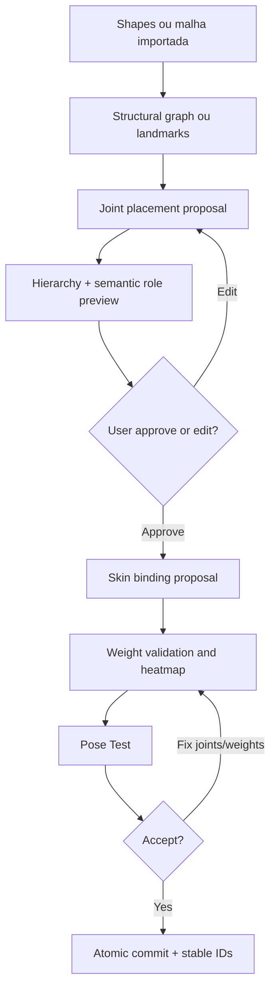

# 05 — Petunia Smart Rig: Auto-Rig, RigMesh incremental e edição manual

**Status:** visão de produto aprovada (RIG-001 a RIG-012). Implementação incremental e algoritmos descritos abaixo são **propostas técnicas** a validar. Fonte de inspiração: Borosan et al., [RigMesh — Automatic Rigging for Part-Based Shape Modeling and Deformation](https://cragl.cs.gmu.edu/rigmesh/) (SIGGRAPH Asia 2012). **Nunca** reutilizar binários/código/recursos do RigMesh sem licença explícita; reconstruir com algoritmo próprio a partir de referências públicas.



## 5.1 Objetivo de UX

Rig evolui com modelagem shape-first, mas sem impor rigging ou conhecimento prévio de ossos. O usuário cria torso, cabeça, patas e cauda; Petunia sugere skeleton/juntas/pesos; permite testar pose ainda no blockout; artista edita, bloqueia, apaga ou gera manualmente. Funciona offline sem IA externa obrigatória.

**Modos:**

- `Manual/Off`: não gerar, não modificar automaticamente; rigs existentes preservados.
- `Assisted`: padrão **ao solicitar rig**; preview de bones e pesos, landmarks corrigíveis, confirmação explícita; comportamento padrão fora da ferramenta é sem autorig.
- `Live`: opt-in; rig incremental diante de operações estruturais **compatíveis**; bloqueios manuais prevalecem; alterações destrutivas ou grande propagação precisam preview/confirm ou resolução de conflito.

**Três comandos distintos:** `DisableAutoUpdates`, `DisableRigDeformation`, `RemoveRig`. O primeiro nunca apaga rig, o segundo não apaga animações, o terceiro exige confirmação e compatibilidade com referências dependentes.

## 5.2 O que já existe na baseline (observado, não certificado por runtime)

- `crates/project/src/rig.rs`: estruturas de Skeleton, Bones, Skin/weights e bind/rest matrices.
- `crates/core/src/rig_commands.rs`: operações de rig no sistema de comandos.
- `crates/project/src/ik.rs`, `crates/project/src/posing.rs`: IK e avaliação de pose.
- Presets: humanoide/quadrúpede/multileg/serpente/peixe/ave, conforme documentação/código visitados.
- `crates/core/src/animate_session.rs`, exportação glTF, animação/posing existentes.
- `docs/bible/specs/p3d-137-auto-rig.md`: heurísticas de fitting e atribuição de weights; lacunas de landmarks e correção.
- `crates/editor/src/animate.rs` e Qt timeline atual integram apresentação.

**Risco de baseline:** peso por proximidade de bone e fitting de bbox não equivalem a RigMesh incremental. Avaliar deformação quando modificadores/topologia alteram a mesh. Há nomes e comentários Slint herdados apesar de shell Qt atual; não duplicar regra em C++.

## 5.3 Structural Shape Graph (SSG)

SSG representa partes **semânticas e estruturais**, independente da geometria avaliada:

```text
CharacterGraph
 ├─ BodyPart(torso)  ── ParentRoot
 │   ├─ BodyPart(neck) ── head
 │   ├─ Joint(shoulder.L) ── upper_arm.L ── elbow.L ── forearm.L ── wrist.L
 │   ├─ Joint(shoulder.R) ── upper_arm.R ── elbow.R ── forearm.R ── wrist.R
 │   ├─ pelvis/hip.L ── upper_leg.L ── knee.L ── shin.L ── ankle.L
 │   └─ pelvis/hip.R ── upper_leg.R ── knee.R ── shin.R ── ankle.R
 └─ OptionalBranches: tail, horns, wings, extra_legs, antennae
```

- Identidade `PartId`, `JointId`, `BoneId`, `GeometrySourceId`, `Revision` duráveis; sem dependência de índice temporário.
- `Part`: tipo semântico opcional, frame, comprimento, perfil/centro do volume, pontos de conexão, shapes dependentes, parâmetros e mirror pairing quando presente.
- `Joint`: parent-child estrutural, ponto/limites, bind/rest orientation, constraints, manual lock e provenance (manual/auto/assisted).
- `Connection`: relação articulada, rígida, fusion/blend ou sobreposta sem fusion; não pressupor que aparência contínua implica mesh manifold.
- `Adapter`: Shape-first proporciona dados ricos; malha importada sem estrutura suporta landmarks manuais ou fitting opcional com qualidade declarada.
- Não impor bipedalidade, hierarquia humana, rig role obrigatório ou ausência de ciclos sem validação. Skeleton de deformação deve ser grafo acíclico/rooted, mas geometria pode ter conexões estruturais complexas; modelar a correspondência explicitamente.

## 5.4 Pipeline de geração assistida



### Fase A — Anatomia/preset

Usuário escolhe bípede, quadrúpede, ave, peixe, multileg, serpente ou custom. São *templates editáveis*, não regras absolutas; malha importada pode ser anatomicamente incomum. Ref por eixos/fitting, landmarks explícitos, hierarquia, centro de segmentos.

### Fase B — Preview e correção

Joints sugeridos como ghost (visual diferente de bones confirmados); labels com papel e orientação. O usuário move, divide, apaga, cria, reparenta e fixa joints **antes** de bind; botões confirmar/cancel. Qt panels não alteram mesh diretamente.

### Fase C — Skin weights

MVP: per-part rigid + método de proximidade existente com limites e normalização. Avançar para Bone Heat, Bounded Biharmonic (se viável), DQS (com fallback LBS), melhor blending nas junções. Não afirmar que Heat/BBW foram implementados. Guardar weights indexados por referências reconciliadas após modificador/topologia, e informar quando remapeamento exato não é possível.

### Fase D — Pose Test

Criar poses provisórias sem destruir Rest Pose nem animações. Mostrar skeleton, eixo/ângulo, hints de clipping, before/after, volume loss quando estimável; rotação/IK mediante comandos transacionais. Se usuário edita *shape base* com personagem posado, pedir contexto claro: `Edit Rest Shape`, `Edit Pose` ou `Corrective Deformation`.

## 5.5 Atualização incremental (diferença central em relação ao autorig atual)

**Algoritmo conceitual:** mudança em SSG → `ChangeSet` tipado → dependências (partes, joints, mesh regions, influence maps, poses, animation bindings) → construir plano de atualização mínimo → preview de mudanças → aplicar atomically e invalidar derivados.

| Delta geométrico | Ação proposta no rig | Requisitos |
|---|---|---|
| Translação de parte rígida | atualizar frame se auto e não locked | manter rest/current distintamente |
| Alongar membro | ajustar juntas livres e bind space | respeitar locked e preservar IDs |
| Alterar espessura sem alongar | atualizar pesos próximos, não mover juntas por padrão | preservar deformação esperada |
| Adicionar cauda | sugerir nova cadeia e role | nenhuma intervenção em ossos existentes não relacionados |
| Adicionar asa | sugerir cadeia e possíveis subdivisões | anat custom permitida |
| Remover membro | análise de dependências; confirmar delete/detach/migrate | nunca deletar clipes silenciosamente |
| Fundir volumes | reconciliar skin no seam e topology map | preview before/after |
| Subdividir/Remesh | transferir weights por correspondência espacial validada | não reutilizar vertex indices cegamente |
| Mudar apenas material/UV | sem rig recalculation | dependências precisas |
| Mover joint manualmente | override/lock; recalcular zonas afetadas quando solicitado | override preservado |

### Regra de override

Overrides possuem tipos: `LockPosition`, `LockOrientation`, `LockParent`, `LockLength`, `LockWeights(region)`, `ManualBone`, `IgnoreAutoGeneration(part)`. No MVP, começar com `Auto/Manual/Locked` por joint e `ManualWeightMask` básico. Decidir colisão: prioridade `manual_locked > explicit_current_user_action > assisted_suggestion > live_auto`. Se atualização automática não puder preservar lock, parar e mostrar conflito com escolhas `keep manual`, `recompute specific`, `cancel`; jamais sobrescrever silenciosamente.

### Idempotência/revisões

Reaplicar o mesmo `RigUpdatePlan` à mesma revisão não deve duplicar joints ou weights. IDs e `source_revision` validam estado; cancelar restaura skeleton e mesh original e não altera animation track. Jobs de weight solve no background em Rust (thread separado do Qt), versionados/canceláveis.

## 5.6 Skinning, geometria e deformação

- `Linear Blend Skinning` (LBS) já observado na base; fornecer opção `Rigid Per Part` para low-poly segmentado. `Dual Quaternion Skinning` (DQS) é futuro opcional para twists/volume, com limitações em escala não uniforme.
- Weights normalizados (soma =1 ou regras explícitas para vértice sem influência), índices válidos, número máximo de influências conforme pipeline de export.
- Preservar inversas de bind para rest pose; `skin_matrix = posed_global * inverse_bind` dentro da convenção existente; nunca transpor/converter matrices por suposição entre glam, C++ e glTF.
- Com modifiers: pesos referem-se a um domínio de mesh bem definido (authoring cage/evaluated mesh), com correspondência/bake explícito; não pintar pesos sobre estrutura de índice efêmera.
- Exports glTF/GLB: skins, joints, weights, clips; respeitar escala e handedness, validar animações/round-trip. Objetos static e rigs não devem perder import/export existente.
- IK: mantenha TwoBone/FABRIK/LookAt existentes quando adequados, evitando reimplementar; pose invertida, zero-length bones, constraints e chain invalid devem retornar erro estável.

## 5.7 UI do Rig Editor no Qt

**Layout recomendado:** `Rig & Bones` (outliner hierárquico), `Properties` (rest pose/transform/role/lock), `Skin Weights` (heatmap, paint/smooth), `Auto-Rig` (manual/assisted/live; preview/regenerate), `Pose Test` (FK/IK, poses salvas). Qt Widgets e `PetuniaDockManager`, preferencialmente componentes reutilizáveis.

**No viewport:** skeleton overlay independente da malha, cores configuráveis, xray opcional, labels ao hover, joints clicáveis por hit ID; alças de edição do rig distintas do gizmo de objeto; Companion View ajuda a posicionar cotovelo/joelho em profundidade; Section Assist confirma joint dentro de massa; Weight Paint heatmap com legenda e indicador não apenas cromático.

**Progresso/status:** `Ready`, `Previewing`, `Solving`, `Needs Review`, `Conflict`, `Committed`, `Cancelled`, `Unsupported`. Durante Live Mode, alterações triviais podem ser incorporadas conforme política explicitamente ligada; mudanças com risco para animações requerem confirmação sem popups repetitivos.

## 5.8 Contratos conceituais Rust

```rust
// Interfaces para design review; não afirmam compilação no projeto atual.
enum RigMode { Manual, Assisted, Live }
enum Provenance { Artist, Assisted, LiveGenerated }
enum OverridePolicy { Auto, Manual, Locked }
struct StructuralPart { id: PartId, source: GeometrySourceId, frame: Frame3, landmarks: Vec<LandmarkId> }
struct JointBinding { joint: JointId, part: PartId, role: Option<RigRole>, policy: OverridePolicy }
struct RigChangeSet { revision: GeometryRevision, changes: Vec<StructuralChange> }
struct RigUpdatePlan { expected_revision: Revision, affected_joints: Vec<JointId>, affected_regions: Vec<MeshRegionId>, conflicts: Vec<RigConflict> }
trait RigSuggestionEngine { fn suggest(&self, input: &RigInput) -> Result<RigProposal, RigError>; }
trait RigIncrementalUpdater { fn plan(&self, graph: &StructuralGraph, rig: &Skeleton, changes: &RigChangeSet) -> Result<RigUpdatePlan, RigError>; }
```

A lógica funcional pertence aos módulos Rust existentes (`core`, `project`, `mesh` conforme ownership) ou a módulo `rig` extraído **somente se a auditoria justificar**. Qt recebe DTOs imutáveis de preview e despacha intents. Nunca construir skeleton no slot C++ do painel.

## 5.9 Roadmap e critérios de entrega

1. **Base**: auditar skeleton, LBS, IK, posing, glTF, modifiers e rotas Qt. Corrigir regressões comprovadas; testes para rest pose/weights/undo.
2. **Rig Editor manual**: bones/joints/reparent, rig role, locks, painting e pose view; salvar/carregar.
3. **Assisted Auto-Rig**: landmarks, fitting de templates, preview/correção, commit, proteção de overrides.
4. **SSG**: structural IDs, segments, conexões/shape profiles e storage migrável; sem quebrar import/export.
5. **Incremental Live**: delta graph, localized recompute, conflitos, idempotência, privacy de edições manuais.
6. **Advanced deformations**: melhores pesos, DQS opcional, corretivos, retarget/export validado.
7. **IA opcional**: investigação de UniRig e similares como provider plugin (licença/dependências/hardware aprovados à parte), sem cloud obrigatória.

### Testes RIG essenciais

- Ativar/desativar Auto sem remover skeleton; remoção explícita com Undo.
- Gerar rig assistido, reposicionar joint, confirmar e salvar/carregar.
- Locked shoulder não se move quando torso alarga; informe conflito se impossível.
- Adicionar cauda em Live cria apenas cadeia correspondente; reexecutar delta não duplica.
- Alterar material não roda solve de weights.
- Remesh preserva/revalida weights; falhas de remap não reatribuem indices aleatórios.
- Pose Test não altera bind/rest e transação cancel restaura tudo.
- Export glTF de rig e animações preserva correspondência de joints/skins.
- Mesh aberta e criatura não anatômica suportam manual, sem suposições de template obrigatório.
- Linux/Windows e fallback sem GPU de IA continuam funcionais.

**Critério de UX:** usuário iniciante cria torso + quatro patas + cauda, recebe rig sugerido, corrige uma articulação, testa pose, altera comprimento de pata sem perder correção manual e pode desligar live sem perder o rig.
