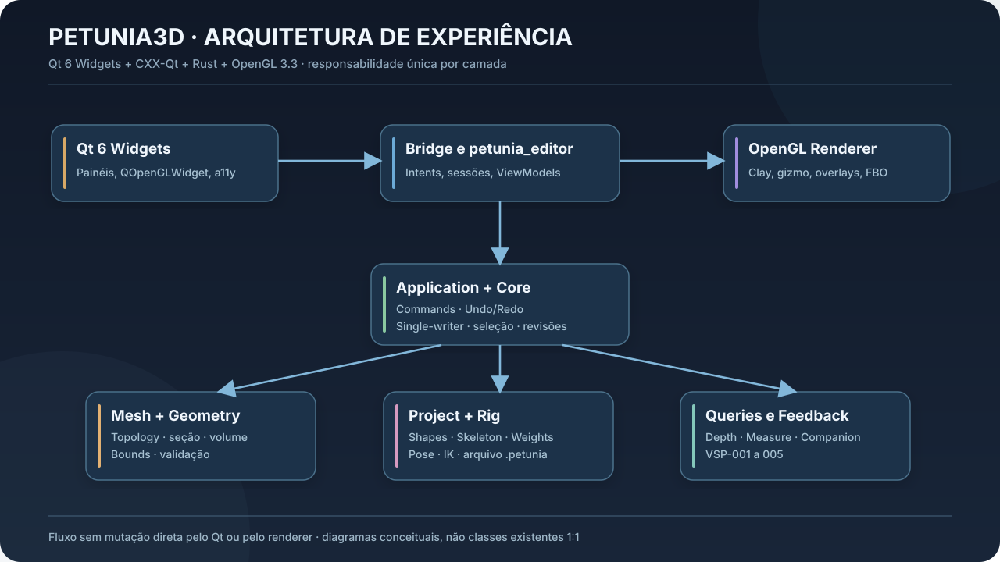
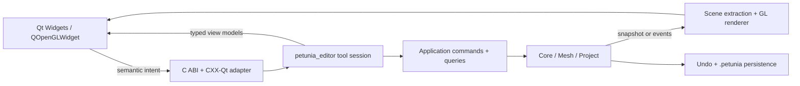

# 06 — Arquitetura concreta: integração Qt 6 Widgets / CXX-Qt / Rust / OpenGL

**Baseline consultada:** `WASDst/petunia3d`, `main` SHA `92c22caa23f96f85f18e72a5e962a1d8831694db` em 2026-10-15. O estado pode mudar; conferir imediatamente antes de editar.



## 6.1 Estado factual do código na baseline

O commit [`584f835`](https://github.com/WASDst/petunia3d/commit/584f83573d3049009524b4718c6f1194b58f1b8a) registra **remoção do Slint do workspace**, extração de `crates/editor` (`petunia_editor`) e uso da UI Qt Widgets como única shell principal. `src/main.rs` chama `petunia_ui_cxxqt::widgets::run()`. `Cargo.toml` inclui `crates/editor` e `crates/ui-cxxqt`, não `ui-slint`.

| Componente observado | Caminho / relação |
|---|---|
| Binário principal | `src/main.rs` |
| Qt Widgets shell | `crates/ui-cxxqt/cpp/petunia_main_window.{h,cpp}` |
| Viewport Widget Qt | `crates/ui-cxxqt/cpp/petunia_gl_widget.{h,cpp}` (`QOpenGLWidget` + wrapper) |
| Docking | `crates/ui-cxxqt/cpp/petunia_dock_manager.{h,cpp}` (`QDockWidget`) |
| Bridge C/C++ | `crates/ui-cxxqt/cpp/petunia_editor_api.h` e funções extern C Rust |
| Ponte CXX-Qt | `crates/ui-cxxqt/src/bridge/shell.rs` |
| Qt editor adapter | `crates/ui-cxxqt/src/editor.rs` (`QtEditor`, nomes legados presentes) |
| Qt viewport GL | `crates/ui-cxxqt/src/render/opengl_viewport.rs` (`QtViewportRenderer`) |
| Editor neutro | `crates/editor/src/lib.rs`, `crates/editor/src/bridge/`, `viewport_intents.rs`, `overlay.rs`, `numeric.rs` |
| Render | `crates/render/src/gl/`, `frame.rs`, `scene.rs`, `extract.rs` |
| Core e commands | `crates/core/`, `crates/commands/`, `crates/application/` |
| Geometria e documento | `crates/mesh/`, `crates/project/` |
| Rig, IK, posing | `crates/project/src/{rig,ik,posing}.rs`, `crates/core/src/rig_commands.rs` |
| Qt Quick preview | `crates/ui-cxxqt/qml/` (não confundir com shell produção) |

O README e diversos docs ainda contêm informações antigas. O `AGENTS.md` observado é específico de branch anterior, tem regras de segurança importantes mas menciona Slint/main bloqueada; **não escolher unilateralmente quais instruções ignorar**. O agente deve reconciliar a fonte canônica mediante decisão humana vigente, preservando não-negociáveis (segurança, single-writer, revisão, low-end) e não autorizar escrita/merge sem permissão.

## 6.2 Boundaries de responsabilidade



**Qt/C++:** desenho de widgets, docking, foco, rolagem, entrada caneta/mouse/teclado, menus, QPainter overlays leves, GL context lifecycle; **não** faz soluções geométricas, fitting ou mutação direta de meshes.

**Editor Rust:** modela estados de interação, input normalizado, `ToolSession`, hotkeys semânticas, estado transient, DTOs de feedback, coordenadas logicas/físicas.

**Application + Core:** valida capacidades e permissões, executa comandos transacionais e queries, gera eventos e atualiza seleção, modificadores e revisão.

**Mesh/Project:** geometria autoral/avaliada, identidade, kernels de interseção e rig/skin, formato e migrações.

**Render:** apenas desenha um snapshot imutável e sobreposições, sem autoridade para mutações nem inferência de semântica de seleção a partir do que pintou.

## 6.3 Relação com APIs existentes

`crates/editor/src/lib.rs` contém `ViewportRenderState` com shading/selection/X-Ray/wireframe/studio light/matcap/AO e `GizmoModel` projetado em pixels. Reutilizar e estender, evitando recriação paralela em `ui-cxxqt`. Há referências herdadas a Slint em nomes/docstrings; renomear com mapa de callers, não no meio de uma mudança ampla de UX.

`QtViewportRenderer` gerencia `HashMap` de superfícies, contextos e câmeras separadas. **Reutilizar este mecanismo** para Companion View, verificando o caso em que Picture-in-Picture compartilha câmera primária — isso deve mudar se a Companion exigir câmera distinta. A própria UI possui splitter e PiP. Verificar thread affinity GL, recriação de surface e cleanup.

`petunia_gl_widget.cpp` desenha overlays e manipula hits do gizmo. O objetivo futuro é concentrar **semântica** de hit/pointer/commands no Rust e usar Qt como adaptador, sem quebrar gestos existentes. Mapear previamente handlers e estados em C++ para evitar decisões duplicadas.

`PetuniaDockManager` abstrai docas; Companion View e Rig Inspector podem usar o mesmo manager e presets de workspace, sem criar sistema próprio de docking.

## 6.4 Contratos recomendados (exemplos, não código compilado)

### Command/Query

```rust
struct EditorIntent { action: ActionId, target: Option<StableGeometryRef>, args: IntentArgs }
struct ToolSession { id: SessionId, source_revision: Revision, selection: SelectionSnapshot, mode: ToolMode }
enum ToolOutcome { Preview(PreviewDescriptor), Committed(CommandReceipt), Cancelled, Rejected(Reason) }
trait DomainQueryService { fn measure(&self, query: &MeasurementQuery) -> Result<Measurement, QueryError>; }
```

`intent` do Qt traduzido uma vez em `CommandDispatcher`. Query não altera o documento; comando altera com `expected_revision`. Os nomes dos tipos devem se ajustar ao domínio atual e à documentação canônica.

### Viewport Frame

```rust
struct ViewportFrameInput {
    viewport_id: ViewportId,
    camera: CameraSnapshot,
    document_revision: Revision,
    geometry: EvaluatedSceneHandle,
    selection: SelectionSnapshot,
    gizmo: GizmoOverlay,
    spatial_feedback: Vec<FeedbackPrimitive>,
    inspection: Option<InspectionOverlay>,
}
```

O consumidor render pode receber estruturas mais compactas; não usar JSON a cada frame se custo for significativo. Contratos C/C++ devem possuir buffers, tamanhos, ownership e estrutura de erro explícitos, evitando panics em ponteiros nulos.

### Feedback primitives

`WorldLine`, `ScreenLabel`, `Polyline3D`, `ReferencePlane`, `SegmentArrow`, `BoxFrame`, `PoseGhost`, `SectionContour`, `RigJointMarker`, `ThicknessSample`, `WarningMarker`. Cada item tem `id`, `anchor(s)`, `priority`, `visibility_policy`, `interactive_hit_id?` (apenas se interativo) e `accessible_label`.

## 6.5 Threading e GPU

- Qt GUI/main thread possui `QApplication`, Widgets e `QOpenGLWidget`. Render somente quando o contexto GL correto estiver current no thread owner.
- Renderizar textura offscreen/FBO no contexto correspondente, liberar os recursos enquanto contexto ainda está disponível; testes de resize e recreação.
- Workers Rust podem calcular BVHs/seções/weights pesados em paralelo a UI; retornar por canal seguro ao controlador com revisão/token/cancel.
- Evitar copiar toda mesh ao Qt; usar snapshot de cena, DTOs leves e handles de recursos.
- Multiview tem orçamento separado, e não deve comprometer latência de gizmo no viewport principal. Preview numérico deve manter prioridade.
- O software fallback existente deve ser preservado; técnicas GL avançadas podem degradar gracefully, sem bloquear modelagem.

## 6.6 Persistência e compatibilidade

O formato `.petunia` possui dados/documento. Novas representações `ManualPivot`, `PinnedAnnotation`, `SectionPlane`, `StructuralGraph`, `RigOverrides` requerem versão/migração/round-trip testado. Distinguir `DocumentState` persistente, `EditorSession` transient e `UserPreferences`. Pinned em sessão pode não ser documento; anotação explícita pode persistir. **Não regravar projetos antigos invalidando sem aviso.**

Rig original (bones, animation, skins) deve ser preservado em mudanças de esquema. Criar fixtures de arquivo antigo e novo. Proibir índices temporários de viewport como identidade serializada.

## 6.7 CI observada em 15/10/2026

| Workflow | Resultado de `main` consultado | Diagnóstico |
|---|---|---|
| UI Architecture Guard | success | Gate de arquitetura passou |
| Supply Chain | success | cargo-deny passou |
| UI Slint | failure | `petunia_ui_slint` não é membro Cargo; workflow legado |
| Canonical Notebook | failure | 7 arquivos de docs gerados em drift; `xtask docs-generate` |
| Deploy Documentation Site | failure | VitePress reportou 15 links mortos |

**Diretriz:** fase zero corrige workflow Slint legado para Qt/editor, revalida docs generated/nav e atualiza README/AGENTS/PROJECT_STATE. Nada disso prova runtime Qt quebrado. Não silenciar CI com `continue-on-error` nem ignorar deadlinks indiscriminadamente.

## 6.8 Gates mínimos por alteração

| Mudança | Verificações obrigatórias |
|---|---|
| Core/selection | testes domain, undo, referência revision, fuzz/proptest quando viável |
| Mesh/section | fixtures complexos manifold/open/holes, tolerâncias, benchmark |
| Render GL | screenshot/golden por hardware/fallback; recreate context, HiDPI |
| Qt widgets | `editor_parity`, `bridge_test`, smoke nativo, teclado/teclado virtual/foco |
| Rig | skinning reference, bind inverse, pose cancel, glTF round-trip |
| Persistência | fixtures backwards compatibility e migração versionada |
| Docs/CI | manifesto, docs-generate, links, progress, workflows substituídos |

**Provas e estados**: `pass`, `fail`, `blocked`, `not run`. O fato de existir método, teste ou commit não certifica a experiência nativa no Linux e Windows.
